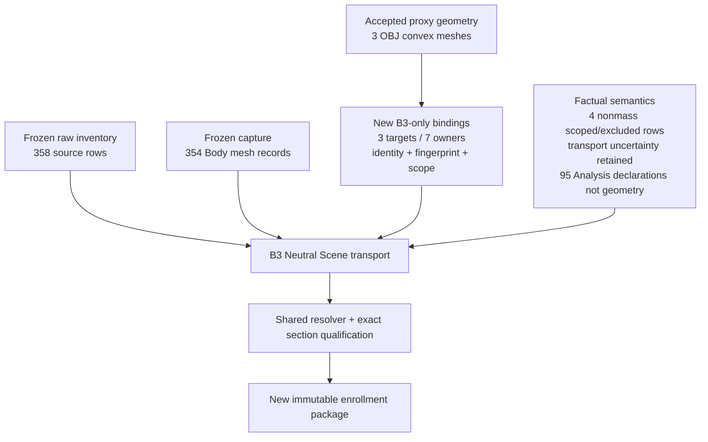

# B3 shared occupancy enrollment plan

Date: 2026-10-09. Status: **IMPLEMENTED / VERIFICATION IN PROGRESS**. B3 remains **OPEN**; B2/live integration and complete clearance remain out of scope.

This plan defines the next bounded implementation after the verified two-dimensional physical-occupancy main chain. It enrolls one new B3-only Neutral Scene transport package through the existing operation/resolver and `MassPatch` path. It does not change the default whole-height operation, trend behavior, existing live scenes, accepted historical packages, or the public room model.

## ✅ Implementation result

The previously planned route is implemented in final run `outputs/design/b3_shared_occupancy_enrollment/run_20261009T142454Z_0d7308/`.

- Focused verification: **141 passed** (`63 + 78`); this is not a full-suite or owner-acceptance claim.
- The comparison audit reports all **9,648** samples equal field-by-field and zero deltas for the recorded areas; the unchanged A loader successfully reads all four variants.
- Final source ledger: **340 selected**, **7 proxy-represented owners**, **6 scoped**, and **5 unknown**; the broader transport retains the frozen source/capture/proxy lineage described below.
- The default whole-height and trend consumers remain unchanged. The B3 route uses the explicit world-XY `z=1.6 m` query over the same physical representative.
- B3 remains **OPEN**. B2/live integration, arbitrary plane or height-band semantics, complete occupancy, and complete clearance remain unpromoted.

The implementation mapping is: `features/analysis_substitute_discovery.py:resolve_source_representation(query=...)` → `features/section_views.py` qualification → `features/neutral_scene_views.py:_resolved_physical_occupancy` accounting → `scripts/design/space_field/run_b3_shared_occupancy_enrollment.py` serialization. The existing design sections below remain the rationale and acceptance contract for that implementation.

## 🧭 Decision boundary

The shared route is deliberately narrow:

- `physical_occupancy` remains the physical operation.
- `free_space` delegates to `physical_occupancy`; it does not acquire a second substitute policy.
- The default query remains whole-height planar projection and keeps current behavior.
- B3 adds an explicit exact-world-plane section query over the same physical `MassPatch` representative, not a second consumer or a second target for the same source.
- `trend` remains an independent consumer and never becomes an occupancy fallback.
- `MassPatch` is the geometry kind. `GeneratedProxy` is provenance, not another geometry kind.
- Boundary closure uses exact selected-scope source ids. Class names, proximity, openings, or distances do not establish membership.
- The accepted convex proxies retain their approximation limit: they fill concavities and internal gaps and do not prove original material geometry.

No rule DSL, plugin framework, `Collider` type, new solid engine, adapter-specific occupancy rule, or public `room_analysis_model` field is introduced.

## 🧱 Implemented state and isolated entry point

```mermaid
flowchart LR
    accTitle: B3 shared enrollment plan
    accDescr: A new B3-only Neutral Scene package binds one MassPatch representative to several original owners, resolves it through the shared physical-occupancy operation, qualifies an exact world-plane section, and writes a new immutable serialized package.
    frozen_inputs["Frozen B3 evidence\n358 raw sources + 354 Body captures + 3 OBJ proxies"]
    b3_transport["B3-only Neutral Scene transport\nsource facts, meshes, bindings, scope, hashes"]
    registry["Registry descriptor\nphysical_occupancy_section\nIMPLEMENTED"]
    resolver["resolve_source_representation\noperation + query"]
    occupancy_view["_resolved_physical_occupancy\ncoverage / selected / unknown"]
    section_helper["Shared pure section qualification\nexact world XY + z, 1e-9 guard"]
    accounting["B3 shared accounting\nselected / legal-empty / unknown\nsource ids and masks"]
    field["New serialized package\nfield_samples + source_sections"]
    loader["Existing A loader\nload_discrete_space_field"]
    frozen_inputs -->|immutable source and proxy facts| b3_transport
    b3_transport -->|typed bindings and geometry refs| resolver
    registry -->|descriptor and qualification policy| resolver
    resolver -->|eligible original / target / unresolved| occupancy_view
    b3_transport -->|frozen meshes + query-bound evidence| section_helper
    occupancy_view -->|eligible selection and coverage| accounting
    section_helper -->|section qualification| accounting
    accounting -->|occupied / legal empty / unknown| field
    field -->|validated serialized variants| loader
```

The implementation entry point should be a new runner, preferably `scripts/design/space_field/run_b3_shared_occupancy_enrollment.py`. The runner is an evidence producer, not a production library. Production feature code must not import `scripts/design`.

## 🔗 Operation, binding, and query contract

Add one registry descriptor named `physical_occupancy_section` with this exact intent:

| Descriptor field | Required value |
| --- | --- |
| `consumer` | `physical_occupancy` |
| `input` | `physical_occupancy_substitute` |
| `geometry_query` | `exact_world_plane_section` |
| `fallback` | `original_without_required_binding` only when the binding is absent; never after a required binding fails |
| `coverage` | `declared_exact_source_set` |
| `substitute_kind` | `MassPatch` |
| query frame | explicit world XY plane, metres, explicit world height |
| B3 query | fixed datum 0 plus world `z=1.6 m` |

The new descriptor is **IMPLEMENTED** in the shared registry used by
`features/substitute_contract.py`. It does not change the default
`physical_occupancy` descriptor or trend descriptor; B3 remains an isolated
serialized branch and is not live evaluator promotion.

### One representative, two queries

The same valid physical binding represents the same source set for both:

1. default whole-height `physical_occupancy` / `free_space`; and
2. explicit `physical_occupancy_section` at the B3 world height.

Do not add two bindings for the same consumer merely because the query differs. A whole-height binding plus a section binding for one source is ambiguous under the existing rules and must be rejected. The query selects a view of the same three-dimensional `MassPatch`; it does not select a different target.

The target may have multiple mesh refs, but every ref must have matching section evidence. If the refs cannot be combined safely without inventing solid-union semantics, the target is unresolved.

## 🧬 Input and provenance lineage

The transport must preserve:

- all 358 raw source records;
- all 354 real capture Body meshes;
- the three accepted OBJ proxies;
- four semantic nonmass records in an explicit semantic scoped/excluded ledger; retain their no-mesh transport uncertainty without turning a known nonmass exclusion into domain-wide physical unknown;
- the distinction between 95 Analysis declarations and actual Analysis geometry;
- absent/unknown materials, groups, affordances, and openings as missing capability, not inferred facts;
- live revision versus scope revision, including `not_rebound` state;
- immutable frozen section records, with only the three convex proxies newly sectioned.

Binding data should be written into the new B3 package input/manifest lineage using source-owned `OM_FunctionSubstitutes` and target `OM_PhysicalOccupancy.represented_source_ids`. Do not add or edit the suggested binding JSON in this planning-only change. IDs, fingerprints, provenance, and scope must come from existing accepted evidence, not names or STEP branches.

## 🧮 Resolver and qualification algorithm

The implementation should extend the existing chain rather than duplicate it:

1. Build the complete original inventory before dropping nonprojected records.
2. Resolve exact selected-domain boundary members by identity. A boundary member is `scoped_out` for interior occupancy; it does not create interior unknown. A mixed proxy containing boundary and interior owners leaves the boundary scoped out and the interior owners unresolved unless separable evidence exists.
3. Call `resolve_source_representation(scene, source_id, operation, query=...)` after adding the minimal query parameter and preserving existing status/reason/diagnostic ordering.
4. First validate owner identity, binding consumer, target identity, geometry refs, units, world-transform provenance, coordinates, indexed records, representation eligibility, and exact declared coverage.
5. Then qualify the requested section through a shared pure helper. Do not reject a valid empty section merely because its area is zero: fully above-plane or fully below-plane geometry is a legal empty result after those validations.
6. Only for crossing geometry, retain existing diagnostics and classify crossing degeneracy, contact, open/non-manifold topology, invalid linework, nested/overlapping shells, or parity disagreement as `unknown`. Do not repair geometry or silently fill it.
7. Preserve the decision order: identity/coordinate/unit/index validation, above/below legal-empty handling, then crossing degeneracy/parity qualification.
8. Return a usable section record only when all required mesh refs and owners qualify. A valid binding alone is insufficient.
9. If a required target is missing or fails section qualification, all owners in its declared coverage become unknown. There is no original fallback after a required binding fails.
10. Select each original or accepted target once. Never union the helper target as an independent original, and never reintroduce represented originals through a later objects merge.
11. Carry unresolved support into field masks and free-space status. Missing localization is domain-wide unknown; it must never become known-free interior area.

`1e-9` contact handling remains an algorithm definition inherited by the section helper, not a new user-facing tolerance parameter. Exact-world-plane support is limited to explicit world XY plus height in metres. No sloped plane or general height-band query is added in this plan.

## 🧩 Implemented code seams and dependency order

| Order | File/symbol | Implemented seam | Callers/consumers |
| --- | --- | --- | --- |
| 1 | `features/substitute_contract.py` and existing registry | Add `physical_occupancy_section` descriptor; preserve historical filename/schema and existing trend/default descriptors | `resolve_source_representation`, registry tests |
| 2 | `features/analysis_substitute_discovery.py:resolve_source_representation` | Accept explicit query; separate representation eligibility from section qualification; keep compatibility wrapper and rejection vocabulary | `_resolved_physical_occupancy`, group trend compatibility, focused resolver tests |
| 3 | `features/section_views.py` (or the exact implementation module selected by the code worker) | Extract only the required pure section-source, indexed-edge, parity, shell, and audit helpers; no import from `scripts/design` | resolver and B3 runner |
| 4 | `features/neutral_scene_views.py:_resolved_physical_occupancy` | Pass query, retain full inventory, selected records, coverage, scope reasons, and unknown owner sets | `analysis_scene_view`, evaluator |
| 5 | `scripts/design/space_field/run_b3_shared_occupancy_enrollment.py` | Read frozen evidence, call the shared resolver/accounting and pure section helper, write new package, compare against accepted run | B3 package verification; evaluator is not modified or connected to section enrollment in this plan |
| 6 | focused tests | Add generic binding/query/coverage and frozen-package comparisons | affected test modules only |

No new public export is required unless the selected pure section helper is intentionally public. The A loader remains `features/discrete_space_field.py:load_discrete_space_field` and is not modified by this plan.

## ⚠️ Failure semantics

| Condition | Result |
| --- | --- |
| Missing source/target/geometry ref | unresolved; preserve diagnostic and owner ids |
| Wrong consumer, kind, analysis role, representation, units, or world transform | binding rejected; no original fallback when binding is required |
| Duplicate or ambiguous binding/target | unresolved for affected source set |
| Declared coverage missing, repeated, owner-mismatched, or overlapping | unresolved for complete declared coverage |
| Valid mesh entirely above or below query plane | usable legal-empty section, with diagnostics retained |
| Plane contact or crossing degeneracy | unknown only in the crossing path unless existing qualification proves a stable result |
| Open/non-manifold/invalid linework/nested or overlapping shells/parity disagreement while crossing | unknown; no geometry repair |
| Mixed boundary/interior target coverage | boundary owner `scoped_out`; interior owners unknown unless separable; boundary does not create interior unknown |
| Four semantic nonmass records without mesh | explicit semantic scoped/excluded ledger plus retained transport uncertainty; never fabricated and never domain-wide physical unknown |
| Missing unknown localization | domain-wide unknown support |
| Trend-only binding/helper | original source remains governed by physical-source occupancy rules; the trend helper is not counted as a second physical mass |

## 📦 New package and immutability

Write only to a unique directory:

`outputs/design/b3_shared_occupancy_enrollment/run_.../`

Required artifacts are exactly `field_samples.json`, `source_sections.json`, `artifact_manifest.json`, and `execution.json`; include binding/selection tables and comparison audit in the same package when needed. The suggested binding lineage location is `docs/project/evidence/b3-physical-occupancy-bindings.json`, but this planning change does not create it. Separate source/code provenance from historical evidence provenance. Do not overwrite old packages, raw sections, accepted A artifacts, or live IFC/Blender state. The A loader must read every serialized variant without code changes.

## ✅ Acceptance matrix

The owner acceptance run is `outputs/design/b3_occupancy_only_handoff/run_20261009T091601Z_242b33/`.

| Check | Required evidence |
| --- | --- |
| Frozen four-lattice comparison | 9,648 points compared field-by-field: index, XY/domain, all states/masks/source ids, `distance_to_domain_boundary_m`, and `distance_to_raw_qualified_occupied_subset_m` |
| Main 0.25 m / `[0,0]` variant | 3,888 samples; 269 occupied, 3,054 conditional empty, 565 outside, 0 unknown |
| Areas | raw `38.73686774289979`; clipped `16.359239442311818`; conditional free `190.1616840398615`; domain `206.5209234821732` with two holes |
| Sources | New 358-row source inventory equals the accepted rows one by one; 13 raw open/non-manifold and 15 below-plane degeneracy historical diagnostics remain |
| Loader | `load_discrete_space_field` reads all variants and preserves source ids, masks, statuses, hashes, and provenance |
| Coverage | Generic tests prove valid many-to-one once-only selection, missing/repeated/owner-wrong/multi-target rejection, no fallback after target failure, and mixed boundary/interior behavior |
| Query separation | One valid physical binding produces default whole-height and explicit section results from the same representative; duplicate query-specific bindings reject as ambiguous; trend remains independent |
| Limits | Complete occupancy and complete clearance remain `null`; no claim of B3 closure, live promotion, or exact original material geometry |

Floating-point differences require a documented numerical basis; do not alter thresholds to force a match.

## 🧪 Focused verification and pause conditions

Run only affected tests, compile, and diff checks in the original B3 execution session. Do not run the full suite without a new owner decision. The existing 148-test verification is not a reason to rerun unrelated tests; rerun only tests covering changed shared functions and new section semantics.

Pause and report to the owner if any of the following occurs:

- frozen source identity, scope hash, query metadata, or accepted package hash cannot be reconciled;
- a target has multiple mesh refs without complete matching section evidence;
- a section helper would need to repair topology, infer a solid union, or import a runner module;
- a required binding cannot distinguish representation eligibility from section qualification;
- exact boundary membership or mixed coverage cannot be represented without dropping an interior owner;
- the accepted comparison requires changing the existing A loader or overwriting historical artifacts;
- a result would require changing default whole-height occupancy, trend, or public model semantics.

The correct pause result is a localized `unknown` or an owner-facing blocker, never a known-free shortcut.
