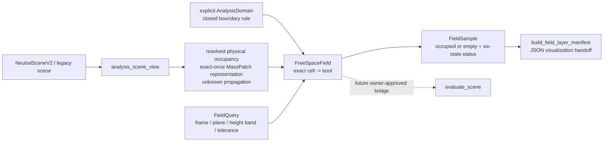

# FreeSpaceField instance design

**Status:** implemented isolated US4, owner-accepted, 2026-10-10.

This document defines the smallest concrete field that can turn the existing
physical-occupancy handoff into auditable two-dimensional free-space samples.
It does not promote the field into `evaluate_scene`, change the B3 loader, or
claim complete three-dimensional clearance.

## Decision

Create one concrete `FreeSpaceField` in `features/free_space_field.py` as a
composition over the existing `Field` contract. It is not a second base class
and it does not own substitute discovery.



The field answers one narrow question:

> For this explicit plan cell and this declared physical query, is the cell
> physically occupied?

`value=False` means that the cell is empty under the stated query. It does not
mean that a person can walk through it, that the route is connected, or that
the cell has a certified clearance. Those are separate future channels.

## Inputs and ownership

`FreeSpaceField` receives four immutable inputs:

1. An explicit analysis domain and its plan frame. A missing domain makes the
   field `not_available`; a malformed domain is `invalid`. It must not fall
   back to a scene bounding box.
2. A fixed lattice descriptor: origin, spacing in metres, row/column counts,
   and a stable target key `(cell_i, cell_j)`. The first implementation uses
   exact cell lookup; it does not add interpolation or a dense three-dimensional
   array.
3. The already resolved `physical_occupancy` records from
   `analysis_scene_view`. Each record carries its plan components, represented
   source ids, source provenance, and any unresolved owner information. The
   field never rescans `SourceObject`, reads B3 JSON directly, or calls the
   evaluator.
4. An immutable `FieldQuery`. This implementation consumes only a frozen
   whole-height plan projection. Section, height-band, and tilted-plane queries
   are unsupported until a separately qualified handoff exists.

The operation registry remains the owner of substitute semantics:

```text
free_space
  -> physical_occupancy
  -> resolve_source_representation
  -> selected MassPatch / GeneratedProxy once per represented owner
  -> plan components
  -> FreeSpaceField
```

The field only consumes the final plan components. `MassPatch` remains the
geometry carrier; `GeneratedProxy` remains provenance. Furniture, plants,
counters, walls, and other physical sources follow the same occupancy path.
Furniture eligibility never removes physical volume from this input.

Boundary doors and other members of the selected analysis-domain boundary are
treated as closed boundary support. They define the domain edge and are not
interior occupancy sources. This rule is general and applies to every boundary
opening-like member unless a later operation explicitly changes the domain.

## Cell evaluation contract

For target `(i, j)`, evaluation proceeds in a fixed order:

1. Validate the target and query. Malformed input returns `invalid`; a
   well-formed but unsupported section/height-band/tilted-plane query is
   `not_available`.
2. Confirm the domain and lattice are available. Otherwise return
   `not_available`.
3. Check whether the cell lies outside the explicit domain. If so, return
   `outside`.
4. Intersect the cell footprint with the resolved physical plan components.
   Any positive intersection returns `value=True`.
5. If an unresolved source can affect the cell, return `unknown` with that
   source id. An unresolved source must never become known empty.
6. An `original` whole-height record may establish a result. An `accepted`
   substitute makes the result `conditional` with an explicit limitation;
   this does not infer generated-proxy category, calibration, or exact
   envelope.
7. Otherwise return `value=False` with the strongest status supported by the
   evidence.

The field stores the support used for the decision: cell bounds, intersecting
component ids, represented source ids, query geometry, units, and algorithm
revision. Scalar and batch lookup must produce the same samples in the same
order; batch execution may use a spatial index later without changing results.

| Situation | Value | Status | Meaning |
| --- | --- | --- | --- |
| malformed cell/query | `None` | `invalid` | request cannot be evaluated |
| missing domain or occupancy channel | `None` | `not_available` | required capability is absent |
| cell outside explicit domain | `None` | `outside` | no interior-space claim |
| unresolved supporting source | `None` | `unknown` | occupancy is not safely decidable |
| accepted substitute whole-height query | `True`/`False` | `conditional` | result is bounded by substitute representation |
| fully qualified whole-height query | `True`/`False` | `established` | result is valid within the declared plan domain |

## Channel boundary

The first instance is a physical occupancy channel only. It does not combine
these channels:

- boundary distance;
- occupancy clearance or body-radius dilation;
- route demand or walkability;
- connectivity or graph topology;
- relation/group evidence;
- influence, probability, or decay.

Those channels can later share the same `Field` core and query/provenance
records. They must be separate fields or bundle members, so a decay rule for a
group relation cannot silently change a measured occupancy result.

## Implemented instance and tests

The implemented checkpoint is deliberately small:

```text
features/free_space_field.py       concrete exact-cell Field
test/test_free_space_field.py      six-state and occupancy contract tests
docs/software-architecture.md     architecture map and status
specs/001-field-kernel-free-space/checklist.md  checkpoint record
```

The tests must cover explicit domain membership, furniture plus non-furniture
occupancy, closed boundary members, exact-once represented-source accounting,
unknown propagation, scalar/batch equivalence, deterministic provenance, and
the distinction between empty space and walkable/clear space. They should use
small explicit polygons or pre-resolved records; they should not invoke
Blender, IFC, `scene_evaluator`, or `scripts.design`.

## Delayed work and gate

Do not implement in this checkpoint:

- live evaluator or room-model promotion;
- clearance/distance transforms, route width, connectivity, or graph metrics;
- arbitrary tilted planes or general height-band geometry;
- automatic domain inference or bbox fallback;
- dense 3D voxel storage;
- SVG/HTML rendering beyond the existing JSON manifest;
- Bayesian calibration, inferred-group selection, or decay defaults.

The repository constitution is still a placeholder. This isolated feature-layer
slice is owner-accepted, but no constitution compliance claim is made. Live
evaluator/B3 promotion remains outside this design.
