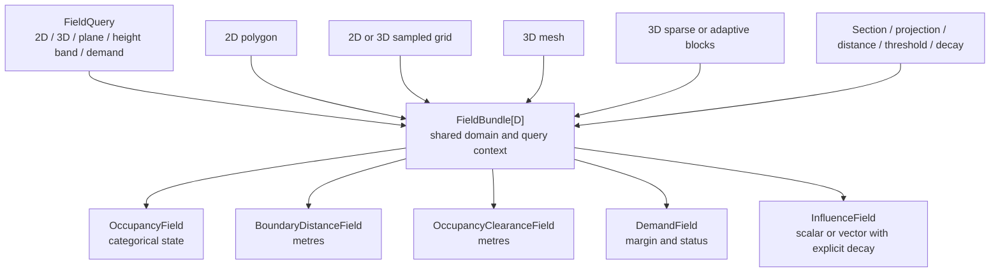
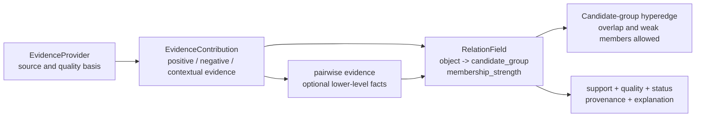

# 空间场统一基类与 2D/3D 表达：brainstorm 笔记

_记录日期：2026-10-09。本文是设计讨论笔记，不是 production contract，也不表示 B3 已关闭或 live evaluator 已 promotion。_

---

## 📌 设计目标

统一表示以下场，并让它们共享分析域、坐标系、查询上下文、来源和缺失语义：

- 占用场：`occupied / empty / unknown / outside`
- 边界距离场：到外边界和孔洞的距离，单位为米
- 占用 clearance 场：到物理占用体的距离，单位为米
- 人体/通行需求场：指定人体、路线、净高和高度带下的满足状态或余量
- 推断影响场：带明确核函数、尺度和衰减参数的标量或向量场

场的语义与表示分离。多边形、点阵、mesh 和稀疏网格是表示方式；占用、距离、净空、需求和影响是语义通道。

## 🧱 建议的最小结构

一个单独的 `SpatialField[D, T]` 表示一个语义通道；`FieldBundle[D]` 把同一域和同一查询上下文中的多个通道绑定起来。这样既能统一接口，也不会把所有场压成一个含义不明的总分。



推荐的基础接口是：

```text
SpatialField[D, T]
  domain
  frame
  query_context
  units
  range_kind          # categorical / scalar / vector
  representation      # polygon / grid / mesh / analytic
  provenance
  evaluate(point, query) -> FieldSample[T]
  evaluate_many(points, query) -> sequence[FieldSample[T]]
```

`FieldSample` 至少保留 `value`、`status`、`source_ids` 和 `support`。`status` 区分 `established`、`conditional`、`unknown`、`outside` 和 `not_available`。未知不能编码成数值零，域外不能编码成已知空闲。

## 🧩 证据场、关系场与候选组超边

空间场不只描述物理占用或距离，也可以描述可解释的关系证据。物理场仍以空间点、平面或体积为定义域；关系场以对象、候选组和查询上下文为定义域。二者共享坐标系、分析域、查询上下文、状态和 provenance，但不能把关系评分伪装成物理几何事实。

一个候选组可看作带成员入射强度的超边：`candidate_group -> {object}`。最终要表达的是每个 `object -> candidate_group` 的 `membership_strength`，而不是只保留 pairwise 边或把对象强制分进唯一组。pairwise 关系（接近、朝向一致、遮挡、共同边界等）只是生成或反驳组成员度的底层证据；它们不等于最终的组定义。

`membership_strength` 表示在当前冻结候选集、分析域和查询条件下，证据对“该对象属于该候选组”的支持程度。它不是概率，不要求所有候选组之和为一，也不要求组互斥。因此同一对象可以弱属于多个候选组，也可以没有任何已建立成员度；未分配、`unknown`、`not_available` 必须可表达，不能自动降成零。



建议最小化记录两类可审计对象：

```text
EvidenceProvider
  provider_id
  provider_kind                 # authored fact / geometry computation / manual review / model
  source_refs                   # stable source ids or artifact references
  quality_basis                 # measurement, validation, or declared limitation
  revision

EvidenceContribution
  contribution_id
  provider_id
  target                         # object, object pair, candidate group, or object->candidate_group relation
  channel                        # e.g. distance, orientation, boundary, affordance, topology
  polarity                       # support / contradict / contextual; never infer sign from a score
  support                        # channel-native strength or measurement, with units where applicable
  quality                        # applicability, precision, coverage, or reliability; distinct from support
  status                         # established / conditional / unknown / outside / not_available
  provenance_refs
  explanation                    # compact human-readable reason and algorithm/version reference
```

聚合结果也应分别保留 `support`、`quality`、`status`、`provenance` 和 `explanation`。`support` 回答哪条证据支持或反驳关系，`quality` 回答该证据在此查询下是否适用和可信，`status` 回答是否可以计算或是否仍未知；provenance 指向原始输入和算法版本，explanation 说明为何得到此成员度。它们不能折叠为一个无来源的总分。

同一 `object -> candidate_group` 关系先按通道保留正、负和上下文贡献，再使用声明过的通道聚合器生成成员度。正负证据不能因为符号相反就静默抵消；冲突、低质量、部分覆盖和缺失都要进入结果状态或解释。`unknown` 表示证据不足以判断，`not_available` 表示该通道或查询未能提供结果，二者都不能被当作反对成员关系的零分。

Bayesian 模型可以在未来作为校准层：在固定候选集上把这些贡献转化为诊断性后验或经验证的概率输出。它不是底层字段或关系存储的依赖；在未完成概率校准、先验和独立性假设验证前，成员度继续是可解释证据强度，不称为概率。

这项扩展不改变当前 2D/3D 场、`unknown`/`outside` 语义或 B3 的 OPEN 声明。B3 的 frozen serialized field 仍是独立加载路径，不能因关系场讨论而被视为已完成 live promotion 或 complete clearance。

## ⚡ 2D/3D 与性能原则

- 2D 可使用精确多边形或离散网格；3D 可使用闭合 mesh、3D 网格或稀疏体素块
- 3D 生成 2D 平面结果时必须记录 `section` 或 `projection` 操作、平面、高度和来源
- 物理占用几何和空间索引只构建一次，距离、净空和需求场共享它
- 大量查询走 `evaluate_many`，单点查询只是便利接口
- 场通道按需计算并缓存，不默认创建整个 dense 3D 网格
- 网格分辨率属于计算参数；人体宽度、路线宽度和净高属于查询需求参数
- 多分辨率结果若不稳定，状态应为 `unstable` 或 `sensitivity_required`

衰减只属于 `InfluenceField` 或独立的 `DecayOperator`。占用场不衰减，距离场保留真实距离，需求场由距离与需求参数计算：

```text
influence(x) = kernel(distance(x, source), scale, parameters)
demand_margin(x) = clearance(x) - required_clearance
```

## 📚 现有参考

OGC/ISO 的 coverage 思路可作为理论基础：场是空间域到属性值域的映射，离散网格、点集和多边形等都可以是不同的 coverage realization。[^1]

PhiFlow 适合作为结构参考：它分离 geometry、values、采样和重采样，并提供 grid、point-cloud 等不同场表示。项目只借鉴这个分层思想，不直接继承或引入其运行时依赖；其数值外推默认不能替代本项目的 `unknown`、`outside` 和 provenance 语义。[^2]

VTK 适合作为属性组织参考：它把几何/拓扑与 point data、cell data 以及标量/向量属性分开，并显式区分插值策略。项目暂不引入 VTK；它的运行时规模超过当前需要。[^3]

## 🔍 对当前代码的关系

当前 [`features/discrete_space_field.py`](../../features/discrete_space_field.py) 仍是严格的 B3 序列化加载器，不是统一的场对象；US1/US2/US3 已在 `features/field_core.py`、`features/space_field_adapter.py` 和 `features/space_field_visualization.py` 提供 Field core、只读 B3 adapter、JSON-friendly manifest 与 design-only replay。`FreeSpaceFieldBundle`、完整 clearance、SVG/HTML renderer 和 live promotion 仍是后续工作。具体二维占用实例的边界见 [`free-space-field-instance-design.md`](free-space-field-instance-design.md)。本文不修改 `formal_field=not_available`，不宣称 B3 已完成 live promotion。

[^1]: Open Geospatial Consortium. (2017). “OGC Abstract Specification Topic 6: Schema for coverage geometry and functions.” https://docs.ogc.org/as/07-011r2/07-011r2.pdf
[^2]: TUM Physics Simulation Group. “PhiFlow Fields.” https://tum-pbs.github.io/PhiFlow/Fields.html ; repository: https://github.com/tum-pbs/PhiFlow
[^3]: Kitware. “VTK vtkDataSet and vtkDataSetAttributes.” https://vtk.org/doc/nightly/html/classvtkDataSet.html ; https://vtk.org/doc/nightly/html/classvtkDataSetAttributes.html

## 🔬 已有实践评估（研究记录，不是生产决策）

本节记录对成熟方法的检索结果。它用于约束后续方案讨论，不表示这些方法已经进入当前运行时。

### 1. Probabilistic Soft Logic / HL-MRF

PSL 用带权一阶规则表达证据关系，并把谓词值表示为连续的 [0, 1] 真值；HL-MRF 将规则违反程度写成 hinge-loss 目标，再进行稀疏 MAP 推断。它适合表达：

- 多个证据通道共同支持 object -> candidate_group
- 同一个对象以不同强度属于多个候选组
- 只对受影响的对象、候选组和关系子图重新计算

当前只借鉴“带权规则、连续成员度、稀疏局部推断”的思想，不引入 Java PSL 运行时，也不把连续真值自动称为物理概率。项目自己的 EvidenceContribution 仍需保留 support、quality、status、source_ids、provenance 和 explanation。

- Bach et al., “Hinge-Loss Markov Random Fields and Probabilistic Soft Logic,” JMLR 18 (2017): https://jmlr.org/beta/papers/v18/15-631.html
- PSL project: https://github.com/linqs/psl

### 2. Dempster-Shafer / belief functions

Dempster-Shafer 允许把证据质量分给命题、命题集合或整个 frame，因此可以表达支持、冲突和未知（无知）。可靠性 discounting 也可用于降低低质量来源的影响。

它适合作为 unknown/conflict 适配器，帮助证据层保留“没有证据”和“证据反对”的区别。它不适合作为当前主框架：对许多候选组进行幂集质量分配会快速膨胀，组合规则还依赖对证据独立性和高冲突情况的明确处理；连续成员度和重叠组也不如规则型支持场直接。

- Glenn Shafer, “A Mathematical Theory of Evidence,” Princeton University Press, 1976: https://press.princeton.edu/books/hardcover/9780691100425/a-mathematical-theory-of-evidence
- Philippe Smets, “The Transferable Belief Model for Quantified Belief Representation,” 1994: https://doi.org/10.1016/0378-4754(94)90050-7

### 3. Choquet / fuzzy integral

Choquet 或 fuzzy integral 可以表示证据通道之间的冗余和互补，解决简单加权和无法表达“两个证据一起出现才更有力”的问题。一般 fuzzy measure 需要约 2^n 个参数，因此当前只适合在通道数很少时使用 2-additive 或其他受限 measure；它不负责候选组发现。

- Grabisch, “The application of fuzzy integrals in multicriteria decision making,” European Journal of Operational Research 89 (1996): https://doi.org/10.1016/0377-2217(95)00176-X
- Marichal, “Aggregation operators for multicriteria decision aid,” 2000: https://doi.org/10.1016/S0377-2217(99)00115-3

### 4. BIGCLAM 与重叠社区发现

BIGCLAM 为每个“对象—社区”关系学习非负 affiliation strength，天然允许重叠、嵌套和不同成员强度，并针对大图设计了可扩展优化。它可作为候选组发现的对照方法，但成员强度是图模型的潜变量，缺少本项目要求的逐证据解释、unknown 和来源记录，因此不作为解释主链。

- Yang and Leskovec, “Overlapping Community Detection at Scale: A Nonnegative Matrix Factorization Approach,” WSDM 2013: https://www-cs.stanford.edu/~jure/pubs/bigclam-wsdm13.pdf

### 当前推荐顺序

```text
EvidenceProvider
  -> EvidenceContribution（正/负支持、quality、status、来源、解释）
  -> 可解释的加权 support / 稀疏 hinge 规则
  -> MembershipField(object, candidate_group) ∈ [0, 1]
  -> CandidateGroup（带成员强度的重叠超边）
  -> group coherence / coverage / conflict / unknown 摘要
  -> 可选：Dempster-Shafer conflict/ignorance adapter
  -> 可选：少量通道的 Choquet/fuzzy integral
  -> 可选：Bayesian 概率校准层
```

Bayesian 继续保留为后续校准层：只有在先验、独立性、校准数据和概率解释都明确后，才把成员度转换为诊断性后验；它不应成为底层字段或关系存储的必要依赖。

### 计算与停止条件

候选关系应先用空间邻域、语义候选集或现有图结构稀疏化。新增或修改一个证据通道时，只重算受影响的对象—组连通分量，并保留通道级贡献以支持增量更新和解释。若后续方法不能同时改善“可解释、支持重叠成员、区分 unknown/conflict、局部可重算”中的至少一项，则停止继续引入新框架。

## 🔥 Grill-me 设计裁决

本轮审查同意这套**架构方向**，但不把它宣布为最终算法，也不声称 PSL/HL-MRF 已被证明是本项目的最佳生产模型。

现有学术证据足以支持以下架构决定：

- 物理空间场、对象关系场和成员度场使用不同定义域，但共享查询上下文、状态和 provenance。
- 证据先进入 `EvidenceContribution` ledger，再聚合为 `membership_strength`。
- 候选组允许重叠、弱成员、未分配和未知状态。
- PSL-like 的带权规则、连续真值和稀疏局部推断是首个值得在项目内验证的聚合候选；连续值不能自动解释为概率。
- Dempster-Shafer 保留为 unknown/conflict 适配器，Choquet/fuzzy integral 保留为少量通道的冗余/互补聚合器，BIGCLAM 保留为重叠候选组发现的对照。

生产实现前必须解决以下问题：

1. 成员度计算必须与候选组生成分离；没有候选组集合，成员度没有明确目标。
2. `support` 与 `quality` 必须分开，低质量、未知和反对证据不能混成一个乘数或零值。
3. 相关证据不能默认简单相加，必须保留通道来源并声明冗余处理方式。
4. `mutual_exclusion` 等硬冲突不能被软支持抵消。
5. 关系场不必天然随距离衰减；衰减函数只能由具体证据通道声明。
6. 当前文献是方法先例，不是家具 IFC 分组的直接验证；权重、候选生成和恢复能力必须由本项目的 synthetic holdout 检验。

因此，当前证据状态分为三层：

| 决策 | 状态 |
|---|---|
| 选择统一证据场/关系场架构 | 足够支持 |
| 把 PSL-like 聚合作为首个候选 | 足够支持进入项目内对比 |
| 宣称它是最佳算法或直接进入生产 | 证据不足 |
| 证明家具布局中的心理或设计有效性 | 当前未覆盖 |

下一步应使用同一组 `EvidenceContribution` 输入，对比简单加权支持与 PSL-like 稀疏规则，检查成员恢复、重叠保留、unknown/conflict 传播、解释完整性和计算时间。Bayesian 继续保留为后续校准层，不作为当前底层依赖。

## 2026-10-10 owner planning alignment

The earlier `SpatialField[D, T]` wording is retained as a generic design sketch.
For the project architecture, the single global concept is now named `Field`.
Concrete spatial and relational uses share the core contract and compose
capabilities; they are not separate functional base classes. The exact Python
protocol/dataclass shape remains an implementation-plan decision.

Status gates are also explicit: malformed required input is `invalid`, a
missing domain or channel is `not_available`, a valid target outside an
available domain is `outside`, insufficient evidence is `unknown`, limited
scope is `conditional`, and complete validated scope is `established`. These
are audit states, not a hidden score and not probabilities.
