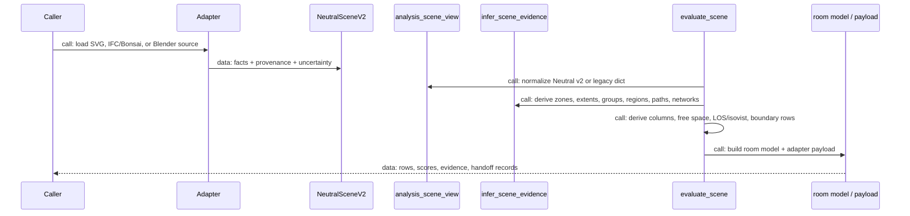
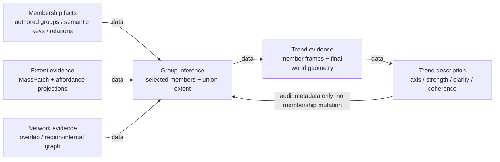
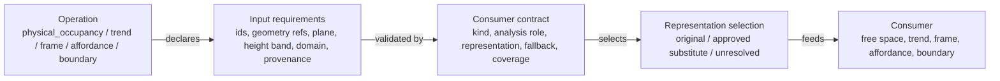
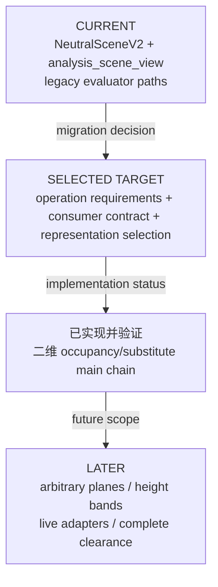
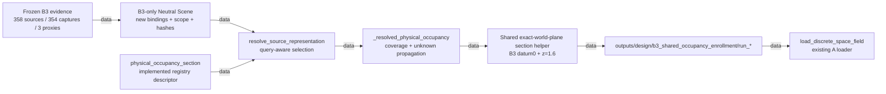
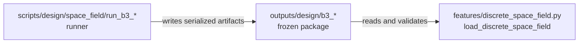
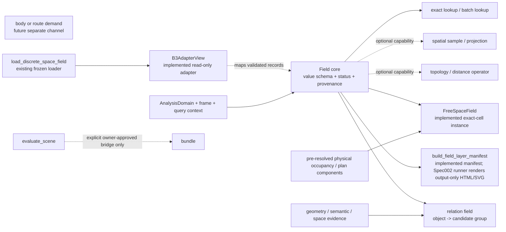

# 软件架构

## Evidence-package saved readback rollout — 2026-11-10 / locally verified candidate

The isolated `evidence-package-structure-e86` candidate is extending the existing
v1 envelope/output boundary with fixed-schema JSON readers and a serialized
`payload_fingerprint`. Existing dataclass validation remains authoritative;
saved `output_identity` is required, and a content fingerprint is checked when
present. Legacy publications without dependencies or fingerprints remain
readable. Computation identity, complete payload integrity, pinned file bytes,
and freshness against a freshly built current contract are separate checks.

The concrete consumer is an output-only, faithful channel readback package in
`scripts/design/group_level/replay_evidence_package_readback.py`. It selects
explicit published channel references, pins artifact SHA-256, compares retained
contracts with freshly built contracts, and supplies a complete dependency
graph before execution. It adds no formula or distance-conditioned potential.
Before numeric readback, independent `current_source_envelopes` must match a
signature of `target`, `query`, `channel_set`, `cache_identity`, `raw_status`,
`value`, `support` and `source_ids`; package ID alone is insufficient. Missing
context yields unavailable; input/query/plane mismatch is rejected. Outer
`source_freshness`/visualization provenance is audit-only and excluded from
this input signature. The P1 repair is implemented and passed scoped independent
review; the retained replay report records zero errors.
The camera-plane free-space/distance chain and world-plane
potential/trend/geometry snapshots remain separate. Per-channel algorithm and
input tracing reuse provenance, package function/version, `derived_from`,
source cache identities and explicit dependencies; no parallel class tree is
needed. The focused rollout tests and retained saved-artifact replay passed;
the existing core checkpoint `51b8c6e7` is a subset, with no mainline merge or push. See the
[integration plan](superpowers/plans/2026-11-09-evidence-package-integration-cleanup.md)
and [evidence record](project/evidence/evidence-package-integration-cleanup-2026-11-09.md).

Potential saved roundtrip preserves all 4,112 outputs and 37 sources. Exact
reexecution uses the pinned original producer `envelopes.json` order: runtime
source sorting otherwise permutes its historical `per_group` audit list. This
does not change a formula or version. The final retained report preserves the
initial ordering failure and the corrected original-producer-order replay.

## Free-space evidence package — 2026-11-07 / implementation and verification in progress

The authorized package reuses the existing `FreeSpaceField` computation through
`features/analysis_requests.py:execute_analysis_request`. Its shared-contract
boundary is `features/free_space_evidence_package.py`: the
`build_free_space_evidence_package` factory returns the existing `EvidencePackage`,
and `build_free_space_package_contract` declares the existing whole-package
dependency/freshness contract. `EvidencePackage.evaluate(source_envelopes)`
returns the same `EvidencePackageOutput` used by potential and distance packages;
the legacy call remains valid, with optional dependencies available to packages
that explicitly consume another package's published channel.
There is one descriptive derived channel, `free_space`, for every lattice cell.
This does not add a score, clearance channel or room-model field.

One field-scope `FieldResultEnvelope` retains the complete compact
`free_space_run` document once. Cell outputs carry lineage and
`observation.cell_locator` with `row`, `column`, `cell_index` and `result_ref`.
The retained document preserves the original occupied Boolean (`True` means
occupied), all six `FieldStatus` values and all seven `FieldSample` fields;
per-cell projection does not duplicate complete calculation provenance. Raw
sample status and package computation status remain separate.

`adapters/free_space_evidence_package.py:evaluate_free_space_package(scene,
request, cache_directory=None)` owns reusable computation/cache orchestration.
A miss calls the existing executor and compact serializer. A valid hit reuses
the authenticated compact document and package contract, skips geometry/field
generators, and rebuilds the cheap package output projection. Cache identities
bind source, query, plane, domain/scope, sampling and implementation/schema
dependencies. A cache hit preserves its calculation origin; it is not a new
live native observation. The companion
`evaluate_saved_free_space_package(snapshot)` accepts an exact opened result.
The feature module owns evidence semantics; the adapter reuses existing wire
validation and persistence without moving Blender session concerns into features.

`scripts/design/space_field/run_free_space_evidence_package.py` publishes saved
evidence, shared output/contract/status and visualization bindings. Saved
publication compares the retained contract with no independently observed current
contract, so current freshness is `unavailable` and `read_state` is `historical`.
Self-comparison is not evidence of live currentness. The native preview consumes
the same package and manifest and writes PNG/Blend artifacts; it supplies no
replacement numerical truth. Planned delivery is
`outputs/design/free_space_evidence_package/run_20261107/`. Implementation,
tests, timings, native verification, reviews and commit acceptance are tracked in
the [package evidence ledger](project/evidence/free-space-evidence-package-2026-11-07.md);
none is certified by this architecture entry. This work is isolated in
`order_analyzer_free_space_evidence` from base `58fdf846`; prior proxy route-repair
working files are outside the authorized change.

## Directional group-route repair — 2026-11-06 / active experiment

`features/group_distance_repair.py:global_repair_result` is the constrained
continuation over the accepted group-distance baseline. It batches one source
group against all later targets, searches `(cell, incoming_heading)` states on
the observed lattice, and performs exact edge/turn replay only for selected
routes. Screen-approved state transitions are cached lazily in the shared
clearance context and reused across source searches; per-search exact failures
remain separate blacklists. Checkpoints are source-scoped and fingerprinted by
input, baseline, policy, group order, and `GLOBAL_METHOD_VERSION`.

Terminal statuses distinguish an exact route (`exact_route_verified`), missing
access (`proxy_unreachable`), observed topological infeasibility
(`infeasible_observed`), and a still-possible but unresolved route
(`unresolved_unknown`). An unresolved status is never promoted to a pass.
The retained `run_global_full_current_20261106_merged/repair_result.json` now
contains all 666 unordered pairs of 37 groups, each with an
`exact_route_verified` selected route under `global-directional-lazy-exact/3`.
This establishes feasibility of the saved routes under the recorded directional
policy; the experiment does not establish global shortestness. The original
baseline readings remain historical inputs rather than the repaired outputs.

`features/group_distance_evidence_package.py` publishes those saved observations
through the existing `EvidencePackage` / `EvidencePackageOutput` contract. Its
only derived channels are `euclidean_distance` and `path_distance`, in metres.
Path distance decomposes into source centroid offset, the selected free-space
polyline, and target centroid offset; endpoint offsets are metric-only. Free
space remains an authenticated input dependency and exact ResultRef, without a
third channel or a duplicate sample field. Source envelopes retain the selected
witness, raw readings, dependencies, plane/query context and retained-result
reference. Saved/bundle dependency or pair-scope mismatches are rejected.

`scripts/design/group_level/run_group_distance_evidence_package.py` publishes a
saved repair without repeating graph construction or search. It writes the
two-channel output, common package contract/status, input and visual file
hashes, and a manifest mapping pair identities to native Blender collections,
objects and timeline frames. Retained-publication freshness does not assert
live-scene currentness. Per-pair Blender views distinguish Euclidean straight
lines, selected clearance routes and metric endpoint offsets. This delivery
lives in sibling jj workspace `clearance-proxy`
(`order_analyzer_free_space_distance_bridge_proxy`); main-tree integration is
separate. Acceptance commands, actual candidate hashes, artifact locations and
known limits are recorded in the existing distance evidence ledger.

## Analysis board workline — 2026-11-04 / core independently accepted

The free-space baseline is now backed up at `codex/free-space-cache@origin`
(`d08cd0eb`). The approved next increment is the [persistent board design](superpowers/specs/2026-11-04-analysis-board-design.md),
[implementation checklist](superpowers/plans/2026-11-04-analysis-board.md) and
[delivery ledger](project/evidence/analysis-board-2026-11-04.md). Task 1 implements
`blender_addon/order_analyzer_ui/board.py`: a strict saved descriptor on a stable
Empty, explicit external ResultRefs with independently retained identity/backend
expectations, historical restoration and unavailable/hidden failure behavior.
The shared hidden result mesh is built in scene units; a child applies a
slab-relative Z offset and per-object categorical materials. Exact source reuse
also requires the stored native scale. `palettes.py` provides sampled cividis,
viridis and magma plus finite numeric display mapping; its source license is
retained in `PALETTE_LICENSE.txt`. Shader colors convert sRGB at the native handoff;
the addon imports no Matplotlib. Overlay retains its API with finite lift and SI
unit conversion corrected. Task 2 connects runtime publication to
`board.attach_result`, historical load and explicit saved-result selection to
`restore_boards`/`select_result`, and the existing Analysis Results panel to
display-only style controls. Board/source, mesh, material and node ownership roles
are excluded from physical capture; the depsgraph guard recognizes those roles
while ordinary source-material edits remain factual updates. Runtime observes
actual scene scale changes before the neutral Scene-update path, invalidates
Domain currentness and restores board presentation historically at the new scale.
Datum-free legacy results retain a hidden result-only display with an explicit
unavailable-board message. `build_display_fragments` projects meshes through
`geometry_views._project_to_plane` in the selected plane-local frame, clips there
and transforms fragments back to world SI, preserving polygon holes and area.
Focused integration acceptance passes 410 affected tests after independent review
fixes. The restored-board depsgraph path recognizes owned presentation resources
without runtime handles, addon re-registration handles missed scale changes, and
the Boolean free-space panel no longer presents inert numeric range controls;
saved-result selection is limited to explicit board entries. Portable Blender 5.2
native acceptance has also passed for actual S3 attachment, hidden-source/shared
mesh placement, palette/opacity changes, save/reopen restoration and historical
status. Keep calculation plane, source/cache truth and historical display state
separate; ordinary source materials remain factual updates.

## Free-space prerequisite workline — 2026-11-04 / independently verified

This map's current checkout is the isolated `free-space-cache` jj workspace at
`D:/PROJECTS/understandOtherPackage/order_analyzer_free_space_cache`. It contains
the recovered camera/capture/request/session/addon dependency closure, unlike the
main-tree absence statements retained below as historical context. Actual files
and this workline's tests, rather than those historical status labels, establish
availability. The independent Task 0 baseline is 507 passed (33.84 s), with one
installed-dependency warning; it is not new-feature acceptance.

Use [verified-agent-workflow](../skills/verified-agent-workflow/SKILL.md) and the
[current checklist](superpowers/plans/2026-11-04-free-space-prerequisite-checklist.md).
Reuse `bonsai_analysis_plane` for native drawing identity, `bonsai_space_authoring`
for slab datum, `analysis_requests`/`geometry_views` for finite-band projection,
and the existing result wire/session for persistence and current reads. Slab datum
wiring and inclusive participation audit are independently accepted (Task 3:
`3faec84f`). Task 4 adds content lookup in the session after canonical capture,
binding, datum, domain and support validation but before legacy proxy activation
or projection. It reuses the complete result wire and serializer for a fresh
current-job publication; the distance kernel is outside this workline.

Task 4's implementation boundary is `blender_analysis_session`: pure validated
scene preparation precedes a content-addressed disk lookup, and misses retain
the existing activation/request/display generation. The fixed CLI supplies a
persistent workline cache under `outputs/blender_analysis/content_cache/v1`.
Content excludes job/request IDs, declared display metadata and plane audit
revision while including physical facts, exact domain/selection, query/datum,
rules and implementation versions. `analysis_requests` retains its strict
revision-sensitive semantic identity through a shared pure identity recipe.
Hits reconstruct current request/query/support/binding metadata through the
existing sample serializer, preserving calculation provenance and its origin
ResultRef. Current reads still require independent native observation of the
new publication. Task 4 is independently accepted at `ea4fe375`: 416 checks
passed, with additional fresh-process generation-boundary and failure probes.
Actual native S3 first/repeat publications now independently pass. The repeat
reuses the exact first content key and calculation origin, and all 24,442 cell
values/statuses match. A separate fresh-process replay forbids all six generation
boundaries and produces the same repeat result bytes without changing its cache
file. This replay proves reuse, not native currentness. The actual 0.2 m variant
misses a distinct key, and restored ordinary Start at 0.1 m hits the original
key and first calculation origin. Independent four-run reconciliation preserves
every stored first/repeat/restored cell value/status. The scene sampling property
was never changed; the variant uses the supported runtime request API, without
accepting the separate broad UI sampling callback.

Task 5's 24,442-cell native run exposed a separate codec scaling defect:
serialization and validation repeatedly traverse large shared provenance for
each cell. An independent bounded 1,024-point probe counts `4*N+7` shared
payload visits in serialization and `N+2` per validator. The isolated
`free-space-wire-scale` workspace (base `ea4fe375`, change `kopsuxvo`, frozen
revision `662f8814`) supplied the independently accepted session/wire correction,
now integrated into this checkout at `a19bfc85`. Exact core Field-owned metadata is detached
once; generic mutable samples retain per-evaluation detachment. Cache rebinding
owns its document once and reuses core metadata overlays. Strict validation
uses one normalized document and private shallow sample views while retaining
every cell/ref/delta/identity/fragment check, defensive public decoding and the
original successful validator return identity. Wire versions and exports stay
unchanged. Independent affected regression passed 866 tests with one existing
skip; separate scale, seven-field/six-state parity, alias and malformed-input
probes passed, with specification and quality verdicts PASS. Refreshed native
23-resource evidence passed in `native-codec-scale-preflight.json` and
`task5-independent-codec-scale-preflight.json`. Actual field and identical-input
cache acceptance now pass at the retained native publication instants. The original
native job was cancelled normally after about 41 minutes without a result;
its request and logs remain historical evidence. No worker stack was sampled,
so this finding does not identify its active instruction or sole bottleneck.
Independent correction review reproduced and then verified rejection of
pair-list provenance coercion and Mapping-subclass provenance/query lookup
hooks. Their regression coverage is part of the accepted normalized-validation
correction. Evidence: `task5-wire-scale-scope-probe.json` and the independent
wire-scale final review under `outputs/design/free_space_prerequisite/verification`.

The actual 0.1 m S3 field has 14,047 established known-empty samples, 7,023
established occupied samples and 3,372 outside/null samples. Unknown sources and
geometry failures are empty. The necessary actual source/domain/result plan
alignment view independently passes and was delivered inline. Thin source
outlines include above-band context; they do not define occupancy. Known empty
does not establish walkability or clearance. The exact-result reading guide's
current and historical blocks pass on the actual repeat publication, including
all seven sample fields and seven identity/currentness refusals. Conditional,
unknown, invalid and not-available samples are unobserved in this actual run
and remain covered by synthetic tests. See the current acceptance summary in
[the evidence ledger](project/evidence/free-space-prerequisite-2026-11-04.md).
Actual four-run and final whole-scope specification/quality verdicts are PASS,
with no product gaps. Local acceptance is `9ff90182` (change `qurnkros`, parent
`a19bfc85`); Tasks 0–6 are complete in this isolated workline. Current acceptance
bookkeeping is change `qpslwnyq`. The main and distance workspaces are not
integrated by this delivery; no push, merge or distance execution is implied.

Task 1's native lifecycle and matrix correction are independently accepted
(`a951c761`). Native creation/reuse/update, non-unit scenes, recovery and save
have been observed. Save/reopen retained the managed IFC marker, GUID and SI
height; ordinary native import omitted the camera object and initially ensure
rejected that missing link. The bounded managed-restore correction now restores
the camera through the official importer inside one owned recovery event,
retaining the same annotation/GUID and creating no duplicate drawing. Independent
restore acceptance passed at `ca47cb83` (306 passed, one existing skip), including
audited native same-GUID restoration and partial-import rollback. Restoration is
separate from cache behavior.
`adapters/bonsai_analysis_plane.py:ensure_native_analysis_plane(*, elevation_m,
project_global_id=None, camera_guid=None, storey_ref=None,
query_kind="whole_height_projection")` finds exactly one native
`IfcAnnotation(ObjectType="DRAWING")` through `OM_AnalysisPlane` ownership
(`Owner="order_analyzer"`, `Role="analysis_plane"`, `Version="1"`, matching
`ProjectGlobalId`), or creates it. Explicit existing GUID/project identity must
match that owned drawing. The public elevation is world metres; native creation
places the exact camera before class assignment, and updates retain GUID/object
identity through `Drawing.sync_object_placement`. Non-unit Blender scenes use a
camera-scoped SI handoff to the installed metre-based Surveyor before its native
georeference conversion. Ownership writes and updates use owned native
transactions and the existing snapshot/recovery boundary, now retaining camera
pose and Bonsai placement checksums. Duplicate ownership/native links, wrong
project, invalid/tilted pose and unsupported exact-section orientation reject.
`create_native_drawing` retains its ordinary defaults, adding optional
`elevation_m=None`, `managed=False`, and
`query_kind="whole_height_projection"`. The addon's explicit New action calls
ensure with its existing elevation property (initial default 1.6 m); adoption
and refresh keep their observed pose and GUID-based revision behavior. Static
IFC DRAWING annotations gain the existing `drawing_camera` role so both physical
inventory paths exclude them, while ordinary annotations and name lookalikes
retain their existing roles. Live native-camera and owned-helper exclusions stay
in use. Unit tests cover real IFC transaction/property-set/serialization behavior
behind synthetic Blender seams. Loaded-byte/resource preflight has passed; the
combined current S3 datum/domain/field view and actual field/cache acceptance
remain Task 5 checks. Managed
native reopening and restoration have already passed the recorded lifecycle gate.

The existing exact result/sample interfaces and current-versus-historical
observation requirements are documented in
[Reading an exact free-space result](free_space_result_reading.md).

## Free-space query clarified by the user — 2026-11-03 / existing capabilities audited

Task 2 is independently accepted and committed (`e02d899b`). It wires `ground_to_analysis_plane_band` to
the selected slab's verified horizontal upper surface, using plane-local bounds
`(datum_z_m - plane.origin[2], 0)`. `AnalysisRequest.height_band_datum` retains the
full immutable receipt in request identity and result serialization. The live
session checks that receipt against the frozen captured project, exact slab and
storey identities, containment, five-field SI mesh digest and recomputed top
before any occupancy execution. Generic direct finite bands remain datum-free;
whole-height and absolute-world-Z section queries remain independent. Numerical
regressions establish this wiring; actual native datum/plane alignment remains
Task 5 evidence.

Current task semantics are floor-upper-surface → analysis-plane-height physical
mass projection, restricted to the projected confirmed domain. Object scope
includes boundary contact; known occupied cells still require positive-area
intersection. The exact plane section is a separate retained query interface.
The recovered UI already offers `ground_to_analysis_plane_band`
(`blender_addon/order_analyzer_ui/__init__.py:_make_analysis_request`), and
`features/analysis_requests.py:_occupancy` uses the existing
`geometry_views.plan_projection(..., height_band=...)` before constructing
`FreeSpaceField`. At that audit the UI assumed world ground Z=0; Task 2 now uses
`adapters/bonsai_space_authoring.py:resolve_slab_datum` as its selected floor
lower bound. Task 3 now passes the existing qualified plane-local domain polygon
to `_occupancy`, which intersects each selected physical footprint with the exact
shell and holes. Immutable `projected_domain_participation` provenance classifies
`inside`, `crossing`, `boundary_contact` and `disjoint`, with exact intersection
area, selected geometry refs and original-owner/substitute coverage. Each selected
proxy is audited once for its full represented owner set. Contact participates in
the source audit with zero occupied area; disjoint and contact-only geometry are
omitted from the field inputs. Factual `selected_records` and physical source
inventory remain intact, including accepted-substitute conditionality. Exact
boundary/support exclusions, nonphysical sources, legal-empty height/section
queries and unresolved geometry carry explicit reasons with an unevaluated domain
relation when no qualified footprint exists. Failed geometry remains unknown and
the existing trusted-support checks remain in force. No buffer or tolerance-based
area inflation is applied; FreeSpaceField retains its positive-area cell rule.
The executor's existing backend file hashes now include `analysis_requests.py`,
so these semantics change the content identity without changing the result wire.
The historical distance-run S3 input explicitly declares `whole_height_planar_mass_patch`,
`height_band=null`; that run is not evidence for the clarified query. The earlier
support-binding diagnosis below is an audit of another supported scope mechanism,
not the prescribed solution. Eleven existing UI/request/projection/slab/domain/
section checks passed in Pixi in 5.55s at the original audit. Task 3 independent
analytic acceptance passed; fresh S3 visual validation remains open; see the
existing distance checklist.

## 当前任务：选区纠正 — PRIOR S4 SUPERSEDED / INTENDED S3 CONFIRMED / CORRECTED UNREACHABLE RUN RETAINED

**2026-11-03 current intent correction:** 用户红线选择右侧家具大厅和左侧连接通道。原窄 S4 及 `group_distance_ifc/run_v1/` 的 666 outside 仅是历史错误选区结果；其确认执行记录保留，但选区身份不再代表当前意图。worker/reviewer 已由实际源识别候选 S3（207.24092382549588 m²，37/37 组相交），`.18.C1` 完成；原请求因 A22 斜墙 residual 3.4968646007715876 mm² refused；owner 已选择既有 per-request `aperture_residual_tolerance_m2=1e-5`（10 mm²）策略，prepare 后的 fresh confirmation 已 accepted/active，面积及零孔 shell 不变。A22 保留 `above_area_budget=true`、`significant_residual=false`、`scenario_closed=false`，独立 opening budget `1e-6 m²`（1 mm²）不变。依据[既有 residual policy](project/evidence/d6-inner-space-residual-tolerance.md)，无 global/default/schema 改动、几何修复或 closure override；新请求的 manifest/result binding 已于 `domain_correction_inspection/confirmed_domain_manifest.json` / `confirmed_domain_result.json` 冻结，session revision 1 的 `user-red-outline-s3-20261103` action 记录用户明确选区，旧 refusal 保留；`.18.C2–.18.C3` 完成；实际 `run_v2_corrected_domain/` 为 37 centroids inside、666 Euclidean computed / 666 hybrid unreachable/null / 0 routes。343 occupancy 保留 slab，21,064 established occupied + 3,378 outside，graph nodes/edges/searches 0。`run_v2_corrected_domain/preview/index.html` 已交付，`.18.C4/.18.10` user review 和 `.18.8` 有用真实路径验证仍 open。S3 inferred floor support 尚不具备 occupancy exclusion 资格，不得排除 slab 或更改高度策略；本轮 whole-height occupancy 实际阻断所有路线。实施延续见 distance plan `.18.C1–.18.C4`，`.18` 仍 open。

**2026-11-03 historical free-space investigation (before Tasks 1–4):** Existing whole-height inspection explicitly carried the historical `excluded_support_slab` scope into `run_free_space_field_inspection.py`; it did not obtain free cells by choosing a height band. The general seam was `bonsai_live.validate_support_binding` → `blender_analysis_session.execute_live_analysis` → the exact domain-support/member exclusion in `analysis_requests` and `neutral_scene_views`. A validated specific support changed request-local interior occupancy while retaining factual sources and geometry; an absent or stale binding excluded nothing. `evaluate_domain_request` exposed support candidates/binding only for authored IfcSpace, returning `support_status=not_applicable` for inferred wall domains such as S3. Historical B3 identified the same slab GUID, but its IFC hash and domain differed and could not supply a current binding. Full result serialization, atomic writing and exact ResultRef/sample reading existed; content-key cache selection and downstream reuse were not yet connected. Request semantic identity included plane revision. The isolated `free-space-cache` workspace then used parent `9c0b024b`, before the six-file path-band draft. Six existing support/identity/result-reader checks passed under Pixi (3.58s); this was not a new S3 run or user acceptance. Current accepted cache behavior is described above under Task 4; the [distance implementation checklist](superpowers/plans/2026-11-03-group-distance-module-implementation.md) remains a separate workline.

2026-11-02 用户确认所有分析范围来自选定墙体围合区域在选定相机分析平面上的投影。任务工作区 `order_analyzer_group_distance` 已恢复并核验 sibling `order_analyzer_spec008` 的有界实现闭包；原主工作区尚未集成。Spec008 有 2026-10-19/20 disposable 验收，但实际实现文件未包含在其当前 jj revision，恢复已按实际磁盘 bytes/hash 记录，不能按 revision 宣称已恢复。

复用链：native drawing camera → `AnalysisPlane`；选墙 → 原 B4 / `domain_handoff` 显式确认 → shell/holes 的 WORLD SI support mesh → `AnalysisRequest` 在选定 camera plane 投影。指定 IFC 的 S4 墙域确认已在隔离任务工作区的 S4 产物中完成，manifest/result 绑定和源字节已复核；该确认尚未宣称已安装回主树。不要将 support vertices 预变换成 camera-local 后再投影。B4 structural frame 与 camera frame 分别保留来源身份；倾斜按既有能力拒绝。无确认域时，不能用楼板、家具 bbox、旧网格或画布顶替。计划与执行证据见[前置计划](superpowers/plans/2026-11-02-wall-domain-camera-prerequisite.md)。距离 kernel、IFC runner 与 output-only renderer 已在隔离工作区实现；`.17` readiness 已冻结，原 S4 的历史完整结果是 666 Euclidean computed / 666 hybrid outside / 0 routes，`.18` 保留有用真实路径与用户视觉验收。下列 PENDING 描述继续指原主树部署状态。

## Spec008 Analyzer workflow completion — DESIGN / IMPLEMENTATION PENDING

[Spec008](../specs/008-analyzer-workflow-completion/spec.md) / [plan](../specs/008-analyzer-workflow-completion/plan.md) record the 2026-10-19 workflow completion design. This is planned behavior, not current-tree implementation or native acceptance. The inspected workflow baseline is sibling `order_analyzer_spec004_delivery` (`spec004-delivery@4b332704`, actual file bytes also require verification); the main workspace still lacks its addon/request/live-session dependencies. `workflow007@1a271593` has an unresolved `features/analysis_requests.py` conflict and is not the integration baseline. Implementation must first recover the bounded dependency closure into an isolated jj workspace and reconcile intended changes without overwriting unrelated dirty work.

Planned ownership: the addon owns explicit drawing-camera create/adopt/refresh and Space confirmation; `adapters/bonsai_analysis_plane.py` reuses `CameraBinding` and `AnalysisPlane`; `adapters/bonsai_live.py` retains canonical source, storey and structural-context qualification; one narrow planned `adapters/bonsai_space_authoring.py` translates the exact frozen B4 shell/holes into native profiles/extrusion and coordinates transaction recovery. Plane and Space get only thin composition bindings, with native identity/geometry authoritative. Base elevation, B4 cut height and extrusion height remain distinct. Storey height comes from an explicit traceable authored quantity or manual entry; selected slab base is its unique horizontal upper surface. Tilted/multilevel unsupported inputs reject explicitly. Existing B4 service/reducer, both wall modes, candidate UI and diagnostics remain authoritative.

The inspected native `Spatial.set_space_representation_from_polygon` uses only the exterior ring; Spec008 therefore plans `ShapeBuilder.profile(..., inner_curves=...)` before native extrusion/representation assignment. Seed-only `bim.generate_space` cannot satisfy this contract. Exceptions in native `IfcStore.execute_ifc_operator` finalize undo bookkeeping; they do not establish automatic atomic rollback. Exact identity return and fault-injected IFC/Blender/history recovery are release gates. Furniture participation must reach group/affordance/trend consumers through the shared policy while retaining physical occupancy. Existing AnalysisRequest/Field/result persistence stay in use; no public `room_analysis_model` shape change, new enclosure algorithm or general object/result framework. B3 remains OPEN.

## Spec004 Blender analysis workflow — APPROVED / IMPLEMENTATION IN PROGRESS

[Spec004](../specs/004-blender-analysis-workflow/spec.md) and [plan](../specs/004-blender-analysis-workflow/plan.md) were approved by the user on 2026-10-15 and are **APPROVED / IMPLEMENTATION IN PROGRESS**. They describe the planned lightweight Blender addon, canonical capture, separate B4 structural context, Pixi occupancy/display fragments and persisted results. Current-tree Spec003 request/plane/live-capture dependencies are **CURRENT TREE ABSENT**, while B4/domain handoff files exist; T0 must verify Git checkpoint `23d24a3` and its approved dependency/import closure in isolation, preserving dirty history. Production implementation and acceptance are not yet claimed; historical architecture statements below are not proof that absent files exist in this checkout.

The planned deliverable is a unified Analysis workbench: one `N → Analysis` panel with independently collapsible Domain and Free-space sections. Domain preserves complete existing B4 UI/service capabilities independently of free-space execution, including tolerance/closed-aperture assumptions, outlines/holes/area/labels, counts, selection/explicit confirmation, current/attempt/refusal/stale and aperture residual diagnostics. B4 keeps its existing service/reducer; free-space keeps AnalysisRequest/Field and existing operation vocabulary. Shared capture/identity/confirmed-domain/result access lets later operations join incrementally, without a new framework/DSL/job registry; the substitute registry remains representation selection. Planned immutable domain/free-space documents expose manifest-derived metadata list, exact ResultRef open and sample read/reconstruct through one live/embedded entry. Version/identity/freshness mismatch and stale-as-current reject; unknown/conditional/provenance persist, mesh is display only. Headless consumer contracts are planned; no current downstream analysis consumer or future analysis implementation is claimed. B3 remains OPEN.

The approved 2026-10-17 extension adds a separate `Space Authoring` panel. It reuses the existing B4 service/reducer to prepare a versioned candidate cache and spatial index once, then performs hover/list selection through cached point-in-polygon queries. It calls Bonsai's native IfcSpace representation seam only after explicit user confirmation and fresh identity/height validation. Preparation is cancellable and timer-driven with real stage progress; cache freshness and candidate decisions are persisted as analyzer diagnostics, while the resulting IfcSpace remains native IFC truth. This extension does not replace B4, add a second enclosure algorithm, or create a general job framework.

本文件是 `order_analyzer` 的当前代码架构图与跨层变更入口。它记录“现在实际存在什么”和“已选但尚未完成什么”两种状态；目标状态不得冒充当前实现。

## 🧭 使用规则与范围

任何项目工作先参考本图，确定写什么、怎么写、放在哪里。若图缺项或过期，先查实际代码、测试、fixture、配置和导出，再更新本图；架构变更必须与代码同步维护，不能用旧图掩盖实现事实。

用户于 2026-10-15 澄清：所有后续版本与工作区管理优先使用 **jj**，含派工会话；隔离开发和并行工作副本优先用 **`jj workspace`**，远端推送可用时使用 **`jj git push`**。jj 不可用或不能完成所需操作时，允许使用 Git 命令或 Git worktree，并简述具体原因、保持工作区与历史状态一致。只读 jj 检查使用 `jj --ignore-working-copy`，保留既有 dirty work；完整规则见[项目记忆](indoor_layout_evaluation_matrix_architecture_memory.md#jj-first-version-and-workspace-management)。旧计划的 Git 优先要求和绝对禁用 Git 要求均服从此规则。

当前有两条并列入口：`features/analyzer.py:OrderAnalyzer` 是二维矩阵/OCTA 兼容入口；`adapters/* -> NeutralSceneV2 -> analysis_scene_view -> infer_scene_evidence -> evaluate_scene` 是 indoor-layout 描述与评价入口。

本轮“占用/替身主链”与冻结 B3 shared enrollment 已实现；当前验证状态为 **IMPLEMENTED / VERIFICATION IN PROGRESS**。已实现的是默认 whole-height 与指定 world-XY 高度（B3 `z=1.6 m`）的冻结 358-source 接入；不代表任意倾斜 plane、通用 height band、live adapter promotion、完整 occupancy 或 complete clearance。

## 🗺️ 当前实际代码图

The B3 whole-height preview is output-only: verified frozen meshes become
`MassPatch` plan projections in a fresh `preview_*` directory. It retains the
locked physical selection, three proxies, owner substitution and boundary-door
exclusion. In `geometry_views._polygon_components`, a GEOS topology exception
alone permits a warned retry on a 1e-12 plane-unit precision grid; ordinary
projections retain full precision. A failed retry remains an exception and the
preview records its support as unknown. This does not repair source meshes or
change the exact-height section helper, occupancy completeness or clearance.

```mermaid
flowchart TD
    accTitle: Current order analyzer architecture
    accDescr: Source adapters preserve facts in NeutralSceneV2; inference derives evidence; evaluation emits matrix rows and handoff payloads; the OCTA matrix path remains parallel and Blender preview is output-only.
    svg_adapter["adapters/svg_scene.py\nload_svg_neutral_scene"]
    ifc_adapter["adapters/ifc_bonsai.py\nload_ifc_neutral_scene"]
    blender_adapter["adapters/blender_geometry.py\nload_blender_neutral_scene"]
    rhino_source["adapters/rhino_visualarq_source.py\nnormalize_visualarq_source"]
    rhino_grid["adapters/rhino_visualarq_grid.py\nnormalize_visualarq_guides"]
    rhino_exporter["test/bim/export_rhino_source_ifc.py\nwrite_ifc / IFC grid export"]
    legacy_svg["features/scene_loader.py\nload_structured_svg_scene\ncompatibility"]
    neutral_contract["features/scene_contract.py\nNeutralSceneV2 + factual records"]
    scene_view["features/neutral_scene_views.py\nanalysis_scene_view"]
    substitutes["features/geometry_substitutes.py\nMassPatch / SurfacePatch / AffordanceZone"]
    discovery["features/analysis_substitute_discovery.py\ndiscover / resolve_source_representation"]
    registry["features/substitute_contract.py\nregistry / contract matching"]
    section_helper["features/section_views.py\nexact_plane_section / section_record_rejection"]
    inference["features/scene_inference.py\ninfer_scene_evidence"]
    affordance["features/affordance/*\nprofiles / geometry / evaluator / grid"]
    frame_runner["test/bim/run_ifc_furniture_frames.py\nstandalone frame runner"]
    frames["features/furniture_frame.py\ninfer_furniture_frame"]
    group_api["features/group_self_description.py\ndescribe_group_relations\nstandalone authored-group API"]
    position_grammar["features/position_grammar.py\nregion/group grammar"]
    columns["features/column_grid.py\ncolumn_grid_evidence"]
    analysis_regions["evaluator analysis_scene\nview + inferred_regions"]
    evaluator["features/scene_evaluator.py\nevaluate_scene\nmetrics / free space / graphs / payload"]
    model["features/room_analysis_model.py\nbuild_room_analysis_model"]
    payload["adapter_payload + JSON validators"]
    preview["adapters/blender_preview.py\nbuild_preview_manifest(scene, matrix)\noutput-only"]
    b3_bindings["docs/project/evidence/b3-physical-occupancy-bindings.json\nB3-only bindings"]
    b3_runner["scripts/design/space_field/run_b3_shared_occupancy_enrollment.py\nB3-only runner"]
    b3_package["outputs/design/b3_shared_occupancy_enrollment/run_*\nfrozen serialized package"]
    inspection_runner["scripts/design/space_field/run_free_space_field_inspection.py\nwhole-height inspection runner"]
    inspection_manifest["outputs/design/free_space_field_inspection/run_*\ninspection_manifest.json"]
    inspection_html["inspection.html\ninline SVG + embedded JSON"]
    b3_loader["features/discrete_space_field.py\nload_discrete_space_field"]
    octa_api["features/analyzer.py\nOrderAnalyzer"]
    octa["OCTA_toolbox-master/octa\nGrid / Stimulus / GridPattern / Order"]
    svg_adapter -->|data: source facts| neutral_contract
    ifc_adapter -->|data: source facts| neutral_contract
    blender_adapter -->|data: source facts| neutral_contract
    rhino_source -->|data: normalized dict| rhino_exporter
    rhino_grid -->|data: normalized dict| rhino_exporter
    rhino_exporter -->|data: native IFC file| ifc_adapter
    legacy_svg -->|data: legacy scene dict| scene_view
    neutral_contract -->|data: typed facts| scene_view
    neutral_contract -->|data: typed facts| discovery
    registry -->|data: operation descriptors| discovery
    discovery -->|data: selected occupancy and diagnostics| scene_view
    b3_bindings -->|data: source-owned bindings and scope| b3_runner
    registry -->|data: physical_occupancy_section descriptor| b3_runner
    b3_runner -->|data: resolver/query request| discovery
    discovery -->|data: eligible selection| b3_runner
    b3_runner -->|data: frozen evidence + selected records| section_helper
    section_helper -->|data: occupied / legal-empty / unknown| b3_runner
    neutral_contract -->|data: geometry facts| substitutes
    scene_view -->|data: normalized scene| inference
    substitutes -->|data: MassPatch projections| scene_view
    affordance -->|data: authored/derived zones| inference
    scene_view -->|data: normalized scene| evaluator
    inference -->|data: evidence| evaluator
    scene_view -->|data: scene input| group_api
    discovery -->|data: resolved trend binding| group_api
    evaluator -->|data: view + inferred regions| analysis_regions
    analysis_regions -->|data: region/grid input| columns
    columns -->|data: column evidence| evaluator
    evaluator -->|data: group input| position_grammar
    position_grammar -->|data: grammar evidence| evaluator
    frame_runner -->|data: IFC analysis mesh| frames
    frames -->|data: frame result| frame_runner
    evaluator -->|data: matrix| model
    evaluator -->|data: handoff records| payload
    neutral_contract -->|data: source scene| preview
    evaluator -->|data: matrix evidence| preview
    b3_runner -->|data: writes accepted artifacts| b3_package
    b3_package -->|data: frozen field/source sections| b3_loader
    b3_package -->|data: authenticated whole-height inputs| inspection_runner
    inspection_runner -->|data: manifest + timings + provenance| inspection_manifest
    inspection_manifest -->|data: embedded payload| inspection_html
    octa_api -->|data/API result| octa
```



### 当前入口与真实符号

| Concern | Current entry | Boundary |
| --- | --- | --- |
| OCTA order | `features/analyzer.py:OrderAnalyzer` (`_build_grid`, `_apply_matrix`, `_prepare`, `calculate_order`, `report`) | Grid order compatibility; not Neutral Scene semantics |
| Canonical SVG | `adapters/svg_scene.py:load_svg_neutral_scene` | Converts authored SVG facts to `NeutralSceneV2`; SVG does not define matrix behavior |
| Legacy SVG | `features/scene_loader.py:load_structured_svg_scene` | Plain-dict compatibility path; semantic drift risk |
| IFC/Bonsai | `adapters/ifc_bonsai.py:load_ifc_neutral_scene` | IFC facts, groups, grids, openings, surfaces, domain, provenance |
| Blender source | `adapters/blender_geometry.py:load_blender_neutral_scene` | Explicit source handoff; ordinary meshes are not silently BIM-classified |
| Contract | `features/scene_contract.py:NeutralSceneV2` | `AnalysisContext`, `AnalysisDomain`, `SourceObject`, `MeshGeometry3D`, authored groups/grids/affordances/openings, uncertainty |
| Compatibility view | `features/neutral_scene_views.py:analysis_scene_view` | Central Neutral-v2/legacy bridge |
| Inference | `features/scene_inference.py:infer_scene_evidence` | Zones, extents, groups, regions, gap paths, networks, boundaries, interface relations; it does not call `infer_furniture_frame` or `describe_group_relations` |
| Occupancy resolution | `features/analysis_substitute_discovery.py:resolve_source_representation`; `features/substitute_contract.py` operation descriptors | Selects original/substitute/unresolved, including `physical_occupancy` and free-space delegation |
| Resolved Neutral view | `features/neutral_scene_views.py:_resolved_physical_occupancy` | Builds physical inventory, MassPatch/GeneratedProxy selection, exact many-to-one coverage, and unresolved source ids |
| Physical free-space handoff | `features/scene_evaluator.py:_physical_occupancy_blockers`, `_negative_space_descriptor` | Delegates `free_space` to resolved `physical_occupancy`; propagates unknown status instead of known free |
| B3 exact section | `features/section_views.py:exact_plane_section`, `section_record_rejection`; `scripts/design/space_field/run_b3_shared_occupancy_enrollment.py` | Qualifies frozen original sections and three new proxy sections at explicit world XY `z=1.6 m` without changing live evaluator behavior |
| Evaluation | `features/scene_evaluator.py:evaluate_scene` | Rows, score matrix, free-space/LOS/path graphs, evidence geometry, adapter payload |
| Room model | `features/room_analysis_model.py:build_room_analysis_model` | Description/model aggregation; does not define scoring algorithms |
| Standalone frame | `features/furniture_frame.py:infer_furniture_frame`, used by `test/bim/run_ifc_furniture_frames.py` | Furniture mesh frame calculation outside `infer_scene_evidence` |
| Standalone authored-group API | `features/group_self_description.py:describe_group_relations`; `features/_authored_group_inventory.py:_build_authored_group_inventory`; `adapters/ifc_bonsai.py:_native_group_records` | Direct Neutral Scene inventory preserves raw references, duplicate/unresolved-reference audit, shared membership, and explicit empty IFC groups before geometry/relation description. Reuses the unshifted geometry projections held by the current `analysis_scene_view` call; this is an invocation-local performance workaround. Eligibility reports input completeness separately from `group_geometry.geometry_status`; empty groups remain audit-only and ordinary IFC groups remain non-furniture. Separate from `scene_inference.py` and the lossy compatibility view. |
| Position grammar | `features/position_grammar.py:region_position_grammar_evidence`, `group_assembly_grammar_evidence` | Evaluator-side grammar evidence |
| Column grid | `features/column_grid.py:column_grid_evidence` | Evaluator passes `analysis_scene` containing view data plus inferred regions |
| Preview | `adapters/blender_preview.py:build_preview_manifest(scene, matrix)` | Consumes Neutral Scene source geometry plus evaluator matrix evidence; output-only inspection |
| Spec002 inspection | `scripts/design/space_field/run_free_space_field_inspection.py:build_inspection` | Authenticates frozen whole-height inputs, calls `analysis_scene_view`, evaluates `FreeSpaceField`, and writes manifest/HTML output only |

## 🔁 Indoor-layout evaluation sequence



## 📐 Group, region, and trend semantics

Group inference is not trend inference. Group membership may use authored groups, semantic keys, affordance extents, overlap/network evidence, region keys, and explicit relations. Trend is an independent description of directional organization from final world-space `Analysis` geometry and member-frame evidence. Trend must not silently add, remove, split, or merge group membership.



Relevant symbols: `scene_inference.py:furniture_groups`, `_furniture_group_frame`, `_region_frame_mean`, `_frame_with_explainability_correction`; `features/furniture_frame.py:infer_furniture_frame`; `features/group_self_description.py:describe_group_relations`.

## ⚙️ Operation → inputs → consumer contract → representation

The shared vocabulary is intentionally small. It does not imply inheritance, plugins, or a general-purpose solid engine. Each operation declares input requirements and accepted representations; selection returns original, approved substitute, or unresolved diagnostics.



The current implementation uses `features/analysis_substitute_discovery.py:resolve_source_representation` with operation descriptors loaded by `features/substitute_contract.py` from the single registry, `scripts/design/group_level/trend_substitute_registry.json`, and consumes the result in `features/neutral_scene_views.py:_resolved_physical_occupancy`. The B3 runner passes an explicit query to the same resolver and uses `features/section_views.py` for frozen section qualification before writing its isolated package. `MassPatch` is the geometry kind; `GeneratedProxy` is a representation provenance identifier, not a second substitute type. Default whole-height and trend behavior remain unchanged. Arbitrary tilted planes, general height bands, live adapter promotion, and complete clearance remain later work.

| Operation | Consumer | Representation requirement | Registration status | Migration status |
| --- | --- | --- | --- | --- |
| `physical_occupancy` | `scene_evaluator.py:_physical_occupancy_blockers`, `_negative_space_descriptor` | Whole-height planar physical geometry with exact-once source accounting and unknown propagation | `resolve_source_representation` + operation descriptor | **二维主链已实现并验证** |
| `free_space` | `scene_evaluator.py:_negative_space_descriptor` and topology helpers | Delegates to `physical_occupancy`; no independent substitute semantics | Operation descriptor delegates upstream input | **二维主链已实现并验证** |
| `physical_occupancy_section` | `scripts/design/space_field/run_b3_shared_occupancy_enrollment.py` via `resolve_source_representation` and `features/section_views.py` | Same physical `MassPatch` representative, explicit world XY height in metres, B3 `z=1.6 m`; exact declared source coverage | Registry descriptor implemented; B3-only runner path | **IMPLEMENTED / VERIFICATION IN PROGRESS** |
| `trend` | `group_self_description.py` through `resolve_function_substitute` | Final world-space `Analysis` `MassPatch` | Shared operation resolver, preserving the compatibility wrapper | Current; must not alter membership; inference-side group frames remain separate |
| `single_furniture_frame` | `furniture_frame.py:infer_furniture_frame` | Area-weighted 2D PCA over furniture `MassPatch` | No shared operation registration | Current |
| `affordance` | `features/affordance/*`, `scene_inference.py` | Authored `AuthoredAffordanceZone` or explicit fixture helper output | No shared operation registration | Current |
| `boundary_channels` | `neutral_scene_views.py`, `boundary_evidence.py`, evaluator rows | Geometry plus height/material/surface/opening facts; separate channels | No shared operation registration | Current, multiple evidence helpers |
| B3 serialized field | `features/discrete_space_field.py:load_discrete_space_field` | Validated field package and tri-state missingness | Standalone serialized-loader contract | A loader unchanged; frozen shared enrollment implemented; B3/live/clearance limits remain open |

## 🚧 Selected target and migration state



Not current: arbitrary tilted-plane occupancy, general height-band semantics, live adapter promotion, complete clearance, complete real-world occupancy, a universal resolver for every metric, a rule DSL, plugin architecture, adapter-specific occupancy inference, a new solid engine, or a new public `room_analysis_model` field. Accepted historical B3 packages remain unchanged.

### B3 shared occupancy enrollment — IMPLEMENTED / VERIFICATION IN PROGRESS

The implementation and evidence are documented in [B3 shared occupancy enrollment plan](project/b3-shared-occupancy-enrollment-plan.md). The descriptor, B3-only bindings, shared resolver/query path, section helper, runner, and frozen package are implemented. Owner verification is still in progress; this is not an `OWNER ACCEPTED` claim.



The implemented route keeps binding eligibility separate from section qualification. One valid physical binding represents the same three-dimensional `MassPatch` for both default whole-height and explicit section queries; adding two query-specific bindings for the same consumer is ambiguous and is rejected. `GeneratedProxy` remains provenance, not a geometry kind. Generic arbitrary height semantics, live adapter promotion, and complete clearance remain open.

### B3 serialized branch isolation

The B3 branch is intentionally isolated from the live Neutral Scene evaluator:



The accepted handoff at `outputs/design/b3_occupancy_only_handoff/` and the current loader tests are evidence packages, not proof that B3 has been promoted into the production occupancy resolver.

## 🧪 Architecture-change checklist

The unchecked items below are a reusable checklist for each future change, not an open-task ledger. This round's evidence is recorded separately below.

- [ ] Read this document, `AGENTS.md`, the architecture memory, and `docs/room_analysis_model_development_standard.md`.
- [ ] Confirm the layer: adapter, Neutral Scene, view/resolver, inference, evaluator, room model, or output-only preview.
- [ ] Search all callers and direct private-helper tests with `rg`.
- [ ] Preserve source ids, provenance, uncertainty, and exact membership semantics.
- [ ] For substitutes, validate source binding, consumer, kind, analysis role, representation, geometry refs, ambiguity, and exactly-once coverage.
- [x] For the current two-dimensional occupancy chain, verify operation descriptors, `resolve_source_representation`, `_resolved_physical_occupancy`, exact many-to-one coverage, and unknown propagation through free-space.
- [ ] Keep missing/failed geometry unknown or unavailable; never known free.
- [ ] Keep physical occupancy separate from furniture eligibility, grouping, trend, affordance, and channel blockers.
- [ ] Do not let trend or preview overlays mutate group membership or matrix semantics.
- [ ] For free space, test explicit-domain and missing-domain behavior, occupancy union, boundary members, blockers, and serialized status/provenance.
- [ ] For room-model changes, attach metrics to `target_layer` and `target_id`; keep scoring outside `build_room_analysis_model`.
- [ ] For B3 changes, preserve accepted packages and distinguish current evidence from historical plans.
- [ ] Update this document and the architecture memory together when a shared boundary changes.
- [ ] Run focused tests for the changed operation and downstream consumers; record unrun live/expensive checks.

### This round's verification record

- Historical B3 implementation report: **60 focused tests passed**; the current Field owner suite is recorded separately below as 74 tests. Neither is full-suite evidence.
- New package: `outputs/design/b3_shared_occupancy_enrollment/run_20261009T141817Z_8e23c2/`, `execution.json` reports `exit_0`.
- `comparison_audit.json` reports **9,648 sample mismatches = 0**, `frozen_original_rows_identical = true`, and zero delta for all four recorded areas; `conditional_free_area_m2 = 190.1616840398615`.
- The unchanged A loader read all four serialized variants. The implementation preserves default whole-height/trend behavior, keeps B3 isolated from the live evaluator, and retains complete occupancy/clearance as null/open.
- A prior failed run `run_20261009T141637Z_243803` with mappingproxy serialization error remains historical evidence; the later run is the successful implementation package.
- Reproduction command from the repository root (historical focused command; do not rerun here):

```powershell
pixi run pytest test/test_physical_occupancy_resolution.py test/test_analysis_substitute_discovery.py test/test_trend_core_checkpoint_1a.py test/test_neutral_scene_analysis_regression.py test/test_group_self_description.py scripts/design/group_level/test_trend_substitute_registry.py test/test_floorplan_scene_loader.py -k "not floorplan_scene_loader or inferred_gap_path_occupancy_by_objects_and_affordances or inferred_gap_path_free_space_overlap or inferred_gap_path_cad_free_space_overlap or compares_inferred_gap_paths_to_explicit_paths" -q
```

- Not run in this documentation sync: live IFC/Blender adapters, the full repository suite, or Mermaid rendering. Arbitrary tilted-plane/height-band semantics, live adapter promotion, and complete clearance remain open.

## 🔗 Related documents

- [Architecture memory](indoor_layout_evaluation_matrix_architecture_memory.md)
- [Room analysis model standard](room_analysis_model_development_standard.md)
- [Substitute architecture note](analysis_description_and_substitute_architecture_note.md)
- [Physical occupancy policy plan](project/physical-occupancy-policy-plan.md) — scoped two-dimensional implementation complete/verified; height and B3 generic enrollment remain open
- [B3 field handoff and occupancy plan](project/b3-space-field-handoff-and-occupancy-plan.md) — accepted packages/history; B3 remains open
- [FreeSpaceField instance design](project/free-space-field-instance-design.md) — concrete exact-cell occupancy field; B3 and evaluator promotion remain separate

## 🧭 Unified Field kernel — US1/US2/US3 implemented; US4 isolated instance implemented

### IMPLEMENTED — Spec002 offline FreeSpaceField inspection output layer

Spec002 implements an output-only, offline HTML/SVG inspection seam. It
authenticate the frozen whole-height package, build a runner-local
`NeutralSceneV2`, pass it through `analysis_scene_view`, and then construct the
existing `FreeSpaceField`. It is not a second Field layer and does not promote
the field into `evaluate_scene`, `room_analysis_model`, the B3 loader, or live
adapters.

The implemented seam consumes the successful
`run_20261009T142454Z_0d7308` package as distributed artifacts, not
`preview_input.json` alone. It preserves explicit world-XY metres,
the frozen source origin metadata (`origin_offset_m=[0,0]`) and the effective
view offset returned by `analysis_scene_view`, domain geometry with holes, exact boundary membership,
and per-proxy provenance. The five locked unresolved ids retain canonical
`missing_geometry` uncertainty before shared-view promotion; capture refs/arrays
are audit-only when qualified `geometry_refs` are absent. If that handoff cannot
be represented without changing `features/*`, implementation stops for owner
ruling.

The renderer calls `build_field_layer_manifest`, deduplicates repeated
global provenance only at serialization, records timings/output sizes, and
keeps all six statuses distinct. Historical 9,648/zero-mismatch evidence is
eye-plane package history, not the new whole-height acceptance sample.

The first architecture slice implements the immutable core contract in
`features/field_core.py`. It defines `Field`, `FieldQuery`, `FieldSample`, and
the six-state `FieldStatus` vocabulary with exact lookup, ordered batch lookup,
deeply frozen audit payloads, and status-gated values. US2 adds the read-only
`B3AdapterView` and `build_field_layer_manifest` seams over validated B3
deliveries. The B3 loader, `evaluate_scene`, `room_analysis_model`, default
overlay, `FreeSpaceFieldBundle`, and live promotion remain unchanged or future
work. The Spec002 runner owns its output-only SVG/HTML rendering and does not
modify those layers. US4 adds
`features/free_space_field.py:FreeSpaceField`, a concrete composition over
the core that consumes pre-resolved whole-height `physical_occupancy`
components. It uses existing geometry composition helpers and does not add a
second base hierarchy, runtime `FieldBundle`, source scanning, or resolver
logic. The live evaluator bridge remains absent.

`FieldResultEnvelope` is the shared immutable output and audit boundary for
field computations. Its schema identity is `field-result-envelope/v1`; it
retains the canonical target, query, raw result status, normalized channel
set, per-channel observations and requirements, support, provenance,
explanation, projection metadata, and a cache identity derived from the
target/query/channel declarations and input, source, recipe, algorithm, and
schema fingerprints. Raw status and channel records are preserved even when
an individual channel is unavailable or a structured value is only partial.
The cache identity therefore belongs to the complete envelope input boundary,
not to a display sample or a rendered manifest.

`FieldSample` is a validated scalar projection of an envelope. The
`field-layer-manifest/v1` representation is a visualization projection built
from the same envelope and may use the sample when its invariants are met.
When no valid sample projection exists, the manifest keeps raw status,
channel-set, channel records, provenance, and explanation and falls back to
`status="unknown"` and `visual_state="unknown"`; it must not turn partial,
unavailable, invalid, outside, or ambiguous evidence into known free space.
This preserves the existing free-space field compatibility path and its
whole-height limitations while keeping audit data recoverable.

This slice does not implement group candidate inference, a group candidate
selector, scalar aggregation, perceptual scores or weights, or a job/result
registry. Candidate-group evidence remains future/design-only; any later group
inference or scalar aggregation must consume envelopes without changing this
boundary.

The first relation evidence package is implemented in
`features/group_geometry_relation_field.py`. Its public target is an
authored furniture-group pair. Boundary-gap, contact, and positive-area
overlap observations remain available for replay, but the raw member-pair
records are explicitly audit-only and group-level aggregation is still
deferred. The adapter also records the historical semantic/neighborhood
relations and why position-grammar and column-grid evidence are not attached
to this envelope. Candidate inference, the complete candidate-by-unit
attribution field, membership edges, potential, and strength remain separate
work.

The package requires `FieldQuery.plane == scene.context.analysis_plane`.
The current IFC supplies world-XY by the user's temporary choice; neither the
package nor the planar renderer owns that choice. The 1B contract test calls
`scripts/design/group_level/render_group_geometry_relation_field_ifc.py`,
which consumes that run's description/envelopes and draws the existing
plane-local member polygons without loading IFC or projecting meshes again.
The 2026-10-27 delivery maps all 666 group-pair envelopes to pair JSON/SVG,
with an overview and source/plane/unit manifest. All 667 SVG files parsed;
overview, near/far separation and contact PNG samples were visually reviewed.
The corrected contract test passed by replaying the retained real IFC scene
and description; this was not an independent second geometry extraction.
This source covers computed gap/contact observations only: overlap, shared
members and missing/invalid/partial branches remain unverified. See the
[package verification record](project/evidence/geometry-relation-field-package-v1.md#current-verification-and-limits).
The user accepted the geometry-field sample review on 2026-10-27 ("合理").
The second package is the diagnostic-only
`features/group_trend_alignment_field.py`. Its current public channels are
`overall_group_axis` and `layout_axis` for one `furniture_group` target.
`member_frame` and `member_axis` remain in lower-level descriptors and
provenance as suppressed audit data. The historical v1 run (37 envelopes and
148 plane-local SVG views) is retained; the current runner uses the v2 schema
and draws only the two active group-level channels. These descriptors preserve
geometric concentration diagnostics; they do not define potential,
membership, strength, candidate closure, or a winner. See the [trend package
history record](project/evidence/group-relation-history-audit-v1.md).
Stage-2 readout comparison, blind review, and recipe decisions remain open.
Camera integration and other analysis planes have not been verified.

`features/field_core.py` defines `EvidencePackage` as the shared execution
template for package-owned derived outputs and `EvidencePackageOutput` as its
validated additive result. A package must provide a callable output function
and version; the template runs it against immutable source envelopes and
validates channel shape, status, scale metadata, lineage, duplicate prevention
and complete source preservation. Derived channels remain separate from raw
channels, and output-function version participates in the derived identity.
Channel algorithm tracing uses existing method/algorithm/schema provenance,
otherwise package function/version scoped to the named channel. Source channels
may inherit envelope provenance; `derived_from`, source cache fingerprints and
explicit dependencies identify actual inputs. The runtime output carries source envelopes,
additive outputs and compact dependencies. Target/query/scope, freshness and
visualization manifest live in surrounding package contract/status/manifest
records, not as fields on `EvidencePackageOutput`.

An opted-in package can read a declared upstream package channel. The raw
reader checks identity only; downstream computation uses the resolver/context,
which gates the caller-supplied freshness separately from the channel's domain
status. The resolver does not calculate freshness itself. Stale or unavailable
channels are available only as audit metadata when a typed source output exists,
with the observation redacted from computation; outputs derived from those
dependencies must have `observation=None`, including `partial` outputs. An
unavailable dependency without a source output has no observation. Published
outputs store compact dependency references, not nested upstream outputs.
The saved-readback rollout adds fixed-v1 envelope/output readers that reuse
validated types and reject unknown structural fields/schema. Saved output
identity is required; optional full-payload fingerprints detect changed
observations/statuses that computation identity does not cover. Legacy
no-dependency/no-fingerprint publications remain readable with pinned file
bytes and current-contract comparison. Different targets may consume the same
channel name. Direct self-dependencies are rejected. An explicitly supplied
graph must cover every referenced node and match current/available typed
upstream declaration edges before its acyclic callback boundary. The compatible
no-graph call makes no complete-graph or global-cycle guarantee. No registry or
scheduler is maintained. The separate readback consumer preserves existing
channels and does not make potential consume group-distance.
`features/group_axis_potential_field.py` now adds the reviewed axis-only
diagnostic package. It consumes only each source envelope's
`overall_group_axis`, weights the undirected doubled-angle vectors by the
existing PCA clarity, and emits additive `aggregate_direction`,
`direction_coherence`, `resultant_strength`, `coverage`, and excluded-axis
diagnostics. `layout_axis` and suppressed member channels remain source audit
data and do not enter the resultant. The complete-scene target summarizes all
currently supplied authored furniture groups; it does not infer a higher-level
group, membership, candidate, or winner. The pinned-IFC replay runner reuses
the verified IFC-derived trend envelopes and analysis-plane geometry without
rerunning extraction. The contract does not verify the scientific correctness
of a package formula or define cross-package fusion; raw source channels remain
present in serialized output.

The full-scope pairwise axis-relation channels are user-confirmed additive
evidence in the axis-potential package: undirected angle gap, `cos²(δ)`
direction similarity, clarity similarity, and `min(ca, cb)` common clarity
support. The read-only IFC diagnostic runner is
`scripts/design/group_level/run_group_axis_relation_ifc.py`; its retained
artifact at `outputs/design/group_axis_relation_diagnostic/run_20261029T131057Z/`
covers all 37 groups and 666 unordered pairs, writes symmetric matrices and a
neutral plan, and keeps each pair as a relation address rather than a pairing or
group selection. The package replay preserves all source envelopes and emits
2,664 independently traceable pair-channel outputs. It does not emit a
combined score or add pair readings as extra votes in the global resultant.
Existing group-pair geometry observations remain a separate package and do not
satisfy this axis-relation layer.

All evidence packages follow the minimum shared declaration in
[`docs/superpowers/specs/2026-10-30-evidence-package-minimal-standard.md`](superpowers/specs/2026-10-30-evidence-package-minimal-standard.md):
producer/function identity, declared source channels, deterministic targets,
query/scope/plane, dependency fingerprints, channel semantics, package-owned
normalization, freshness status, and IFC visualization manifest. The shared
core validates structure and lineage; it does not choose package formulas or
cross-package fusion.

On 2026-11-01 the user confirmed package cohesion: a package owns the calculations
needed for its declared relation without requiring another evidence package to
be enabled. Reuse ordinary functions and valid caches; do not introduce a shared
measurement layer or package scheduler. Existing source-envelope calls remain
valid; an opted-in package may declare explicit cross-package dependencies.
Pure-axis/source channels stay intact; future distance-conditioned or joint
results are additional named outputs, not automatic extra votes. Real source
changes still invalidate dependent results.
The reusable group-distance module is implemented in `features/group_distance.py`,
with the pinned-IFC runner `scripts/design/group_level/run_group_distance_ifc.py`
and output-only `render_group_distance_preview.py`. Kernel review is owner accepted;
13 focused nonspatial checks and 4 runner/renderer delivery checks are recorded.
The authorized `.18.8b` continuation upgrades route adjacency to corner-safe
eight-neighbor weighted edges under a
new v2 algorithm/schema identity; footprint accesses remain four-neighbor shared
edges. Both orthogonal flank queries are required diagonal support, and exact
domain coverage still constrains every center segment. Historical v1 readers
remain supported. The runner reuses authenticated retained v3 input bytes
without reprojecting geometry or regenerating free-space; v4 outputs are fresh.
V2 is `group-distance/2` / `group-distance/v2`, with edge support
`eight-neighbor-two-flank-occurrences/1`. Additive uncertainty occurrence counts
keep deterministic predecessor recovery compositional; existing path-cell counts
retain their meaning and distinct support controls state. Guard keys/query refs
resolve full sample authority through the manifest and exact ResultRef. Failure
components include edge guard dependencies even without a cardinal connection.
The actual candidate `run_v4_eight_neighbor/` has all 666 computed routes, equal
immutable replay, 13,800 nodes/51,293 edges/36 source runs in each graph, and
14,983 selected diagonals with 29,966 checked guard occurrences. Full pair
comparison preserves identities/Euclidean/centroids and reports 587 shorter plus
79 equal hybrid readings; largest reduction is 5.253573574692414 m. The complete
HTML/CSV preview has all 666 locators. Independent numerical verification passes
the actual full-scope source/sample/topology/guard/domain/CSV/replay probe and
affected checks. Independent native reopen verification passes; final specification
review is PASS and quality is Approved, with no findings. Technical `.18.8b` is
complete; user visual gates `.18.10`/`.18.C4` remain open. The existing plan/ledger
holds the evidence; root records the accepted local commit separately.
The `.18.8a` continuation adds an explicit exact-result sample handoff in
`adapters/free_space_distance.py`. It opens the existing immutable ResultRef using
consumer expectations, authenticates its retained native request/capture, projects
only group/domain geometry in the original plane coordinates, and carries the
original lattice, bool values, six statuses, query and result lineage into
`GroupDistanceInput`. The kernel consumes those saved samples without invoking
`FreeSpaceField`; the existing whole-height constructor route remains unchanged.
`scripts/design/group_level/run_group_distance_free_space.py` supplies the reusable
historical-publication CLI. Known-empty samples retain the full source inventory
through integer references into `free_space_result.source_ids`; shared support
context is stored once and each cell keeps its local geometry plus an exact
ResultRef/row/column locator for complete original support and provenance.
Blender board meshes/materials are display-only. A saved read remains historical
unless the caller supplies the independently verified native observation.
The accepted four-neighbor baseline is `outputs/design/group_distance_ifc/run_v3_finite_band_result/`,
using the accepted 1.6 m finite-band result `fe3243c13b3f45daac8744efc46f3962`.
It preserves all 24,442 saved samples and projects 37 groups from the authenticated
producing capture. Both graphs have 13,800 nodes, 26,301 edges and 36 batched source
searches; all 666 hybrid distances/routes are computed. Implementer checks cover
48,734 selected nodes, 48,068 edges, access/lineage/arithmetic and equal immutable-
bundle replay. Independent final specification review is PASS and code quality
is Approved. Its baseline complete
preview is `run_v3_finite_band_result/preview/index.html`; the HTML payload retains
only fields consumed by its viewer, with full numerical evidence in the run.
User visual acceptance `.18.10`/`.18.C4` remains pending.
The historical superseded-selection package `outputs/design/group_distance_ifc/run_v1/` has
37 groups, 666 computed Euclidean readings, 666 `outside` hybrid observations and
666 indexed status views under `preview/`. Every group union lies outside S4;
all 5651 in-domain grid cells are occupied by the retained IfcSlab source, with
36 outside cells, no free/unknown cells and zero graph searches/routes. This is an
input/domain and whole-height occupancy limit, not evidence of broken Dijkstra.
Source/hash/pair reconciliation and separate runtime/memory scopes are in the
[IFC evidence](project/evidence/group-distance-ifc-v1.md) and
[implementation checklist](superpowers/plans/2026-11-03-group-distance-module-implementation.md).
The user has corrected the selection to the right furniture hall plus left passage; matching candidate S3 is confirmed and active under the explicit existing 10 mm² residual request policy, retaining A22 diagnostics, unchanged geometry and the separate 1 mm² opening budget. Corrected manifest/result bindings are frozen in `domain_correction_inspection/`. The historical whole-height `run_v2_corrected_domain/` has all 37 centroids inside, 666 Euclidean computed and 666 hybrid unreachable/null with zero routes. After the existing exact boundary-member exclusion, 343 occupancy records remain; every one of 21,064 occupied samples includes the retained slab, with 3,378 outside samples and zero graph nodes/edges/searches. Its historical preview is `run_v2_corrected_domain/preview/index.html`; independent review verified 12 runner/preview hashes, 666 locators, SVG viewer and corrected S3 visuals. Combined kernel/delivery checks passed 19 tests in 14.68s before the metadata-only count correction; focused post-correction delivery checks passed 6 tests in 17.71s. Its occupancy is 343 records, with 353 retained as pre-rebind history; metrics and kernel output are unchanged. The historical outside-only and all-unreachable packages are not current distance inputs. Current v3 technical acceptance is complete; user visual acceptance keeps `.18` open. No
occupancy exclusion or domain expansion is implied. The frozen numerical contract
still uses NetworkX 3.6.1 scalar labels, deterministic tight-predecessor recovery
and explicit binary64 component residual diagnostics.
Distance-conditioned potential formulas remain undecided; this module does not add
a potential-package channel or alter the accepted `.16` hierarchy.

The 2026-11-04 continuation adds an opt-in directional-clearance route model in
the same kernel. `clearance_policy=None` preserves the accepted v4
`group-distance/2` behavior and historical readers. When enabled, the kernel
uses `group-distance/3` / `group-distance/v3` with
`eight-neighbor-two-flank-occurrences-directional-clearance/1`; states are
`(cell,incoming_heading)`, access candidates retain direction, and every
positive-length segment plus continuous heading turn is checked against the
authenticated retained projected physical polygons and exact domain boundary.
Every eligible center also retains the four shared-edge access headings, even
when neither adjacent route edge supplies that direction; any outgoing move
still pays its complete turn check. Access-only seed states obey the same
center value/status gate as ordinary graph nodes, including endpoint-only routes.
The policy is `L>=0.225 m`, `R>=0.225 m`, `L+R>=0.55 m` at the same route
position. Cached lattice samples still own walkability and status support; they
do not become a subcell route or an isotropic erosion. Endpoint centroid/proxy
offsets remain metric-only. Constrained route witnesses carry side/turn sample
refs, physical/domain limiting witnesses, and uncertainty statuses. The design,
focused checklist, and pending same-S3 old/new visual gate are recorded in
`superpowers/specs/2026-11-04-group-distance-clearance-design.md` and
`superpowers/plans/2026-11-04-group-distance-clearance-implementation.md`.
The 2026-11-05 continuation authenticates the retained 1.6 m S3/v4 bundle before
binding an explicit clearance policy in both runners. Geometry, saved samples
and the exact free-space ResultRef remain unchanged. The constrained kernel
nodes combined physical/domain boundaries once and indexes complete segments.
Conservative local bounds limit minimum queries; batched ray intersections and
calculation-local feasibility caches avoid repeated full-scene work. Turn totals
include the interior stationary minimum of each fixed-segment visibility interval;
endpoint/midpoint checks alone are insufficient. Vertex events retain their actual
boundary point as a candidate, avoiding a trigonometric rounding miss without
buffering ordinary rays. Visibility envelopes exclude occluded turn events while
retaining collapsed-angle vertex candidates. Rechecks retain the original ray
origin/direction and complete-index seeds, avoiding diagonal reconstruction drift.
Full edge/turn first-hit sweeps supply side-cell status dependencies; positive
area uses the DE-9IM interior dimension-two predicate, while degenerate rays
retain positive-length support on both adjoining cells. Uncapped witnesses are materialized for selected routes
and rechecked against the complete boundary index. Route summaries include edges
and turns. The preview and native comparison readers authenticate policy-only
input changes and display the saved narrowest cross-section with left/right values.
Per-edge independent side minima form conservative display bands; their sum is
never labeled as the same-position minimum total. Constrained HTML retains only
the summary and display coordinates; full witnesses remain in numerical output.
Real constrained execution and independent acceptance remain pending in the
existing distance ledger; historical v4 artifacts remain the accepted baseline.
This confirmation does not change the .14/.15 order.

The source-axis `g→k` support mapping is implemented and replay-validated against
the retained IFC-derived trend envelopes. The owner-reviewed design supersedes the
external-only prerequisite: continuous `S(g,alpha)=c_g*cos²(theta_g-alpha)`
uses every usable actual `overall_group_axis` as an anchored reference view k,
with every qualified scope group retained as a row. No fixed region/K, radius,
threshold, mode detection or winner is introduced. Parallel references remain
views/aliases, not extra votes or discovered organization clusters. This is a
reference-conditioned projection of complete E, not its replacement or final M.
The proposed fixed producer reads existing source envelopes;
`EvidencePackage.evaluate(source_envelopes)` remains valid, and the optional
dependency context does not add a proposal-envelope framework. Logical field identity binds scene namespace,
immutable anchor group ID, query/plane identity and recipe; canonical content
fingerprints include normalized scope/query/plane/source axes/envelopes/versions,
excluding timestamps/revisions so edit/undo can reuse original contents.
Cell lineage references the actual row and anchor axis channels; all original
and pair channels/states/provenance remain. Anchor clarity is separate, not
another factor. Extent stays absent/unspecified; no extent profile is fabricated.
Self cells are retained but excluded from the non-self known-value profile
(`expected=N_scope-1`, unknown not zero, valid zero counts toward coverage).
A separate proposed read-only `Q_k=ΣS(g,k)exp(i2theta_g)` describes the full soft
view including self, using support once and reporting self weight/fraction,
positive count, anchor_only, coverage, zero-support and cancellation states.
It never updates the reference, validates support, or changes the existing
global aggregate helper's singleton semantics. No usable anchor in nonempty
scope yields an actual-source scope diagnostic; empty scope is handled before
evaluate, preserving existing core nonempty contracts.
The retained-envelope replay at
`outputs/design/group_axis_potential_ifc_replay/run_20261031T142448Z/`
contains 37 usable source axes and 1,369 cells (37 self, 1,332 non-self), 37
non-self profiles, 37 read-only direction descriptions and 37 same-plane SVG
views. It writes the shared package contract and a `fresh` package status while
reusing retained geometry without extraction or synthetic scenes. No-anchor
scope diagnostics and singleton/zero/cancellation semantics have focused
structural or mathematical checks. This does not claim those unobserved states
occur in the pinned IFC. Owner/user result review closed on 2026-10-31 for
the current overlapping reference-support views: the user replied
“不错，我理解了” after viewing the matrix and representative IFC plans.
This acceptance does not establish reality calibration, hierarchy approval or
browser interaction acceptance; see the [visual review record](project/evidence/group-axis-source-axis-visual-preview-v1.md). See
[`2026-10-30-group-axis-potential-field-identity-and-generation-protocol.md`](superpowers/specs/2026-10-30-group-axis-potential-field-identity-and-generation-protocol.md).
Geometry, Frame, Form+Scale, and arrangement packages remain deferred. Hierarchy
spec .14 is frozen and plan .15 is written; `.16.1-.16.3` are implemented and
retained-replay validated. The owner accepted `.16.4` and parent `.16` on
2026-11-01 within the frozen axis-only scope; both are complete. See the
[hierarchy evidence record](project/evidence/group-axis-field-hierarchy-v1.md).

The output-only renderer
`scripts/design/group_level/render_group_axis_potential_preview.py` reads that
retained replay without reevaluating support or extracting IFC geometry. Its
standalone HTML links the complete numerical group-by-anchor matrix, a selected
field's same-plane furniture geometry, and one group's support across every
field. Three sampled reference views and a source/artifact manifest accompany
the preview under `outputs/design/group_axis_potential_visual_preview/`.
This presentation layer preserves the original matrix/profile/direction values
and does not change production semantics, membership, or field-family behavior.

### Group-field hierarchy / merge — IMPLEMENTED / RETAINED REPLAY AND OFFLINE OWNER ACCEPTED

The owner-reviewed spec
[`2026-11-01-group-axis-field-hierarchy-design.md`](superpowers/specs/2026-11-01-group-axis-field-hierarchy-design.md)
freezes an automatic circular angular-arc family recipe over actual source-axis
classes with `beta<90°`. Every source-axis leaf and scope row remains durable;
families retain all leaves, use `J_F(g)=max S(g,k)` once, compare child residual
against `P\F`, and report scale persistence as a scale measure only. There is
no formal promotion, compression, fixed K, winner, hard membership, or
parent-as-new-anchor.

This layer is downstream of the source-axis `g→k` mapping and reuses the
existing `EvidencePackage`/`FieldResultEnvelope` contracts. The ordinary helper
is `features/group_field_hierarchy.py:build_axis_field_hierarchy`; the existing
`build_group_axis_potential_package(*, scene_namespace=None)` factory preserves
legacy mode and appends hierarchy outputs when a non-empty namespace is given.
the hierarchy implementation used `evaluate(source_envelopes)` without changing
the then-current shared contracts. The existing runner's
`_package_contract(..., scene_namespace=...)` includes the
hierarchy identity and target union. Independent subset/full contract tests
check stale/fresh comparisons; the runner status is a write-time receipt, not
evidence of live editing or recomputation.

`scripts/design/group_level/run_group_field_hierarchy_ifc.py` replays retained
envelopes and same-plane geometry without loading IFC. The existing output-only
renderer adds complete indexed family views and a family matrix when hierarchy
artifacts are present. No new execution framework, public export or room-model
field was added. The [implementation plan](superpowers/plans/2026-11-01-group-axis-field-hierarchy-implementation.md)
retains the historical 52 helper/package/freshness tests and 4 runner/preview
tests. Final recorded checks are 8 helper tests (42.33s), a post-change targeted
invariant test (1 passed, 7 deselected, 22.40s), and 3 renderer tests (35.72s).
Compilation and the exact replay/renderer CLI executions exited 0.

The current replay `outputs/design/group_axis_field_hierarchy_ifc/replay_v2/` preserves
37 leaves, 1,369 leaf cells and 4,112 legacy outputs, and adds 30,156 hierarchy
outputs: 703 families, 26,011 family cells, 1,332 residual edges and 668 exact
event pairs are recorded. There are 34,268 total outputs and index entries.
The source SHA-256 is
`1c97e93d5c6f6e2f2430816aca2d2f72bb44fed1ac98afa3aed567ae905cc077`, project
GlobalId is `2uGd6yom9GZe5$z7LfbGW0`, plane is `ifc-world-plan`, and 51 retained
input hashes are recorded. Status is `fresh` with `recompute_required=false`.
The current preview `outputs/design/group_axis_field_hierarchy_preview/run_20261101T101331Z/`
has 17 matching artifact hashes, 14 matching input hashes and complete indexes;
107 retained files are unchanged. Independent audit covered 314,167 actual
source references and 1,332 residual summaries, and found retained `S`/`J`/
topology equal to v1. Detailed manifests and checks are in
the [hierarchy evidence record](project/evidence/group-axis-field-hierarchy-v1.md).

V2 repairs frozen-contract direction/status/audit omissions: canonical modulo-
180 endpoints and valid descriptor admission; no-axis/zero-mass unavailable
states; anchor contribution mass/fraction and positive-contributor `anchor_only`;
profile leaf-cell coverage/status counts; residual known mass/mean; actual
original cell target references. Browser-facing rational pairs use exact decimal
strings while machine integer pairs remain intact. V1 and its old preview are
retained as historical evidence of the earlier omissions/display failure.

The owner inspected the final report/status/metadata/code/test changes and
three offline family PNGs: H204 has G10/G12 anchors but 37 support rows; H159 and
H174 are overlapping incomparable tops with 27 shared references and G06 support
0.227040/0.592176. The same geometry, 0..1 scale and orange anchor outlines were
accepted. H174's narrow `[89.9999974008°,90°)` lifespan is a scale fact, not
robustness. Browser file-URL policy blocked local HTML; no workaround was used.

The actual singleton subset was tested; it was not a singleton observation in
the original 37-group full scene. Missing/invalid axes, zero clarity/mass,
cancellation, exact event ties and other planes remain unobserved in that scene.
`<90°` describes a direction band;
spatially separated parallel organizations remain indistinguishable, and
`n_eff` is not an independent sample count. Live UI, browser interaction,
metadata edit counters, real rotation/undo, real-world cluster validity and
cross-package fusion are not accepted by this slice. Final independent audit
had no remaining blockers; the owner authorized completion of `.16.4`, all Task
4 subitems and parent `.16`. This is owner acceptance, not user review or
real-world cluster validity. Frame/geometry/fusion work is not started here.

The output-only diagnostic runner
`scripts/design/group_level/run_group_candidate_recipe_diagnostic.py` compares
parallel one-step proposal shapes from the retained geometry observations. It
reuses stored IFC-derived projections and emits complete-scope plane-local SVG
views; it does not implement candidate inference, attribution, membership,
strength, closure, or winner selection. The two diagnostic recipes remain
parallel and unresolved until the Stage-2 review gates are satisfied.

The set-level diagnostic runner
`scripts/design/group_level/run_group_set_candidate_diagnostic.py` converts
the retained pair observations into multi-group component views. Its
nearest-neighbour and contact graphs are chaining baselines, and its
complete-link views expose the current geometry-only limitation. Candidate
selection, authored membership, attribution and strength remain deferred.

Both group runners now write `package_contract.json` and a stable
`package_status.json` using the shared read-only freshness protocol in
`features/field_core.py`. The status payload is the planned UI handoff: a future
Analysis consumer reads `freshness`, `recompute_required`, `reasons`, and
`affected_targets` directly and does not infer freshness from visual manifests or
per-envelope status. UI implementation, automatic recomputation, cache storage
policy, and target-level dependency graphs remain deferred. The core does expose
a caller-supplied package-graph cycle validator; it does not maintain a registry
or schedule dependency traversal automatically.
The runner-written status is a write-time receipt comparing the newly created
contract with itself; a later consumer must compare the saved contract with a
freshly built current contract. Each runner checks all declared artifact paths
for non-empty readable bytes, but does not validate artifact contents or hashes.



The core shares domain, frame, query context, value schema, representation,
status, and provenance across spatial and relational uses. Exact lookup and
batch lookup are required; interpolation is optional and is not required by a
relation field. Physical occupancy, distance, demand, and influence remain
separate channels. Occupancy and measured distance do not decay; decay is an
explicit influence/operator parameter.

The implemented status gates are: malformed required input is `invalid`, a
missing domain or channel is `not_available`, a valid target outside an
available domain is `outside`, insufficient evidence is `unknown`, accepted
substitute-backed whole-height results are `conditional`, and complete
original-backed scope is `established`. A `conditional` sample must carry a
non-empty explanation of its representation limitation; status alone cannot
hide why the value is bounded.
The detailed decision is in
`specs/001-field-kernel-free-space/owner-decision.md`.

The owner verification command for the focused US1/US2 checks, unchanged B3
loader baseline, and US3 replay reports **74 passed**. The final isolated US4
precision-repair evidence reports **67 new plus 74 existing = 141 passed**.
It covers core status
and immutability, adapter identity/status mapping, manifest state separation,
loader compatibility, and deterministic design-only replay. The B3 JSON
loader, `evaluate_scene`, `room_analysis_model`, default overlay, complete
free-space geometry, clearance, runtime `FieldBundle`, and live evaluator
promotion remain unchanged or future work. The Spec002 output-only SVG/HTML
renderer is a separate implemented runner and does not alter those layers. US4
is accepted as an isolated
slice; B3/live promotion and constitution ratification remain open.
