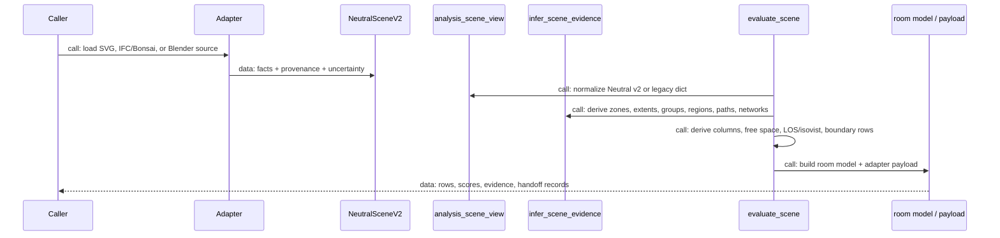
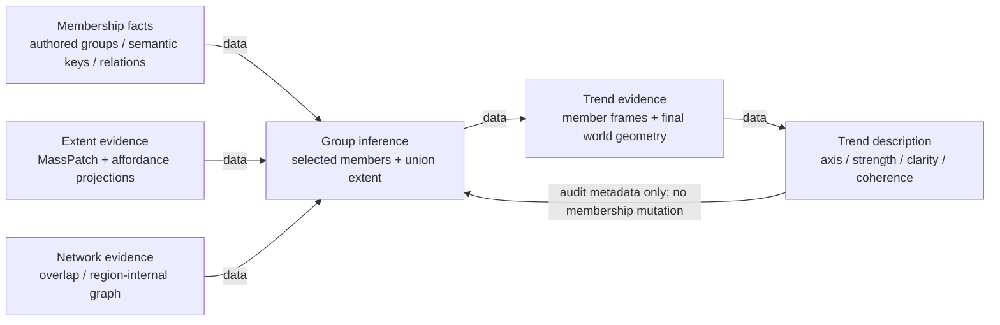
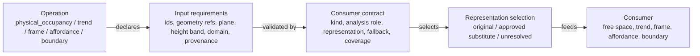
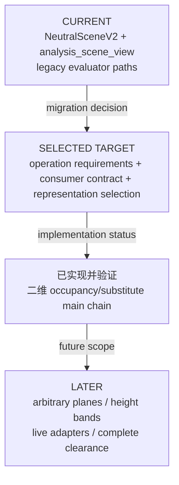
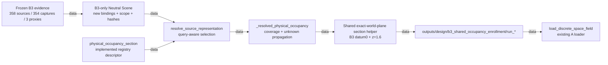
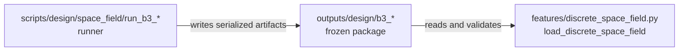
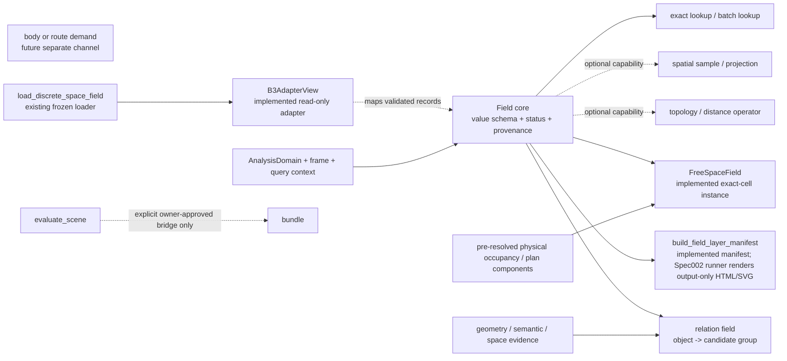

# 软件架构

## Spec008 Analyzer workflow completion — DESIGN / IMPLEMENTATION PENDING

[Spec008](../specs/008-analyzer-workflow-completion/spec.md) / [plan](../specs/008-analyzer-workflow-completion/plan.md) record the 2026-10-19 workflow completion design. This is planned behavior, not current-tree implementation or native acceptance. The inspected workflow baseline is sibling `order_analyzer_spec004_delivery` (`spec004-delivery@4b332704`, actual file bytes also require verification); the main workspace still lacks its addon/request/live-session dependencies. `workflow007@1a271593` has an unresolved `features/analysis_requests.py` conflict and is not the integration baseline. Implementation must first recover the bounded dependency closure into an isolated jj workspace and reconcile intended changes without overwriting unrelated dirty work.

Planned ownership: the addon owns explicit drawing-camera create/adopt/refresh and Space confirmation; `adapters/bonsai_analysis_plane.py` reuses `CameraBinding` and `AnalysisPlane`; `adapters/bonsai_live.py` retains canonical source, storey and structural-context qualification; one narrow planned `adapters/bonsai_space_authoring.py` translates the exact frozen B4 shell/holes into native profiles/extrusion and coordinates transaction recovery. Plane and Space get only thin composition bindings, with native identity/geometry authoritative. Base elevation, B4 cut height and extrusion height remain distinct. Storey height comes from an explicit traceable authored quantity or manual entry; selected slab base is its unique horizontal upper surface. Tilted/multilevel unsupported inputs reject explicitly. Existing B4 service/reducer, both wall modes, candidate UI and diagnostics remain authoritative.

The inspected native `Spatial.set_space_representation_from_polygon` uses only the exterior ring; Spec008 therefore plans `ShapeBuilder.profile(..., inner_curves=...)` before native extrusion/representation assignment. Seed-only `bim.generate_space` cannot satisfy this contract. Exceptions in native `IfcStore.execute_ifc_operator` finalize undo bookkeeping; they do not establish automatic atomic rollback. Exact identity return and fault-injected IFC/Blender/history recovery are release gates. Furniture participation must reach group/affordance/trend consumers through the shared policy while retaining physical occupancy. Existing AnalysisRequest/Field/result persistence stay in use; no public `room_analysis_model` shape change, new enclosure algorithm or general object/result framework. B3 remains OPEN.

## Spec004 Blender analysis workflow — APPROVED / IMPLEMENTATION IN PROGRESS

[Spec004](../specs/004-blender-analysis-workflow/spec.md) and [plan](../specs/004-blender-analysis-workflow/plan.md) were approved by the user on 2026-10-15 and are **APPROVED / IMPLEMENTATION IN PROGRESS**. They describe the planned lightweight Blender addon, canonical capture, separate B4 structural context, Pixi occupancy/display fragments and persisted results. Current-tree Spec003 request/plane/live-capture dependencies are **CURRENT TREE ABSENT**, while B4/domain handoff files exist; T0 must verify Git checkpoint `23d24a3` and its approved dependency/import closure in isolation, preserving dirty history. Production implementation and acceptance are not yet claimed; historical architecture statements below are not proof that absent files exist in this checkout.

The planned deliverable is a unified Analysis workbench: one `N → Analysis` panel with independently collapsible Domain and Free-space sections. Domain preserves complete existing B4 UI/service capabilities independently of free-space execution, including tolerance/closed-aperture assumptions, outlines/holes/area/labels, counts, selection/explicit confirmation, current/attempt/refusal/stale and aperture residual diagnostics. B4 keeps its existing service/reducer; free-space keeps AnalysisRequest/Field and existing operation vocabulary. Shared capture/identity/confirmed-domain/result access lets later operations join incrementally, without a new framework/DSL/job registry; the substitute registry remains representation selection. Planned immutable domain/free-space documents expose manifest-derived metadata list, exact ResultRef open and sample read/reconstruct through one live/embedded entry. Version/identity/freshness mismatch and stale-as-current reject; unknown/conditional/provenance persist, mesh is display only. Headless consumer contracts are planned; no current downstream analysis consumer or future analysis implementation is claimed. B3 remains OPEN.

The approved 2026-10-17 extension adds a separate `Space Authoring` panel. It reuses the existing B4 service/reducer to prepare a versioned candidate cache and spatial index once, then performs hover/list selection through cached point-in-polygon queries. It calls Bonsai's native IfcSpace representation seam only after explicit user confirmation and fresh identity/height validation. Preparation is cancellable and timer-driven with real stage progress; cache freshness and candidate decisions are persisted as analyzer diagnostics, while the resulting IfcSpace remains native IFC truth. This extension does not replace B4, add a second enclosure algorithm, or create a general job framework.

本文件是 `order_analyzer` 的当前代码架构图与跨层变更入口。它记录“现在实际存在什么”和“已选但尚未完成什么”两种状态；目标状态不得冒充当前实现。

## 🧭 使用规则与范围

任何项目工作先参考本图，确定写什么、怎么写、放在哪里。若图缺项或过期，先查实际代码、测试、fixture、配置和导出，再更新本图；架构变更必须与代码同步维护，不能用旧图掩盖实现事实。

用户于 2026-10-15 澄清：所有后续版本与工作区管理优先使用 **jj**，含派工会话；隔离开发和并行工作副本优先用 **`jj workspace`**，远端推送可用时使用 **`jj git push`**。jj 不可用或不能完成所需操作时，允许使用 Git 命令或 Git worktree，并简述具体原因、保持工作区与历史状态一致。只读 jj 检查使用 `jj --ignore-working-copy`，保留既有 dirty work；完整规则见[项目记忆](indoor_layout_evaluation_matrix_architecture_memory.md#jj-first-version-and-workspace-management)。旧计划的 Git 优先要求和绝对禁用 Git 要求均服从此规则。

当前有两条并列入口：`features/analyzer.py:OrderAnalyzer` 是二维矩阵/OCTA 兼容入口；`adapters/* -> NeutralSceneV2 -> analysis_scene_view -> infer_scene_evidence -> evaluate_scene` 是 indoor-layout 描述与评价入口。

本轮“占用/替身主链”与冻结 B3 shared enrollment 已实现；当前验证状态为 **IMPLEMENTED / VERIFICATION IN PROGRESS**。已实现的是默认 whole-height 与指定 world-XY 高度（B3 `z=1.6 m`）的冻结 358-source 接入；不代表任意倾斜 plane、通用 height band、live adapter promotion、完整 occupancy 或 complete clearance。

## 🗺️ 当前实际代码图

The B3 whole-height preview is output-only: verified frozen meshes become
`MassPatch` plan projections in a fresh `preview_*` directory. It retains the
locked physical selection, three proxies, owner substitution and boundary-door
exclusion. In `geometry_views._polygon_components`, a GEOS topology exception
alone permits a warned retry on a 1e-12 plane-unit precision grid; ordinary
projections retain full precision. A failed retry remains an exception and the
preview records its support as unknown. This does not repair source meshes or
change the exact-height section helper, occupancy completeness or clearance.

```mermaid
flowchart TD
    accTitle: Current order analyzer architecture
    accDescr: Source adapters preserve facts in NeutralSceneV2; inference derives evidence; evaluation emits matrix rows and handoff payloads; the OCTA matrix path remains parallel and Blender preview is output-only.
    svg_adapter["adapters/svg_scene.py\nload_svg_neutral_scene"]
    ifc_adapter["adapters/ifc_bonsai.py\nload_ifc_neutral_scene"]
    blender_adapter["adapters/blender_geometry.py\nload_blender_neutral_scene"]
    rhino_source["adapters/rhino_visualarq_source.py\nnormalize_visualarq_source"]
    rhino_grid["adapters/rhino_visualarq_grid.py\nnormalize_visualarq_guides"]
    rhino_exporter["test/bim/export_rhino_source_ifc.py\nwrite_ifc / IFC grid export"]
    legacy_svg["features/scene_loader.py\nload_structured_svg_scene\ncompatibility"]
    neutral_contract["features/scene_contract.py\nNeutralSceneV2 + factual records"]
    scene_view["features/neutral_scene_views.py\nanalysis_scene_view"]
    substitutes["features/geometry_substitutes.py\nMassPatch / SurfacePatch / AffordanceZone"]
    discovery["features/analysis_substitute_discovery.py\ndiscover / resolve_source_representation"]
    registry["features/substitute_contract.py\nregistry / contract matching"]
    section_helper["features/section_views.py\nexact_plane_section / section_record_rejection"]
    inference["features/scene_inference.py\ninfer_scene_evidence"]
    affordance["features/affordance/*\nprofiles / geometry / evaluator / grid"]
    frame_runner["test/bim/run_ifc_furniture_frames.py\nstandalone frame runner"]
    frames["features/furniture_frame.py\ninfer_furniture_frame"]
    group_api["features/group_self_description.py\ndescribe_group_relations\nstandalone authored-group API"]
    position_grammar["features/position_grammar.py\nregion/group grammar"]
    columns["features/column_grid.py\ncolumn_grid_evidence"]
    analysis_regions["evaluator analysis_scene\nview + inferred_regions"]
    evaluator["features/scene_evaluator.py\nevaluate_scene\nmetrics / free space / graphs / payload"]
    model["features/room_analysis_model.py\nbuild_room_analysis_model"]
    payload["adapter_payload + JSON validators"]
    preview["adapters/blender_preview.py\nbuild_preview_manifest(scene, matrix)\noutput-only"]
    b3_bindings["docs/project/evidence/b3-physical-occupancy-bindings.json\nB3-only bindings"]
    b3_runner["scripts/design/space_field/run_b3_shared_occupancy_enrollment.py\nB3-only runner"]
    b3_package["outputs/design/b3_shared_occupancy_enrollment/run_*\nfrozen serialized package"]
    inspection_runner["scripts/design/space_field/run_free_space_field_inspection.py\nwhole-height inspection runner"]
    inspection_manifest["outputs/design/free_space_field_inspection/run_*\ninspection_manifest.json"]
    inspection_html["inspection.html\ninline SVG + embedded JSON"]
    b3_loader["features/discrete_space_field.py\nload_discrete_space_field"]
    octa_api["features/analyzer.py\nOrderAnalyzer"]
    octa["OCTA_toolbox-master/octa\nGrid / Stimulus / GridPattern / Order"]
    svg_adapter -->|data: source facts| neutral_contract
    ifc_adapter -->|data: source facts| neutral_contract
    blender_adapter -->|data: source facts| neutral_contract
    rhino_source -->|data: normalized dict| rhino_exporter
    rhino_grid -->|data: normalized dict| rhino_exporter
    rhino_exporter -->|data: native IFC file| ifc_adapter
    legacy_svg -->|data: legacy scene dict| scene_view
    neutral_contract -->|data: typed facts| scene_view
    neutral_contract -->|data: typed facts| discovery
    registry -->|data: operation descriptors| discovery
    discovery -->|data: selected occupancy and diagnostics| scene_view
    b3_bindings -->|data: source-owned bindings and scope| b3_runner
    registry -->|data: physical_occupancy_section descriptor| b3_runner
    b3_runner -->|data: resolver/query request| discovery
    discovery -->|data: eligible selection| b3_runner
    b3_runner -->|data: frozen evidence + selected records| section_helper
    section_helper -->|data: occupied / legal-empty / unknown| b3_runner
    neutral_contract -->|data: geometry facts| substitutes
    scene_view -->|data: normalized scene| inference
    substitutes -->|data: MassPatch projections| scene_view
    affordance -->|data: authored/derived zones| inference
    scene_view -->|data: normalized scene| evaluator
    inference -->|data: evidence| evaluator
    scene_view -->|data: scene input| group_api
    discovery -->|data: resolved trend binding| group_api
    evaluator -->|data: view + inferred regions| analysis_regions
    analysis_regions -->|data: region/grid input| columns
    columns -->|data: column evidence| evaluator
    evaluator -->|data: group input| position_grammar
    position_grammar -->|data: grammar evidence| evaluator
    frame_runner -->|data: IFC analysis mesh| frames
    frames -->|data: frame result| frame_runner
    evaluator -->|data: matrix| model
    evaluator -->|data: handoff records| payload
    neutral_contract -->|data: source scene| preview
    evaluator -->|data: matrix evidence| preview
    b3_runner -->|data: writes accepted artifacts| b3_package
    b3_package -->|data: frozen field/source sections| b3_loader
    b3_package -->|data: authenticated whole-height inputs| inspection_runner
    inspection_runner -->|data: manifest + timings + provenance| inspection_manifest
    inspection_manifest -->|data: embedded payload| inspection_html
    octa_api -->|data/API result| octa
```



### 当前入口与真实符号

| Concern | Current entry | Boundary |
| --- | --- | --- |
| OCTA order | `features/analyzer.py:OrderAnalyzer` (`_build_grid`, `_apply_matrix`, `_prepare`, `calculate_order`, `report`) | Grid order compatibility; not Neutral Scene semantics |
| Canonical SVG | `adapters/svg_scene.py:load_svg_neutral_scene` | Converts authored SVG facts to `NeutralSceneV2`; SVG does not define matrix behavior |
| Legacy SVG | `features/scene_loader.py:load_structured_svg_scene` | Plain-dict compatibility path; semantic drift risk |
| IFC/Bonsai | `adapters/ifc_bonsai.py:load_ifc_neutral_scene` | IFC facts, groups, grids, openings, surfaces, domain, provenance |
| Blender source | `adapters/blender_geometry.py:load_blender_neutral_scene` | Explicit source handoff; ordinary meshes are not silently BIM-classified |
| Contract | `features/scene_contract.py:NeutralSceneV2` | `AnalysisContext`, `AnalysisDomain`, `SourceObject`, `MeshGeometry3D`, authored groups/grids/affordances/openings, uncertainty |
| Compatibility view | `features/neutral_scene_views.py:analysis_scene_view` | Central Neutral-v2/legacy bridge |
| Inference | `features/scene_inference.py:infer_scene_evidence` | Zones, extents, groups, regions, gap paths, networks, boundaries, interface relations; it does not call `infer_furniture_frame` or `describe_group_relations` |
| Occupancy resolution | `features/analysis_substitute_discovery.py:resolve_source_representation`; `features/substitute_contract.py` operation descriptors | Selects original/substitute/unresolved, including `physical_occupancy` and free-space delegation |
| Resolved Neutral view | `features/neutral_scene_views.py:_resolved_physical_occupancy` | Builds physical inventory, MassPatch/GeneratedProxy selection, exact many-to-one coverage, and unresolved source ids |
| Physical free-space handoff | `features/scene_evaluator.py:_physical_occupancy_blockers`, `_negative_space_descriptor` | Delegates `free_space` to resolved `physical_occupancy`; propagates unknown status instead of known free |
| B3 exact section | `features/section_views.py:exact_plane_section`, `section_record_rejection`; `scripts/design/space_field/run_b3_shared_occupancy_enrollment.py` | Qualifies frozen original sections and three new proxy sections at explicit world XY `z=1.6 m` without changing live evaluator behavior |
| Evaluation | `features/scene_evaluator.py:evaluate_scene` | Rows, score matrix, free-space/LOS/path graphs, evidence geometry, adapter payload |
| Room model | `features/room_analysis_model.py:build_room_analysis_model` | Description/model aggregation; does not define scoring algorithms |
| Standalone frame | `features/furniture_frame.py:infer_furniture_frame`, used by `test/bim/run_ifc_furniture_frames.py` | Furniture mesh frame calculation outside `infer_scene_evidence` |
| Standalone authored-group API | `features/group_self_description.py:describe_group_relations`; `features/_authored_group_inventory.py:_build_authored_group_inventory`; `adapters/ifc_bonsai.py:_native_group_records` | Direct Neutral Scene inventory preserves raw references, duplicate/unresolved-reference audit, shared membership, and explicit empty IFC groups before geometry/relation description. Reuses the unshifted geometry projections held by the current `analysis_scene_view` call; this is an invocation-local performance workaround. Eligibility reports input completeness separately from `group_geometry.geometry_status`; empty groups remain audit-only and ordinary IFC groups remain non-furniture. Separate from `scene_inference.py` and the lossy compatibility view. |
| Position grammar | `features/position_grammar.py:region_position_grammar_evidence`, `group_assembly_grammar_evidence` | Evaluator-side grammar evidence |
| Column grid | `features/column_grid.py:column_grid_evidence` | Evaluator passes `analysis_scene` containing view data plus inferred regions |
| Preview | `adapters/blender_preview.py:build_preview_manifest(scene, matrix)` | Consumes Neutral Scene source geometry plus evaluator matrix evidence; output-only inspection |
| Spec002 inspection | `scripts/design/space_field/run_free_space_field_inspection.py:build_inspection` | Authenticates frozen whole-height inputs, calls `analysis_scene_view`, evaluates `FreeSpaceField`, and writes manifest/HTML output only |

## 🔁 Indoor-layout evaluation sequence



## 📐 Group, region, and trend semantics

Group inference is not trend inference. Group membership may use authored groups, semantic keys, affordance extents, overlap/network evidence, region keys, and explicit relations. Trend is an independent description of directional organization from final world-space `Analysis` geometry and member-frame evidence. Trend must not silently add, remove, split, or merge group membership.



Relevant symbols: `scene_inference.py:furniture_groups`, `_furniture_group_frame`, `_region_frame_mean`, `_frame_with_explainability_correction`; `features/furniture_frame.py:infer_furniture_frame`; `features/group_self_description.py:describe_group_relations`.

## ⚙️ Operation → inputs → consumer contract → representation

The shared vocabulary is intentionally small. It does not imply inheritance, plugins, or a general-purpose solid engine. Each operation declares input requirements and accepted representations; selection returns original, approved substitute, or unresolved diagnostics.



The current implementation uses `features/analysis_substitute_discovery.py:resolve_source_representation` with operation descriptors loaded by `features/substitute_contract.py` from the single registry, `scripts/design/group_level/trend_substitute_registry.json`, and consumes the result in `features/neutral_scene_views.py:_resolved_physical_occupancy`. The B3 runner passes an explicit query to the same resolver and uses `features/section_views.py` for frozen section qualification before writing its isolated package. `MassPatch` is the geometry kind; `GeneratedProxy` is a representation provenance identifier, not a second substitute type. Default whole-height and trend behavior remain unchanged. Arbitrary tilted planes, general height bands, live adapter promotion, and complete clearance remain later work.

| Operation | Consumer | Representation requirement | Registration status | Migration status |
| --- | --- | --- | --- | --- |
| `physical_occupancy` | `scene_evaluator.py:_physical_occupancy_blockers`, `_negative_space_descriptor` | Whole-height planar physical geometry with exact-once source accounting and unknown propagation | `resolve_source_representation` + operation descriptor | **二维主链已实现并验证** |
| `free_space` | `scene_evaluator.py:_negative_space_descriptor` and topology helpers | Delegates to `physical_occupancy`; no independent substitute semantics | Operation descriptor delegates upstream input | **二维主链已实现并验证** |
| `physical_occupancy_section` | `scripts/design/space_field/run_b3_shared_occupancy_enrollment.py` via `resolve_source_representation` and `features/section_views.py` | Same physical `MassPatch` representative, explicit world XY height in metres, B3 `z=1.6 m`; exact declared source coverage | Registry descriptor implemented; B3-only runner path | **IMPLEMENTED / VERIFICATION IN PROGRESS** |
| `trend` | `group_self_description.py` through `resolve_function_substitute` | Final world-space `Analysis` `MassPatch` | Shared operation resolver, preserving the compatibility wrapper | Current; must not alter membership; inference-side group frames remain separate |
| `single_furniture_frame` | `furniture_frame.py:infer_furniture_frame` | Area-weighted 2D PCA over furniture `MassPatch` | No shared operation registration | Current |
| `affordance` | `features/affordance/*`, `scene_inference.py` | Authored `AuthoredAffordanceZone` or explicit fixture helper output | No shared operation registration | Current |
| `boundary_channels` | `neutral_scene_views.py`, `boundary_evidence.py`, evaluator rows | Geometry plus height/material/surface/opening facts; separate channels | No shared operation registration | Current, multiple evidence helpers |
| B3 serialized field | `features/discrete_space_field.py:load_discrete_space_field` | Validated field package and tri-state missingness | Standalone serialized-loader contract | A loader unchanged; frozen shared enrollment implemented; B3/live/clearance limits remain open |

## 🚧 Selected target and migration state



Not current: arbitrary tilted-plane occupancy, general height-band semantics, live adapter promotion, complete clearance, complete real-world occupancy, a universal resolver for every metric, a rule DSL, plugin architecture, adapter-specific occupancy inference, a new solid engine, or a new public `room_analysis_model` field. Accepted historical B3 packages remain unchanged.

### B3 shared occupancy enrollment — IMPLEMENTED / VERIFICATION IN PROGRESS

The implementation and evidence are documented in [B3 shared occupancy enrollment plan](project/b3-shared-occupancy-enrollment-plan.md). The descriptor, B3-only bindings, shared resolver/query path, section helper, runner, and frozen package are implemented. Owner verification is still in progress; this is not an `OWNER ACCEPTED` claim.



The implemented route keeps binding eligibility separate from section qualification. One valid physical binding represents the same three-dimensional `MassPatch` for both default whole-height and explicit section queries; adding two query-specific bindings for the same consumer is ambiguous and is rejected. `GeneratedProxy` remains provenance, not a geometry kind. Generic arbitrary height semantics, live adapter promotion, and complete clearance remain open.

### B3 serialized branch isolation

The B3 branch is intentionally isolated from the live Neutral Scene evaluator:



The accepted handoff at `outputs/design/b3_occupancy_only_handoff/` and the current loader tests are evidence packages, not proof that B3 has been promoted into the production occupancy resolver.

## 🧪 Architecture-change checklist

The unchecked items below are a reusable checklist for each future change, not an open-task ledger. This round's evidence is recorded separately below.

- [ ] Read this document, `AGENTS.md`, the architecture memory, and `docs/room_analysis_model_development_standard.md`.
- [ ] Confirm the layer: adapter, Neutral Scene, view/resolver, inference, evaluator, room model, or output-only preview.
- [ ] Search all callers and direct private-helper tests with `rg`.
- [ ] Preserve source ids, provenance, uncertainty, and exact membership semantics.
- [ ] For substitutes, validate source binding, consumer, kind, analysis role, representation, geometry refs, ambiguity, and exactly-once coverage.
- [x] For the current two-dimensional occupancy chain, verify operation descriptors, `resolve_source_representation`, `_resolved_physical_occupancy`, exact many-to-one coverage, and unknown propagation through free-space.
- [ ] Keep missing/failed geometry unknown or unavailable; never known free.
- [ ] Keep physical occupancy separate from furniture eligibility, grouping, trend, affordance, and channel blockers.
- [ ] Do not let trend or preview overlays mutate group membership or matrix semantics.
- [ ] For free space, test explicit-domain and missing-domain behavior, occupancy union, boundary members, blockers, and serialized status/provenance.
- [ ] For room-model changes, attach metrics to `target_layer` and `target_id`; keep scoring outside `build_room_analysis_model`.
- [ ] For B3 changes, preserve accepted packages and distinguish current evidence from historical plans.
- [ ] Update this document and the architecture memory together when a shared boundary changes.
- [ ] Run focused tests for the changed operation and downstream consumers; record unrun live/expensive checks.

### This round's verification record

- Historical B3 implementation report: **60 focused tests passed**; the current Field owner suite is recorded separately below as 74 tests. Neither is full-suite evidence.
- New package: `outputs/design/b3_shared_occupancy_enrollment/run_20261009T141817Z_8e23c2/`, `execution.json` reports `exit_0`.
- `comparison_audit.json` reports **9,648 sample mismatches = 0**, `frozen_original_rows_identical = true`, and zero delta for all four recorded areas; `conditional_free_area_m2 = 190.1616840398615`.
- The unchanged A loader read all four serialized variants. The implementation preserves default whole-height/trend behavior, keeps B3 isolated from the live evaluator, and retains complete occupancy/clearance as null/open.
- A prior failed run `run_20261009T141637Z_243803` with mappingproxy serialization error remains historical evidence; the later run is the successful implementation package.
- Reproduction command from the repository root (historical focused command; do not rerun here):

```powershell
pixi run pytest test/test_physical_occupancy_resolution.py test/test_analysis_substitute_discovery.py test/test_trend_core_checkpoint_1a.py test/test_neutral_scene_analysis_regression.py test/test_group_self_description.py scripts/design/group_level/test_trend_substitute_registry.py test/test_floorplan_scene_loader.py -k "not floorplan_scene_loader or inferred_gap_path_occupancy_by_objects_and_affordances or inferred_gap_path_free_space_overlap or inferred_gap_path_cad_free_space_overlap or compares_inferred_gap_paths_to_explicit_paths" -q
```

- Not run in this documentation sync: live IFC/Blender adapters, the full repository suite, or Mermaid rendering. Arbitrary tilted-plane/height-band semantics, live adapter promotion, and complete clearance remain open.

## 🔗 Related documents

- [Architecture memory](indoor_layout_evaluation_matrix_architecture_memory.md)
- [Room analysis model standard](room_analysis_model_development_standard.md)
- [Substitute architecture note](analysis_description_and_substitute_architecture_note.md)
- [Physical occupancy policy plan](project/physical-occupancy-policy-plan.md) — scoped two-dimensional implementation complete/verified; height and B3 generic enrollment remain open
- [B3 field handoff and occupancy plan](project/b3-space-field-handoff-and-occupancy-plan.md) — accepted packages/history; B3 remains open
- [FreeSpaceField instance design](project/free-space-field-instance-design.md) — concrete exact-cell occupancy field; B3 and evaluator promotion remain separate

## 🧭 Unified Field kernel — US1/US2/US3 implemented; US4 isolated instance implemented

### IMPLEMENTED — Spec002 offline FreeSpaceField inspection output layer

Spec002 implements an output-only, offline HTML/SVG inspection seam. It
authenticate the frozen whole-height package, build a runner-local
`NeutralSceneV2`, pass it through `analysis_scene_view`, and then construct the
existing `FreeSpaceField`. It is not a second Field layer and does not promote
the field into `evaluate_scene`, `room_analysis_model`, the B3 loader, or live
adapters.

The implemented seam consumes the successful
`run_20261009T142454Z_0d7308` package as distributed artifacts, not
`preview_input.json` alone. It preserves explicit world-XY metres,
the frozen source origin metadata (`origin_offset_m=[0,0]`) and the effective
view offset returned by `analysis_scene_view`, domain geometry with holes, exact boundary membership,
and per-proxy provenance. The five locked unresolved ids retain canonical
`missing_geometry` uncertainty before shared-view promotion; capture refs/arrays
are audit-only when qualified `geometry_refs` are absent. If that handoff cannot
be represented without changing `features/*`, implementation stops for owner
ruling.

The renderer calls `build_field_layer_manifest`, deduplicates repeated
global provenance only at serialization, records timings/output sizes, and
keeps all six statuses distinct. Historical 9,648/zero-mismatch evidence is
eye-plane package history, not the new whole-height acceptance sample.

The first architecture slice implements the immutable core contract in
`features/field_core.py`. It defines `Field`, `FieldQuery`, `FieldSample`, and
the six-state `FieldStatus` vocabulary with exact lookup, ordered batch lookup,
deeply frozen audit payloads, and status-gated values. US2 adds the read-only
`B3AdapterView` and `build_field_layer_manifest` seams over validated B3
deliveries. The B3 loader, `evaluate_scene`, `room_analysis_model`, default
overlay, `FreeSpaceFieldBundle`, and live promotion remain unchanged or future
work. The Spec002 runner owns its output-only SVG/HTML rendering and does not
modify those layers. US4 adds
`features/free_space_field.py:FreeSpaceField`, a concrete composition over
the core that consumes pre-resolved whole-height `physical_occupancy`
components. It uses existing geometry composition helpers and does not add a
second base hierarchy, runtime `FieldBundle`, source scanning, or resolver
logic. The live evaluator bridge remains absent.

`FieldResultEnvelope` is the shared immutable output and audit boundary for
field computations. Its schema identity is `field-result-envelope/v1`; it
retains the canonical target, query, raw result status, normalized channel
set, per-channel observations and requirements, support, provenance,
explanation, projection metadata, and a cache identity derived from the
target/query/channel declarations and input, source, recipe, algorithm, and
schema fingerprints. Raw status and channel records are preserved even when
an individual channel is unavailable or a structured value is only partial.
The cache identity therefore belongs to the complete envelope input boundary,
not to a display sample or a rendered manifest.

`FieldSample` is a validated scalar projection of an envelope. The
`field-layer-manifest/v1` representation is a visualization projection built
from the same envelope and may use the sample when its invariants are met.
When no valid sample projection exists, the manifest keeps raw status,
channel-set, channel records, provenance, and explanation and falls back to
`status="unknown"` and `visual_state="unknown"`; it must not turn partial,
unavailable, invalid, outside, or ambiguous evidence into known free space.
This preserves the existing free-space field compatibility path and its
whole-height limitations while keeping audit data recoverable.

This slice does not implement group candidate inference, a group candidate
selector, scalar aggregation, perceptual scores or weights, or a job/result
registry. Candidate-group evidence remains future/design-only; any later group
inference or scalar aggregation must consume envelopes without changing this
boundary.

The first relation evidence package is now implemented in
`features/group_geometry_relation_field.py`. It wraps the existing IFC-driven
`describe_group_relations` member-pair observations into
`FieldResultEnvelope` records with descriptive boundary-gap, contact, and
positive-area-overlap channels. It remains diagnostic-only: group-level
aggregation, candidate inference, the complete candidate-by-unit attribution
field, membership edges, potential, and strength remain separate work.

The package requires `FieldQuery.plane == scene.context.analysis_plane`.
The current IFC supplies world-XY by the user's temporary choice; neither the
package nor the planar renderer owns that choice. The 1B contract test calls
`scripts/design/group_level/render_group_geometry_relation_field_ifc.py`,
which consumes that run's description/envelopes and draws the existing
plane-local member polygons without loading IFC or projecting meshes again.
The 2026-10-27 delivery maps all 666 group-pair envelopes to pair JSON/SVG,
with an overview and source/plane/unit manifest. All 667 SVG files parsed;
overview, near/far separation and contact PNG samples were visually reviewed.
The corrected contract test passed by replaying the retained real IFC scene
and description; this was not an independent second geometry extraction.
This source covers computed gap/contact observations only: overlap, shared
members and missing/invalid/partial branches remain unverified. See the
[package verification record](project/evidence/geometry-relation-field-package-v1.md#current-verification-and-limits).
The user accepted the geometry-field sample review on 2026-10-27 ("合理").
The second package is the diagnostic-only
`features/group_trend_alignment_field.py`. It wraps the existing typed
`Analysis` group descriptors as four parallel channels
(`overall_group_axis`, `member_frame`, `member_axis`, and `layout_axis`) for
one `furniture_group` target. The current IFC run produced 37 envelopes and
148 plane-local SVG views. These descriptors preserve geometric
concentration/consensus diagnostics; they do not define potential, membership,
strength, candidate closure, or a winner. See the [trend package record](project/evidence/group-trend-alignment-field-package-v1.md).
Stage-2 readout comparison, blind review, and recipe decisions remain open.
Camera integration and other analysis planes have not been verified.



The core shares domain, frame, query context, value schema, representation,
status, and provenance across spatial and relational uses. Exact lookup and
batch lookup are required; interpolation is optional and is not required by a
relation field. Physical occupancy, distance, demand, and influence remain
separate channels. Occupancy and measured distance do not decay; decay is an
explicit influence/operator parameter.

The implemented status gates are: malformed required input is `invalid`, a
missing domain or channel is `not_available`, a valid target outside an
available domain is `outside`, insufficient evidence is `unknown`, accepted
substitute-backed whole-height results are `conditional`, and complete
original-backed scope is `established`. A `conditional` sample must carry a
non-empty explanation of its representation limitation; status alone cannot
hide why the value is bounded.
The detailed decision is in
`specs/001-field-kernel-free-space/owner-decision.md`.

The owner verification command for the focused US1/US2 checks, unchanged B3
loader baseline, and US3 replay reports **74 passed**. The final isolated US4
precision-repair evidence reports **67 new plus 74 existing = 141 passed**.
It covers core status
and immutability, adapter identity/status mapping, manifest state separation,
loader compatibility, and deterministic design-only replay. The B3 JSON
loader, `evaluate_scene`, `room_analysis_model`, default overlay, complete
free-space geometry, clearance, runtime `FieldBundle`, and live evaluator
promotion remain unchanged or future work. The Spec002 output-only SVG/HTML
renderer is a separate implemented runner and does not alter those layers. US4
is accepted as an isolated
slice; B3/live promotion and constitution ratification remain open.
