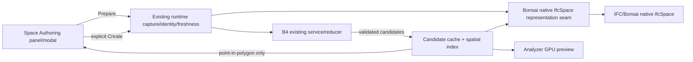

# B4 → Bonsai Space Authoring

**Status:** Design approved for specification. Implementation is not yet claimed.

## Purpose

Extend the existing Analyzer workbench so a user can choose one B4-enclosed area at a time and create a native IFC space through Bonsai. The feature is an incremental extension of the existing B4/domain service and Blender runtime. It must not replace B4, create a second enclosure algorithm, or infer and write every space automatically.

The final user workflow is:

```text
Prepare candidates → wait with real progress → preview by hover or click
→ lock one candidate → validate again → create one native IfcSpace
```

The feature is complete only after repeated live Blender use is acceptable to the user. Fixture tests are necessary but do not substitute for that human acceptance loop.

## Decisions

### Existing algorithms remain authoritative

- B4 remains the source of enclosure candidates, outlines, holes, area, column diagnostics, source identities, and structural freshness.
- The B4 service/reducer and existing Domain state are reused. No second B4 state or replacement polygonizer is introduced.
- Bonsai remains the owner of native IfcSpace creation and IFC Body representation assignment.
- The adapter passes the validated B4 base polygon and positive height to Bonsai's native space representation path (`set_space_representation_from_polygon` or the equivalent supported Bonsai service seam). It does not call the cursor-based Bonsai polygon discovery after B4 has selected the candidate.

### Column policy

Space Authoring uses the Bonsai-compatible policy:

- a column intersecting the enclosing boundary contributes to the boundary detour;
- a column fully inside a candidate is ignored for space boundary generation;
- an interior column is not emitted as a hole;
- the existing B4 policy that can treat all columns as exclusions remains available for diagnostics and existing analysis behavior, but is not silently changed.

The cached candidate records the policy and the column decisions so the resulting IfcSpace has an auditable source.

### Candidate cache

Preparation runs B4 once for the current analysis plane/current storey scope. It creates an immutable-friendly cache containing candidate geometry, stable candidate IDs, source and geometry references, column decisions, area, holes, height facts, and the structural/full observation identities needed for freshness checks.

The cache is an analyzer artifact. It is not IFC truth and does not create objects. It is valid only while its source, plane, storey, configuration, and structural observation identities match the live scene.

The cache builds a lightweight spatial index. Hover and click selection use only this index and point-in-polygon tests over cached geometry. They must not read IFC geometry, run B4, call Bonsai polygon discovery, or start a subprocess.

### Progress and cancellation

Preparation is a staged, timer-driven runtime job so Blender remains responsive. The UI reports a named stage, determinate progress when the stage has a trustworthy denominator, candidate counts, elapsed time, and a Cancel action.

Required stages:

1. capture analysis plane/storey and observation identities;
2. collect B4 structural inputs;
3. construct and qualify closed candidates;
4. apply the Space Authoring column policy;
5. validate positive height, connectivity, geometry, and write prerequisites;
6. build the spatial index and publish the cache.

If a stage has no reliable denominator, the UI shows the stage as processing without inventing a percentage. Cancellation leaves the previous cache available only as historical data and marks the new attempt cancelled. A failed preparation preserves the previous valid cache and exposes the failing stage and diagnostic.

### Selection and writing

The `Space Authoring` modal interaction is display-only until the explicit write command:

- starting the mode enables cached candidate preview;
- the analysis-plane ray is converted to the cached plane coordinates;
- the candidate under the pointer is highlighted with a GPU-only yellow hatch/outline;
- moving the pointer changes only the highlighted candidate;
- left click locks the candidate;
- `Create IfcSpace` performs a fresh identity/freshness/height validation and then calls the Bonsai native representation seam;
- Esc/right click cancels preview or unlocks the candidate;
- a list of cached candidates remains available as a non-hover fallback.

The preview must not create temporary Blender or IFC marker objects. Persisted region overlays remain analyzer-owned display records. The created IfcSpace is a native IFC fact and is handled by Bonsai's normal object/representation refresh.

Before writing, validate:

- candidate cache identity and current candidate digest;
- analysis plane UUID/revision and world-XY contract;
- current IFC/source observation and storey identity;
- positive space height;
- candidate geometry is closed and supported by the Bonsai representation seam;
- no existing binding already owns the candidate unless the user explicitly chooses reuse/update.

If validation fails, no IFC mutation occurs. If Bonsai fails after entity creation begins, the adapter must surface the failure and leave a diagnostic for the partially created object; it must not claim success.

### Heights and naming

The height source is explicit and auditable: prefer the current storey-to-next-storey elevation difference when valid; otherwise use a user-visible positive fallback height. Zero, negative, missing, or ambiguous height blocks writing before IFC mutation.

Candidate IDs are stable within the cache and names are generated from those IDs plus the selected storey/context. The adapter must not rely on Bonsai's repeated default `Space0` name. Existing native IfcSpaces are detected by GlobalId and candidate binding before another write is allowed.

### UI placement

Add one independently collapsible `Space Authoring` panel beside the existing `Plane / Space`, `Region`, `Free-space`, `B4`, and `Results` panels. It owns preparation, progress, cancellation, cached candidate list, preview status, lock state, height summary, and `Create IfcSpace`. `B4` continues to expose structural diagnostics and candidate inspection; it does not become the write panel.

## State model

```text
idle → preparing → ready → candidate_locked → writing → completed
                  ↘ failed / cancelled
ready → stale
candidate_locked → ready | stale
```

`ready` means the cache is usable for selection. `completed` means a native IfcSpace write succeeded. `stale` forbids writing until preparation is rerun. A completed space remains an IFC fact even if the cache later becomes stale.

## Architecture and ownership



The cache is a new feature-local artifact under the existing Blender addon/runtime boundary. It does not become a general job registry or a new field framework. Existing operation vocabulary, capture, identity, and result boundaries remain the shared seams for future analysis modules.

## Acceptance

### Automated checks

- B4 candidate output is reused without a second polygonization path.
- Candidate cache and spatial index return the same candidate for representative interior points and reject outside points.
- Hover/query does not call B4, Bonsai geometry discovery, IFC mutation, or subprocess execution.
- Cache invalidates on plane, storey, structural geometry, height, or source observation changes.
- Cancel and failure preserve the previous valid cache as historical and expose the new attempt status.
- Zero/negative/missing height blocks Bonsai write.
- Bonsai adapter receives the B4 polygon and assigns a positive extrusion.
- repeated candidate selection does not create duplicate native spaces.
- partial write failures are reported and never marked completed.

### Live Blender acceptance

In the specified Portable Blender and a real IFC, the user must be able to:

1. start preparation and see meaningful progress and elapsed time;
2. cancel preparation without freezing Blender;
3. prepare successfully and see candidate count and statuses;
4. preview a candidate quickly by hover and select it from the list;
5. lock one candidate, create one native IfcSpace, and see it in Bonsai/IFC;
6. rerun after a model or height change and see the old cache become stale;
7. encounter a controlled diagnostic for an invalid or zero-height candidate;
8. report satisfaction and repeat the iteration until the workflow is accepted.

The implementation is not accepted merely because fixture tests pass or a panel registers.

## Scope limits

This design does not add automatic whole-model space creation, Revit-specific code, a new IFC schema abstraction, arbitrary tilted planes, general 3D room inference, or a new background job framework. Those remain separate future decisions.
