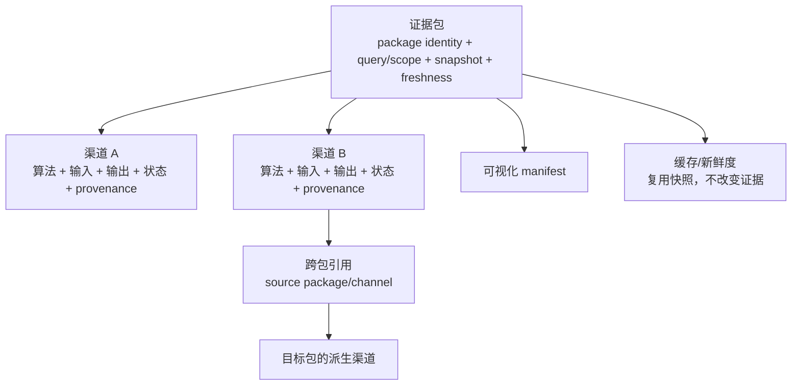

# 证据包结构与跨包读回设计

状态：**实现基线**

证据包是一个结果容器，不是一个把所有算法混在一起的“渠道”。包统一绑定同一次查询的目标范围、输入快照、版本、依赖指纹、状态和可视化产物；包内每个渠道独立声明自己的算法、输入、输出、单位、状态和来源。



跨包调用是可行的，但必须是显式依赖：目标包引用源包的 `package_id`、`output_identity`、`target_identity` 和 `channel`。fresh 读回把原渠道交给目标包，保留观察值、尺度、状态、来源和 provenance；stale/unavailable 读回不给计算回调提供可用的 `channel`，而把源渠道保存在显式的 `audit_channel` 中，便于审计但不能误作当前输入。目标包只能追加派生渠道，不能覆盖源渠道，也不能把 `not_available` 改成数值零。

跨包依赖属于结果身份的一部分。依赖图必须无环；输出对象只保存依赖身份和渠道引用，不递归保存源包输出。直接自依赖在输出边界拒绝；调用方把完整包依赖图交给校验器以拒绝间接环路。同一个目标包不能在一次结果中重复声明同一个源渠道。第一版只提供通用读回和依赖校验，不新增注册表、调度器或统一融合公式；具体包是否消费另一个包仍由该包自己的输出函数声明。

## 最小运行时对象

```text
EvidencePackageOutput
  source_envelopes       # 原始输入，完整保留
  outputs                # 包内追加渠道
  dependencies           # 外部包渠道引用（可为空）
  output_identity        # 由输入、输出声明和依赖稳定计算

EvidencePackageChannelReference
  package_id
  output_identity
  target_identity
  channel

read_evidence_package_channel(output, reference)
  -> 原样返回匹配的 EvidenceOutputChannel

resolve_evidence_package_channel(output, reference, package_freshness=...)
  -> EvidencePackageResolvedDependency
     channel       # 仅 fresh 时可用于计算
     audit_channel # 保留源观察，供历史审计
```

包内渠道继续使用现有 `EvidenceChannelReference`；跨包渠道使用独立引用类型，以免把“同一 envelope 内的渠道”与“外部已发布结果”混为一谈。

## 状态规则

- 读回命中且源渠道为 `computed`：目标包可以使用其观察值。
- 读回命中但源渠道为 `partial`/`ambiguous`：目标包必须保留该状态或显式降级，并说明原因。
- 读回缺失、身份不匹配、源包过期或依赖环：目标包不能计算数值结果；输出 `not_available` 并给出原因。
- 跨包依赖指纹进入目标包 `output_identity`，源包变化会让目标包过期。

## 当前范围

现有 free-space、group-distance 和 group-axis-potential 渠道全部保留；本次把共享跨包读回边界落实到核心契约和测试。不会把 distance 渠道偷偷加入 potential 包，也不会把 free-space 复制成 distance 的第三个独立渠道。是否新增具体联合指标，仍由对应包单独设计。
