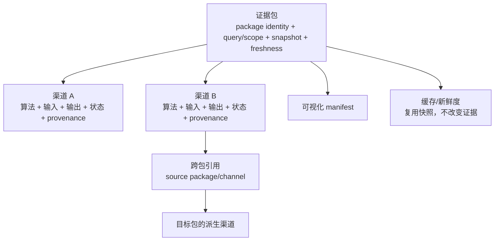

# 证据包结构与跨包读回设计

状态：**实现基线**

证据包是一个结果容器，不是一个把所有算法混在一起的“渠道”。包的外围 contract/status/manifest 统一绑定同一次查询的目标范围、输入快照、版本、依赖指纹、状态和可视化产物；运行时 `EvidencePackageOutput` 保存原始 envelopes、追加 outputs、紧凑依赖引用和 output identity。逻辑结构上每个渠道独立声明产生它的方法/配方版本、实际输入、输出、单位、状态和来源；多个渠道可以复用同一个方法，但不因此合并语义。当前实现由包级 `output_function + version` 标识执行算法，渠道级 algorithm id 和单独 snapshot fingerprint 尚未成为类型字段，属于已记录的后续结构缺口。



跨包调用是可行的，但必须是显式依赖：目标包引用源包的 `package_id`、`output_identity`、`target_identity` 和 `channel`。底层 `read_evidence_package_channel` 只做身份匹配并返回已发布渠道；包执行使用 `resolve_evidence_package_channel` 对调用方提供的 freshness 做门控，resolver 本身不重新计算 freshness。fresh 读回把原渠道交给目标包，保留观察值、尺度、状态、来源和 provenance；stale/unavailable 读回不给计算回调提供可用的 `channel`，而把状态、尺度、来源和 lineage 保存在 observation 已脱敏的 `audit_channel` 中，避免把历史数值误作当前输入。此处只将 `audit_channel.observation` 置为 `None`；状态、尺度、source ids、lineage 和 provenance 仍为审计元数据，不得作为当前数值输入。若 unavailable 没有 typed source output，则没有可审计观察值。输出边界拒绝 stale/unavailable 外部依赖产生任何带 observation 的输出，包括 `partial` 输出。目标包只能追加派生渠道，不能覆盖源渠道，也不能把 `not_available` 改成数值零。

跨包依赖属于结果身份的一部分。输出对象只保存依赖身份和渠道引用，不递归保存源包输出。直接自依赖在输出边界拒绝；调用方可把完整包依赖图交给 `evaluate(..., dependency_graph=...)`，传入时校验器会在 callback 前拒绝间接环路；省略该图时不保证间接环路检查。同一个目标包不能在一次结果中重复声明同一个源渠道。第一版只提供通用读回和依赖校验，不新增注册表、调度器或统一融合公式；具体包是否消费另一个包仍由该包自己的输出函数声明。

## 最小运行时对象

```text
EvidencePackageOutput
  source_envelopes       # 原始输入，完整保留
  outputs                # 包内追加渠道
  dependencies           # 外部包渠道引用（可为空）
  output_identity        # 由输入、输出声明和依赖稳定计算

EvidencePackageChannelReference
  package_id
  output_identity
  target_identity
  channel

read_evidence_package_channel(output, reference)
  -> 原样返回匹配的 EvidenceOutputChannel

resolve_evidence_package_channel(output, reference, package_freshness=...)
  -> EvidencePackageResolvedDependency
     channel       # 仅 fresh 时可用于计算
     audit_channel # 保留脱敏状态/来源/lineage，供历史审计
```

包内渠道继续使用现有 `EvidenceChannelReference`；跨包渠道使用独立引用类型，以免把“同一 envelope 内的渠道”与“外部已发布结果”混为一谈。

## 状态规则

- 读回命中且源渠道为 `computed`：目标包可以使用其观察值。
- 读回命中但源渠道为 `partial`/`ambiguous`：目标包的契约必须保留该状态或显式降级，并说明原因；共享核心只保留源渠道状态，不替消费包选择语义。
- stale/unavailable freshness：resolver 不向计算回调提供可用 `channel`，并将依赖的 `effective_status` 设为 `not_available`；消费包输出不得携带非空 `observation`。消费包契约负责选择输出状态并保留原因，可沿用 resolved dependency 的 `explanation`；共享核心只阻止非空 observation，不自动改写状态或验证原因文本。
- 读回缺失或身份不匹配：typed reader/resolver 拒绝该引用；若消费包选择发布失败结果，由消费包契约决定状态并保留原因，共享核心不会伪造一个 `not_available` 输出。
- 间接依赖环：只有调用方在 `evaluate(..., dependency_graph=...)` 提供完整依赖图时，核心才会在 callback 前拒绝执行；此路径抛出校验错误，不会生成 `not_available` 输出。省略图时不保证检测间接环。
- 跨包依赖指纹进入目标包 `output_identity`，源包变化会让目标包过期。

## 当前范围

现有 free-space、group-distance 和 group-axis-potential 渠道全部保留；本次把共享跨包读回边界落实到核心契约和测试。当前没有通用 JSON 反序列化器，持久化读回需要包专用重建为 typed output。不会把 distance 渠道偷偷加入 potential 包，也不会把 free-space 复制成 distance 的第三个独立渠道。是否新增具体联合指标，仍由对应包单独设计。
