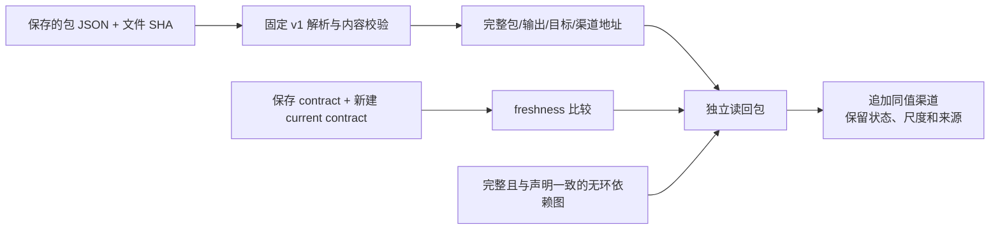

# 证据包结构与跨包读回设计

状态：**共享契约已实现；2026-11-10 保存快照读回 rollout 设计确定，实施和验证进行中。**

证据包是同一次分析快照的结果容器。外围 contract/status/manifest 绑定目标、query、scope、plane、输入/配方版本、freshness 和产物；运行时 `EvidencePackageOutput` 保留完整 source envelopes、追加 outputs、紧凑外部依赖和计算身份。渠道各自保留算法、实际输入、观察、状态、单位和 provenance，不因同包而合成总分。

## 使用现有字段表达渠道责任

- 算法/配方使用渠道 provenance 的 `method`、`algorithm_version`、`schema_version` 和已有公式；没有更细声明时，以包级 `output_function + output_function_version` 加渠道名标识。geometry/trend 的渠道声明继承顶层 envelope provenance。
- 输入使用 `derived_from`、source envelope `cache_identity` 的 input/source/query/recipe/channel 指纹和显式外部依赖。
- 输出使用现有 `observation`、`status`、`scale`、explanation、source IDs 和 provenance。
- `fingerprint_evidence_dependency(output_channel)` 可指纹化完整渠道；保存 JSON 的 `payload_fingerprint` 绑定完整包内容。无需增加渠道算法/快照类树。

## 保存快照边界

`deserialize_field_result_envelope(payload)` 和
`deserialize_evidence_package_output(payload)` 只解析已有 v1 schema，并复用现有类型校验。输入只能是 JSON 值；不按保存的类名装载对象。拒绝未知 schema 和结构字段，要求保存的 `output_identity` 并核对重建值；若有 `payload_fingerprint` 则核对完整内容。旧发布没有 dependencies 或内容指纹仍可读取，消费者须 pin 文件 SHA 并重新比较 contract。

身份和完整性分四层：

| 记录 | 证明的内容 |
| --- | --- |
| `output_identity` | 输入结果身份、输出声明/量尺、函数版本和非空依赖组成的计算身份；不含观察/状态字节。空依赖不进入 hash，以保留真实旧发布身份。 |
| `payload_fingerprint` | 除自身字段外的完整规范化序列化输出，包括 observations、statuses、provenance、输入/配方指纹和 output identity。 |
| 文件 SHA-256 | 当前选中的保存文件的精确字节。 |
| contract freshness | 保存 contract 与新建 current contract 在声明范围内是否一致；旧 status receipt 不能替代本次比较。 |

计算身份相等不能证明数值或状态相等；完整内容指纹也不能证明输入仍为当前场景。

current contract 与保存 output 不能只核对 `package_id`。消费入口
`consume_saved_evidence_package(..., current_source_envelopes=...)` 必须由调用方
独立取得当前来源；它不能把保存 output 中的 envelopes 自动当作当前来源。
放行数值前，比较每个 envelope 的 `target`、`query`、`channel_set`、
`cache_identity`、`raw_status`、`value`、`support`、`source_ids` 组成的输入绑定
签名，包含来源 reading 内容。当前来源上下文缺失则 unavailable；输入、query 或
plane 不匹配直接拒绝。顶层 provenance 的 historical/current `source_freshness`
和 visualization 等审计标签不进入此输入签名；渠道记录仍随 `value` 完整参与。
该门与 contract freshness 比较一起使用，不能以包 ID 相同代替快照绑定。

## 显式依赖与状态

外部地址必须完整包含 `package_id`、`output_identity`、`target_identity` 和 `channel`。同一源输出的不同 target 可以使用同一个渠道名；依赖唯一性以完整地址判定，同一依赖内以 `(target_identity, channel)` 判定。

`read_evidence_package_channel()` 只做身份匹配。
`resolve_evidence_package_channel()` 门控调用方提供的 freshness，自身不重建 contract。fresh 时保留渠道 observation/status/scale；消费包负责解释 `partial`、`ambiguous` 等语义。stale/unavailable 时不提供可用 `channel`，有效依赖状态为 `not_available`；若有 typed source，`audit_channel` 保留状态、尺度、来源和 lineage，但 observation 为 `None`。没有 typed source 的 unavailable 没有历史观察。任何引用 stale/unavailable 依赖的派生输出都必须 `observation=None`，包括 `partial`；消费包负责输出状态和原因。缺失或身份不匹配直接拒绝，不补零。

输出只保存紧凑依赖；`source_output` 是执行期 handle。直接自依赖被拒绝。显式传入 `dependency_graph` 时，图必须覆盖所有引用节点、与当前包及可用 typed upstream 的实际声明边一致，并在 callback 前通过无环检查。省略图的旧调用保持兼容，但不保证完整图或全局间接环检测。没有 registry 或 scheduler 自动补图。

## 本次具体消费者

`scripts/design/group_level/replay_evidence_package_readback.py` 建立独立 `EvidencePackage`，选取已有渠道按原 observation/status/scale 追加读回视图，不发明新公式。必须验证两个不同 target 的同名 distance 渠道确实同时被消费，不能只证明接口允许。每条执行链 pin 文件 SHA、来源身份、query/plane 和选中引用，以新建 current contract 计算 freshness，并传完整依赖图。

free-space、distance、potential 原输出完整保留并能从保存 JSON 重建；geometry/trend 使用同一 envelope parser，作为 source adapters 保留 audit/public 边界。现有 potential 的未使用可选 stale 依赖不能影响纯轴输出。现实 retained replay 不重提 IFC，不生成模拟空间，不更改原有图面。

现有 free-space/distance 是同一 camera plane、query 与 native IFC，并共享 exact free-space ResultRef；保留的 potential/trend/geometry 是 world plane Z0 的另一 query。未找到相应 camera-plane 版本，不得跨平面混用。必须区分共享接口完成、各包保存结果读回完成和业务融合：distance-to-potential 尚未实现，本轮不补造融合公式。

执行证据和完成状态只在既有 [整合计划](../plans/2026-11-09-evidence-package-integration-cleanup.md) 与 [证据记录](../../project/evidence/evidence-package-integration-cleanup-2026-11-09.md) 随实际结果更新。候选保持隔离，无 mainline merge 或 remote push。

## 保存重建与重新执行的顺序边界

保存读回必须逐项保留所有 outputs 和 sources。它不承诺将 runtime 已按 cache
identity 排序的 sources 再送回历史 callback，仍能复原 callback 使用原 producer
顺序生成的审计列表。现有 potential 的 `per_group` 审计列表属于此情况；确定性
重新执行应使用 pin SHA 的原始 `envelopes.json` 顺序。该边界不改变公式、渠道或
版本；最终 retained replay 必须分别报告完整 roundtrip 和原输入顺序重新执行。
