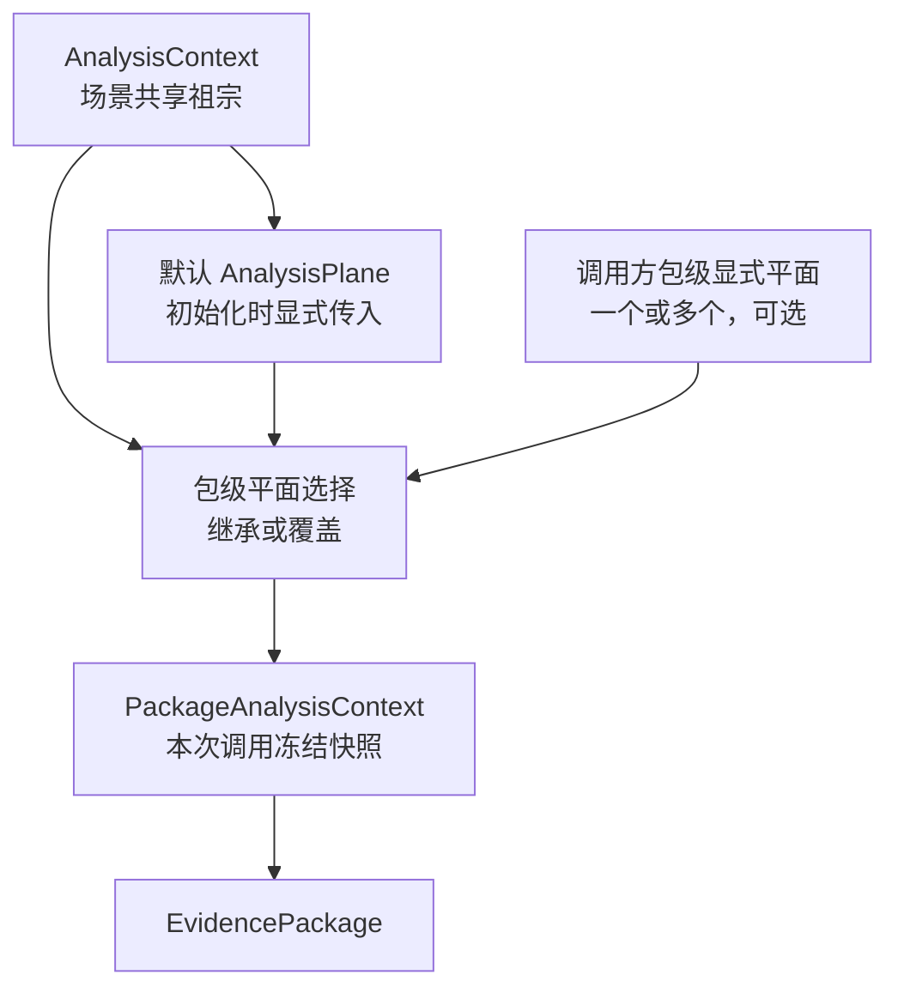

# AnalysisContext 祖宗与证据包平面设计

_设计确认稿 — 2026-11-18；记录共享 Context、默认分析平面和证据包调用契约。_

---

## 设计结论

场景创建时必须显式传入一个有效的 `AnalysisPlane`。这个平面就是场景的默认平面，所有证据包在没有单独指定平面时都继承它。

祖宗 `AnalysisContext` 只持有这个全局默认平面，不负责登记证据包可能使用的全部平面。证据包可以在自己的调用中显式提供另一个平面或多个平面。默认行为始终是一个平面；证据包只有在声明支持多平面并且调用方显式开启时，才可以一次使用两个或更多平面。

这里的“祖宗”使用场景级共享 `AnalysisContext` 对象实现。它不是一个 `AnalysisPlane` 实例，不是 `EvidencePackage` 的父类，也不是全局可变字典。它是通过组合和依赖注入向证据包提供超基础属性的共享来源。

## 对象职责

### `AnalysisPlane`

`AnalysisPlane` 是不可变的平面值对象，保存身份、修订、原点和坐标基。它不保存证据包、网格、模型或 UI 状态。

### `AnalysisContext`

`AnalysisContext` 是场景级共享 Context，也是“祖宗”。它保存现有场景事实，并提供一个全局默认平面：

- 必须有一个显式传入的 `AnalysisPlane`；
- 只持有这个全局默认平面，不持有包的多平面列表；
- 只承载超基础、跨包共享的属性；
- 不承载某个证据包的业务输入、算法参数或输出结果。

现有的来源、单位、坐标系和容差等场景 Context 信息继续保留。旧的单平面访问方式可以继续返回默认平面，以维持兼容性。

### `PackageAnalysisContext`

`PackageAnalysisContext` 是一次证据包调用的冻结快照，不是祖宗。调用方没有显式提供包级平面时，它使用 `AnalysisContext` 的默认平面；调用方一旦显式提供一个或多个平面，该集合就是本次调用的平面集合，祖宗默认平面不会自动追加。它至少包含一个平面。

它只表达本次调用实际获得的平面选择，不负责创建投影、网格、模型视图或缓存。

### `EvidencePackage`

`EvidencePackage` 继续是共享的执行、校验和发布模板，不继承 `AnalysisContext`，也不持有全局 Context。它通过调用参数获得本次的 `PackageAnalysisContext`，而业务输入仍由每个证据包自行声明。

### `NativePlaneSettings`

`NativePlaneSettings` 是 UI/原生适配层的持久化设置，不是祖宗。当前阶段不实现 UI 接入；未来 UI 可以把它转换成冻结的 `AnalysisContext`。

## 解析关系



解析规则固定为：

| 情况 | 有效平面 |
| --- | --- |
| 包没有平面覆盖 | 祖宗 Context 的默认平面 |
| 包指定一个平面 | 指定平面 |
| 包指定多个平面 | 只有包支持多平面且调用显式开启时才允许 |
| 包指定的平面事实不完整或无效 | 拒绝调用 |
| 祖宗没有默认平面 | 拒绝初始化 |

“默认平面”表示祖宗初始化时显式传入的那个平面，不表示系统自动创建平面。包级显式平面不需要先加入祖宗 Context，但必须通过平面值校验以及包自身需要的来源、坐标和依赖兼容检查。

## 证据包调用契约

最终调用关系为：

```text
AnalysisContext.analysis_plane
    + optional package planes
    -> resolve_for_package(package binding)
    -> PackageAnalysisContext
    -> EvidencePackage.evaluate/process_output
```

每次证据包调用都必须具有非空的 `PackageAnalysisContext`。算法可以完全不读取它；传入上下文本身不得触发投影、网格、模型提取或其他数值计算。

多平面调用必须同时满足：

1. 证据包声明支持多平面；
2. 调用方显式允许多平面；
3. 所有平面都通过 `AnalysisPlane` 值校验，并满足该包声明的来源、坐标和依赖兼容性。

旧的无 Context 调用只允许作为迁移适配层暂时存在，不能作为最终核心契约。最终所有包入口都应显式获得有效的 `PackageAnalysisContext`。

## 依赖与缓存规则

平面选择和数值使用是两件事：

- 只传入 Context 不代表算法使用平面；
- 算法不使用平面时，不进行投影、网格或模型抽取；
- 未使用平面的切换不应改变该包的数值查询或缓存身份；
- 算法真正使用平面时，平面身份和修订必须进入其查询、结果来源或缓存依赖；
- 这些数值依赖仍由包自己的计算和缓存边界负责，祖宗 Context 不替包猜测业务依赖。

其他业务输入继续由证据包自己声明，不建立一个承载所有参数的万能共享字典。

## 本阶段实现范围

本阶段不进入 UI，但实现除 UI 适配以外的全部核心要求：

- 保持场景 `AnalysisContext` 只拥有一个显式默认平面；
- 让包级调用能够显式提供一个或多个额外平面；
- 将默认平面和包级显式平面解析为调用级 Context；
- 让所有证据包入口从共享 Context 解析调用级 Context；
- 保证每次调用至少有一个平面；
- 实现包级继承和覆盖；
- 实现多平面能力检查和显式调用许可；
- 保证未使用平面不触发数值工作或无关缓存失效；
- 迁移直接包调用和 `run_*_package` 入口；
- 增加契约、继承、覆盖、多平面、缓存和兼容性测试；
- 同步更新架构文档。

本阶段明确不实现：

- Blender UI 面板和交互控件；
- `.blend` 保存、重开和实时 UI 生命周期；
- 原生平面创建按钮和 UI 事件绑定；
- 大规模 IFC/Blender 几何重算。

## 当前实现与目标的关系

当前代码已经提供 `PackageAnalysisContext`、`AnalysisPlaneCatalog`、`NativePlaneSettings` 以及证据包入口的平面校验。这些是目标设计的部分基础设施；其中把多个平面放进场景目录并由场景目录统一管理的部分，不是本设计的最终语义。

尚需完成的核心接入是：让现有场景 `AnalysisContext.analysis_plane` 成为统一祖宗来源，让所有证据包入口在没有显式平面时继承它，在有显式平面时使用包级输入，并自动生成自己的 `PackageAnalysisContext`。UI 只在后续阶段把用户操作转换成这个场景 Context。

## 验收条件

- 场景没有显式默认平面时初始化失败；
- 所有包在没有显式平面时默认使用祖宗平面；
- 包级调用可以显式提供一个或多个平面；
- 不同包可以同时使用不同平面；
- 多平面调用未满足能力或显式许可时在计算前失败；
- 忽略平面的包不会触发平面相关数值工作；
- 未使用平面切换不会改变其缓存身份；
- 真正使用平面的包能够审计平面身份和修订；
- 旧单平面行为和已有输出格式保持兼容。

本笔记是设计确认稿，不代表上述剩余核心接入已经完成。
