# Blender Analysis Workflow Implementation Plan

> **For agentic workers:** REQUIRED SUB-SKILL: Use superpowers:subagent-driven-development (recommended) or superpowers:executing-plans to implement this plan task-by-task. Steps use checkbox (`- [ ]`) syntax for tracking.

**Goal:** 在指定 portable Blender 中交付统一 Analysis workbench：同一 `N → Analysis` 面板完整接入既有 B4 分区工具与新增 free-space，提供可恢复、可只读消费的结果，作为长期分析交付的一站。

**Architecture:** Domain 与 Free-space 两个可独立折叠/展开的 sections 共享 canonical live capture、identity、confirmed domain 与只读结果访问。B4 继续既有 service/reducer，独立可用；free-space 继续 analyzer-owned plane + AnalysisRequest/FreeSpaceField。Blender 主线程处理 capture、lifecycle、mesh/UI；Pixi 处理核心几何、compact result 与 Field 重建。两类 immutable snapshots 从 live/embedded 同一入口读取；全局仅一个运行 job。

**Tech Stack:** Python 3.12.13（Pixi 锁定，`>=3.12,<3.13`）、portable Blender 5.2.0 LTS、Bonsai/IfcOpenShell、现有 Shapely 2.1、pytest、stdlib subprocess/JSON/UUID/hashlib。

**Spec:** [spec.md](spec.md)；执行细节 [tasks.md](tasks.md)，接口 [contracts/blender-workflow.md](contracts/blender-workflow.md)。

## Global Constraints

- **APPROVED / IMPLEMENTATION IN PROGRESS**；用户于 2026-10-15 批准计划并授权执行。实现、测试和 native acceptance 仍以实际任务证据为准。用户已选 delegated execution；无需再问执行方式。
- 只使用 `D:\Blender\BlenderPortableLTS5.2\App\Blender64\blender.exe`，禁止发现/启动其他 Blender。
- 使用 Pixi，禁止 pip/venv、新 dependency、root package eager import。
- IFC read-only；Save Copy 只写用户明确选择的新 `.blend`，不覆盖 live `.blend`/IFC。
- 默认 `whole_height_projection`、`spacing=0.25 m`；exact query 高度唯一来自 plane `origin.z`，初始 1.6 m。
- B4 structural scope/cut 1.5 m 与 occupancy query 分离；domain identity/consent 不由 display 或家具改动伪造。
- 共享 registry、resolver、MassPatch、FieldStatus 六态和 AnalysisRequest 继续为权威；B3 OPEN。
- 新/改 functions 有 English-first docstrings；重要 geometry/identity/scoring/handoff 步骤解释 why；不改 vendored OCTA。Addon import 必须轻量隔离：Blender 端不得 eager import Shapely 或 heavy core；Shapely/heavy core 与 display-fragment generation 留在 Pixi subprocess。
- jj 优先；隔离/并行工作副本优先使用 `jj workspace`，远端推送可用时使用 `jj git push`。jj 不可用或不能完成所需操作时可回退 Git/Git worktree，记录具体原因并保持工作区与历史状态一致。仅 version specialist 可 VCS 写入和管理工作区，只 enroll 任务 paths；无 blanket snapshot、无 push/merge。T6 优先用 `jj --ignore-working-copy` read-only audit，在隔离 clean workspace（优先 jj workspace）以 hash-validated delta/approved dependency closure 复核；不得使用未验证的 snapshot/path 语法。遵循项目记忆的 jj-first Version and Workspace Management。
- 每任务更新本 feature checklist，记录实际命令、exit code、output path 和未验证项；计划条目不能当成 PASS。结构 fingerprint 只能包含 structural frame 与结构事实，排除 occupancy-only 及 capture-volatile 数据。

---

## Technical Context

| 项 | 已选约束和证据边界 |
|---|---|
| 项目类型 | 可安装本地 Blender addon + repo/Pixi process，非 server。 |
| 当前核心 | 当前树为 `CURRENT TREE ABSENT`：`features/analysis_requests.py` 的 Spec003 基线不可从现状宣称存在；T0 必须由 version specialist 在隔离环境恢复并核验 Git checkpoint `23d24a3` 及 import closure，同时保留现有 dirty history；不可另写 occupancy 算法。 |
| 当前 B4 | 当前磁盘存在 `scripts/design/live_domain/{blender_panel,run_live_domain}.py` 与 `features/_analysis_domain_handoff.py`；现存 B4 session STATE + blocking subprocess 可参考，Spec003 request/plane/live-capture 依赖却缺失，T0 必须核验完整 dependency/import closure。 |
| 当前 capture | 计划依赖 Spec003 checkpoint `23d24a3` 的 `scripts/design/space_field/capture_b3_live_scene.py` evaluated mesh/world metres/mesh release/batch capture；当前树缺失时先验证 import closure，现有 runner 绑定历史 S3，不能原封作为新 workflow。 |
| identity 缺口 | 目标基线中的 B4 generic loader 使用 `blender-object:*`/source_id None；B3 runner 用 `live-step-*`/GlobalId。当前树缺失时不得把这些目标模块当作已验证；恢复后新 canonical `ifc-object:{GlobalId}` 与 `adapters/ifc_bonsai.py` 一致，验证映射，拒绝盲迁移。 |
| domain 缺口 | 当前磁盘的 `_qualified` 产生 derived mesh，但 `domain_handoff` 不返回它；增加实际 `domain_geometries`，不重建。 |
| localized unknown 缺口 | 已核现存 FreeSpaceField 将 unresolved 全域处理；缺失 request baseline 仍需 T0 恢复核验。添加兼容 optional support mapping；occupied 和 geometry semantics 保留。 |
| persistence 缺口 | 当前 live package ~150 MB、cell 重复 metadata；需要按值去重共享 tables 与精确 reconstruct，不直接复制旧 serializer。 |
| Storage | tagged object/overlay、embedded strict JSON Text fake user、unique sidecar partial→final；不保存进程状态。 |
| Native API | owner 于 2026-10-15 只读 probe 观察指定 5.2.0 LTS binary、addon_install/addon_enable、Save Copy RNA、timers、load/undo/depsgraph handlers、mesh attributes、Text fake user 可用。未执行安装或 save/reopen。 |
| Performance | 历史 0.25 m/3969 cells whole-height465.332 s + grid10.221 s，exact54.908 s + grid2.191 s；新当前域尚未测量。capture callback 目标50 ms，单 to_mesh 非抢占需报告实测。 |
| Testing | Pixi pytest focused units/contracts；指定 portable native smoke 运行真实 operators；最后现场两模式和 save/reopen。 |

本设计没有未判定的技术选型。native behavior、真实域选择、持续响应和 save/reopen 是明确的未来验证 gates，不伪装成已解决的实测事实。

## Constitution Check

`.specify/memory/constitution.md` 为未 ratify 的占位模板；不能报告 constitution PASS。pre-design 与 post-design 均为 **UNRATIFIED**，但不再阻止已获批准的实施授权。实际适用 gates 来自 AGENTS.md、用户范围和 architecture memory：只读 IFC、shared contract、Pixi、唯一 portable Blender、English-first code documentation、scoped jj、architecture 与实现同步。

`.specify/extensions.yml` 实际 `hooks: {}`，before_plan/after_plan 无 executable hook。setup-plan 于 2026-10-15 通过 process-only `SPECIFY_FEATURE=004-blender-analysis-workflow`、absolute `SPECIFY_FEATURE_DIRECTORY`、`SPECIFY_FEATURE_NO_PERSIST=1` 成功；BRANCH 返回的是 feature identifier，不表示创建了 VCS branch。

## Project Structure 与最小文件边界

```text
specs/004-blender-analysis-workflow/
  spec.md  plan.md  research.md  data-model.md  quickstart.md
  contracts/blender-workflow.md  tasks.md  checklist.md

blender_addon/order_analyzer_ui/       # planned installable zip root
  __init__.py                        # registration, properties, operators, one panel, preferences
  runtime.py                         # main-thread capture/job/timer/freshness/persistence
  overlay.py                         # native mesh build, face-cell lookup, inspect
adapters/
  blender_analysis_capture.py        # fact capture helpers factored once from B3 script
  bonsai_live.py                     # canonical IFC capture → NeutralSceneV2
  blender_analysis_session.py        # B4 service, request CLI, compact result + pure read API
features/
  _analysis_domain_handoff.py         # additive exact domain mesh return
  analysis_requests.py               # trusted unknown support audit/handoff only
  free_space_field.py                # optional localized unknown supports only
test/
  test_blender_analysis_capture.py    # capture regressions + canonical inputs
  test_bonsai_live.py                 # identities, boundary/support/proxy validation
  test_blender_analysis_session.py    # B4 parity, request/compact, headless consumer contracts
  test_blender_analysis_runtime.py    # fake bpy/process lifecycle and persistence
  test_blender_analysis_overlay.py    # pure overlay payload validation
  test_analysis_requests.py           # trusted section support binding
  test_free_space_field.py            # localized unknown semantics
  bim/run_blender_analysis_workflow_smoke.py # planned persistent native operator acceptance
```

只在需要兼容时改 `scripts/design/live_domain/{run_live_domain,blender_panel}.py` 和 `scripts/design/space_field/{capture_b3_live_scene,run_b3_live_analysis_request}.py`，让实际重复 helper 指向共享实现；历史 runner 的 legacy ID/output 保持兼容。不改 `adapters/blender_geometry.py` 身份语义、不改 `adapters/bonsai_analysis_plane.py` 几何 author 规则。`test/test_b3_live_scene_capture.py`、`test/test_b3_live_analysis_request.py` 与 `test/test_bonsai_analysis_plane.py` 是 required regressions。`docs/software-architecture.md` 与 architecture memory 在 T1 先标 planned seam，再与代码同步更新，不把目标状态写成当前实现；已批准状态不改变其 planned seam 的实现事实，不改既有历史架构内容。

Owner ruling (2026-10-15): use a jj workspace instead of Git-worktree skill instructions. The version specialist owns workspace lifecycle; preserve it and all undelivered artifacts until accepted/integrated, with no automatic deletion. Progress and overlaps are recorded in [progress.md](../../.superpowers/sdd/004-blender-analysis-workflow/progress.md).

## 选型与拒绝项

| 方案 | 结论 |
|---|---|
| A：仅扩展 session script | 文件少，但 reload 后无安装入口、无可靠 persistence/lifecycle，不能满足完整流程。 |
| B：installable addon + existing core/Pixi subprocess | 采用。复用算法和锁定依赖，addon 只负责 native workflow；一个 process 足够。 |
| C：把全部 core/dependencies 放 Blender 内计算 | 拒绝。runtime 重复、阻塞/依赖复制，且无本需求收益。 |

不增加 plugin DSL、泛用任务队列、自动替身/floor 推断、体素层、第二 occupancy/domain 算法或新 dependencies。

## 数据流与任务顺序

```mermaid
flowchart LR
  UI["N → Analysis workbench"] --> DOMAIN["Domain section / independent B4 tools"]
  UI --> FREE["Free-space section / owned plane + query"]
  DOMAIN --> CAP["shared main-thread batched full capture"]
  FREE --> CAP
  CAP --> CAN["bonsai_live canonical NeutralSceneV2"]
  CAN --> B4["structural subset / B4 cut1.5 / reducer"]
  B4 --> DR["DomainSessionResult / candidates + full diagnostics"]
  B4 --> CONSENT["explicit user confirm + actual domain_geometries"]
  CAN --> REQUEST["full occupancy AnalysisRequest"]
  CONSENT --> REQUEST
  REQUEST --> FIELD["shared resolver / FreeSpaceField / exact section"]
  FIELD --> COMPACT["Pixi compact result + display fragments"]
  COMPACT --> PUBLISH["token/digest verification"]
  PUBLISH --> MESH["tagged native mesh + embedded JSON"]
  DR --> DOC["immutable documents / embedded manifest"]
  PUBLISH --> DOC
  DOC --> READ["read-only list metadata / exact ResultRef open"]
  MEMORY["live memory documents"] --> READ
  READ --> SAMPLE["existing FieldSample reconstruction / headless contract tests"]
```



T0 CURRENT TREE ABSENT prerequisite + isolated checkpoint/import-closure verification + B4 capability inventory + user spec/plan review → T1 canonical capture/independent B4 service → T2 localized unknown → T3 compact/read-only consumer/lifecycle → T4 unified sections/overlay/restore → T5 B4 parity + headless consumer + native workflow acceptance → T6 independent review/docs/scoped jj。

T1 capture adapter、canonical adapter 和 session service 是依赖链，不让多个 writer 同时编辑同一文件。T2 在 T1 contract 固定后处理两 core 文件；T3 依赖 T1/T2 response schema；T4 依赖 compact contract；T5 等 T1–T4 focused checks。reviewer 不兼任自己的 implementer，version specialist 是唯一 VCS writer。

## 验证与可交付证据

详细 red/green、签名、小测试、commands 在 [tasks.md](tasks.md)，FR→task→test 在 [checklist.md](checklist.md)。native smoke 只调用真正 operators，不另写算法。live acceptance 需要用户在新面板产生或复用经 fresh 验证的明确确认，绝不脚本伪造人类同意。Save Copy 需要明确新 output `.blend`；reopen 用唯一授权 portable binary 的独立进程。

用户于 2026-10-15 批准设计并授权实施；T0 baseline in progress，后续任务仍 pending。尚无 production tests、addon 安装、live Blender 操作或 `.blend` 保存/重开验收证据。owner 自检/grill 的已判定问题记录在 research；用户 spec/plan gate 已批准，native acceptance 仍 pending。

## Required seam details before implementation

B4 consumes the actual `structural_scene` plus independent `StructuralContext` (datum 0 m/cut 1.5 m/selected XY basis); changing only the identity token while passing the occupancy plane is invalid. Start validates the full capture observation token, recaptures once when stale/unverifiable, and derives both structural/full views from that capture. Stable structural/full digests include sorted stable project/source identities, geometry, relevant transforms/facts and versions; they exclude time, capture/job/session IDs, runtime pointers, selection/dirty/visibility/camera state, IFC transactions and mtime. Structural digest also excludes occupancy-only data.

T0 audits the real reducer caller; T1 binds `source_revision` to stable structural-source-facts digest and `frame_id` to `structural_frame_key`, replacing the current full-scene/full-frame hash dependency or proving an equivalent canonical structural projection. Tests inspect actual reducer arguments across recapture/furniture/occupancy-plane edits. Unknown-support conversion reuses existing affine frame mathematics while preserving GeoJSON polygons/lines/points/qualified-empty; polygon-only `_components` cannot implement that dimensionality-preserving seam. Translated-origin line/point touch cases are required.

A verified unique SupportBinding resolves source_object_id to canonical source.source_id (GlobalId) only in the request-scoped child domain reaching `_scope_exclusions`; B4 inferred source_id remains None. Unknown support uses explicit valid_nonempty/validated_empty/missing_or_malformed states; qualified empty and complete multi-owner support need trusted identity/query/complete-coverage proof, otherwise global unknown. CameraBinding remains display-only and never enters geometry/keys/occupancy.

Pixi precomputes clipped display fragments/triangulation. Main-thread capture, JSON/Text handoff, mesh construction and polling use measured batches (50 ms target), record bytes/counts/elapsed and split subsequent batches after overruns; indivisible calls are reported honestly. Save Copy failure keeps live Text/overlay/result, cleans only owned partials and records no saved artifact. Reopen remains historical/unverified; Start freshly validates IFC/project/GUID mapping/fingerprint/domain/support binding. Detailed records and ownership are in data-model/contracts.

## Unified workbench capability mapping

| Current B4 capability | Planned Domain UI / shared service | Planned evidence |
|---|---|---|
| Refresh; tolerance mm²; world XY/datum0/cut1.5; closed apertures | Domain controls and existing evaluate_domain_request; one /1e6 conversion | T1 service parity + T4 native controls |
| source/geometry counts; candidates/id/version/area/holes/reason | Preserve original service payload; candidate list with Select | T1 complete payload assertion; T5 standalone Domain smoke |
| exact outline/hole curves; measured labels | Tagged Domain diagnostics through existing geometry facts | T4 overlay/label parity, source mesh unchanged |
| Select without confirm; explicit Confirm | Shared reducer/session, same identity gates; no free-space prerequisite | T1 select/confirm + stale/ABA tests; T5 Domain-only operator chain |
| current/last-attempt/refusal/error/stale; ignored tiny and significant aperture residuals | Dedicated diagnostics display from full authoritative payload | T1 diagnostics fixture + T4/T5 UI evidence |

The source is current `scripts/design/live_domain/blender_panel.py` and `run_live_domain.py`; reducer-only replace/conflict actions are not claimed as existing UI parity. Any returned conflict state remains visible. Future operations enter this same UI/service boundary incrementally, using existing operation string/descriptor vocabulary, not a new Operation class, framework, DSL or registry. The existing substitute registry remains representation selection. B4 never needs to masquerade as free-space AnalysisRequest.

The minimum consumer boundary is proposed `list_analysis_results`, `open_analysis_result`, `read_analysis_sample` in the planned session adapter. The catalogue derives from existing embedded manifest/documents; immutable ResultRef plus expected identities/versions selects exactly one snapshot. Its stdlib-only wire portion may be extracted only if heavy imports cannot stay isolated; Field reconstruction remains bpy-free in Pixi. Same input contract handles memory and restored Text; no current downstream analysis consumer is claimed. Tests prove domain/plane/mode/revision/source isolation, version/digest rejection, explicit historical access, stale-as-current refusal, no capture/compute/mutation, unknown/conditional/provenance preservation and no-sidecar reopen parity. Current freshness never proves every cell established or clearance/routing.
